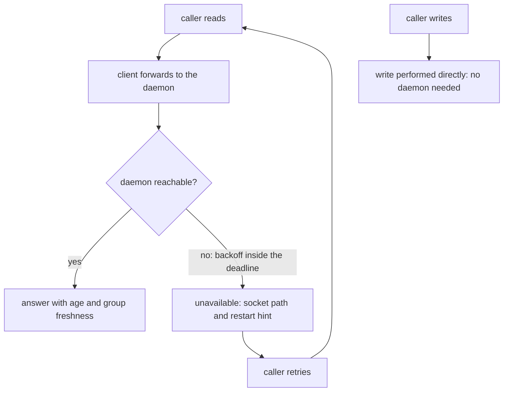
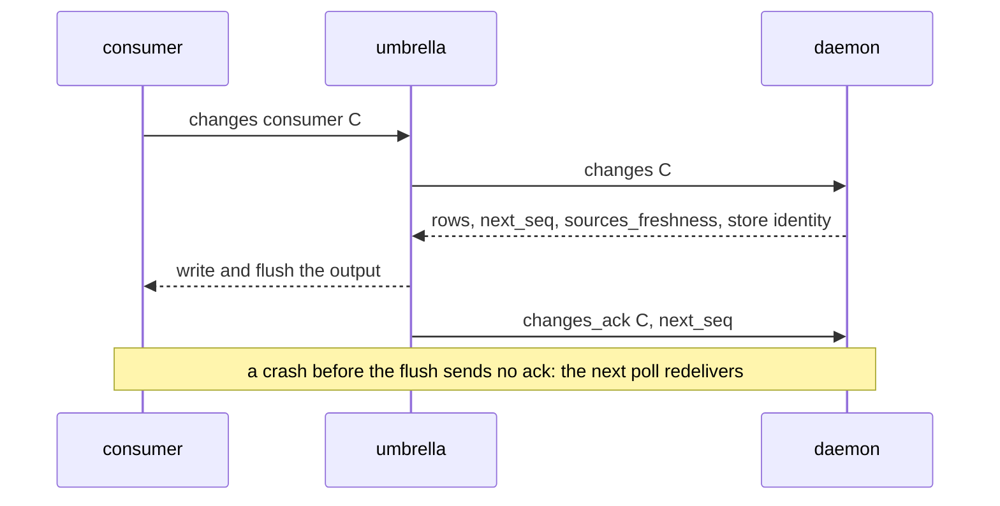
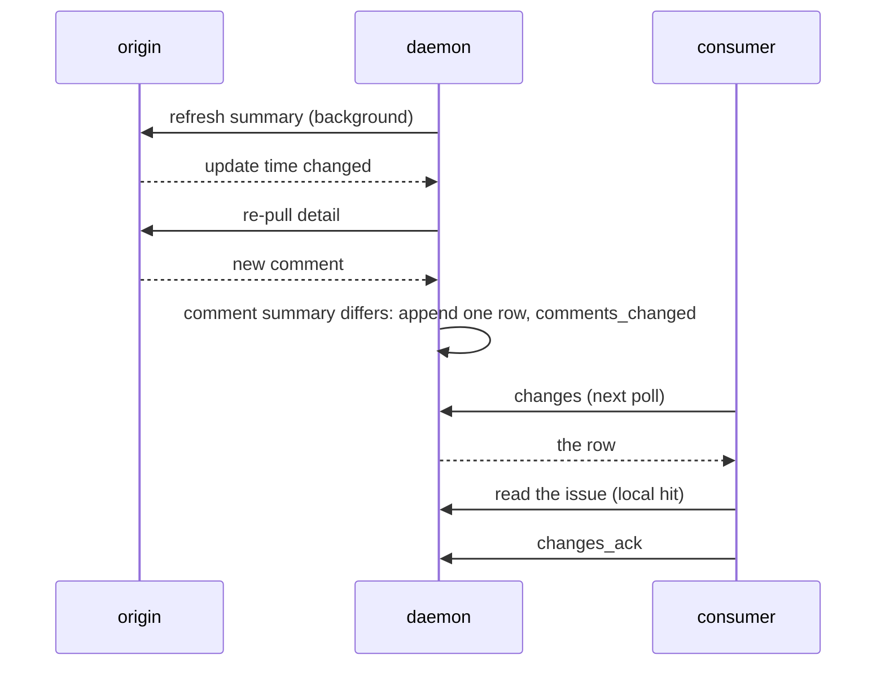
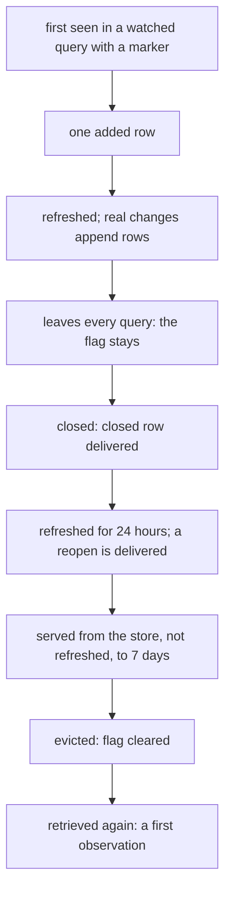
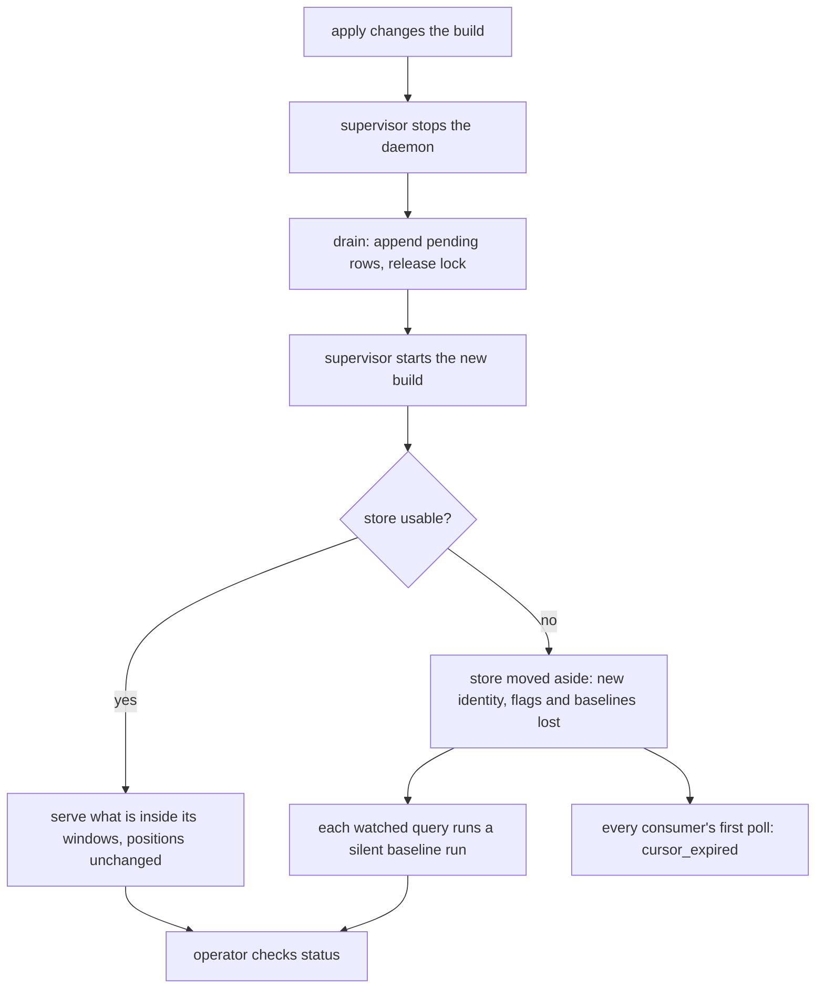

# Stories, use cases & journeys — pg-connector-issue-jira

User stories, the use cases they exercise, and the journeys that compose them. Together they
establish the extent, since a set's extent is exactly what its stories, use cases and journeys
require (`phillipgreenii-nix-agent-support · behavior-docs/docs/behavior · INV-11`). Each carries
its own listing of what it requires and includes (`INV-22`). See the [glossary](glossary.md),
[actors](actors.md), [interfaces](interfaces.md) and [invariants](invariants.md); every ID cited
below resolves in one of those files, in the parent set or the GitHub set declared in the README, or
in the method set.

## User stories

**Caller (`ACTOR-JIRA-CALLER`)**

- **`STORY-JIRA-1`** <!-- uuid: 86caa21d-928e-494f-a773-eebd1976e599 --> — As a **caller**, I want to read an issue and get a
  local answer that says how old it is and carries a comment count, so that a skill or an operator
  never waits on Jira for data the backend already holds, and never mistakes old data for current.
  _(→ `USECASE-JIRA-READ-ISSUE`; `INV-JIRA-PROC-1`, `INV-JIRA-FRESH-1`, `INV-JIRA-FRESH-2`,
  `INV-JIRA-FRESH-3`.)_
- **`STORY-JIRA-2`** <!-- uuid: 085173e8-cc12-47a1-b2bb-7977ffeece30 --> — As a **caller**, I want to list the issues of a query I
  named once in configuration, answered from what the backend already holds, and a clear signal when
  I name a query it does not know, so that a listing is cheap and a typo is never an empty result.
  _(→ `USECASE-JIRA-READ-QUERY`; `INV-JIRA-FRESH-1`, `INV-JIRA-FRESH-2`, `INV-JIRA-ERR-1`.)_
- **`STORY-JIRA-3`** <!-- uuid: 1dc77396-83c1-4910-8be5-d5278491b1c0 --> — As a **caller**, I want any issue I have read to stay
  fresh until it closes, and a closed one to stay readable for a while and then go, so that I need
  not remember to keep anything alive and the store does not grow without bound. _(→
  `USECASE-JIRA-READ-ISSUE`; `INV-JIRA-TRACK-1`, `INV-JIRA-TRACK-2`.)_
- **`STORY-JIRA-4`** <!-- uuid: 908a646d-a175-4b10-8055-c052cf984a00 --> — As a **caller** that cares about one specific issue, I
  want to ask that it be watched, once, so that its changes reach the consumers although it is in no
  watched query, and keep reaching them after it leaves every query until it is long closed. _(→
  `USECASE-JIRA-WATCH-ONE`; `INV-JIRA-WATCH-1`, `INV-JIRA-WATCH-2`, `INV-JIRA-WATCH-3`.)_
- **`STORY-JIRA-5`** <!-- uuid: 900d48c2-1ff5-46dd-8a71-4eb14bfaa53b --> — As a **caller** that writes (creates, comments,
  transitions, updates, closes), I want the write to succeed whether or not the daemon is up, and the
  next read to reflect it, so that a sync job or a rescue tool is never stopped by a stopped daemon.
  _(→ `USECASE-JIRA-WRITE`; `INV-JIRA-WRITE-1`, `INV-JIRA-WRITE-2`.)_
- **`STORY-JIRA-6`** <!-- uuid: 7587940d-ca21-477a-a9ce-117cddeaca67 --> — As a **caller**, I want a clear, retryable
  `unavailable` that names where to look when the daemon is down, rather than an empty answer or a
  direct call that spends the budget behind the daemon's back, so that I wait and retry instead of
  acting on a wrong picture. _(→ `USECASE-JIRA-DAEMON-DOWN`; `INV-JIRA-PROC-2`, `INV-JIRA-ERR-1`.)_

**Change consumer (`ACTOR-JIRA-CONSUMER`)**

- **`STORY-JIRA-7`** <!-- uuid: 63de88ae-31bf-43b6-a25a-144a848f1293 --> — As a **change consumer**, I want to poll what changed
  under one position of my own and acknowledge only what I have actually received, so that a crash
  between receiving and acting loses nothing, and I never diff listings or sweep issues myself. _(→
  `USECASE-JIRA-POLL-CHANGES`; `INV-JIRA-CHG-1`, `INV-JIRA-CHG-6`, `INV-JIRA-CHG-7`,
  `INV-JIRA-CHG-10`.)_
- **`STORY-JIRA-8`** <!-- uuid: a7b779e2-9ab0-4abc-90f3-952f3104624d --> — As a **change consumer** starting out, I want to begin at
  the present instead of being handed every watched issue, and to be told plainly when my position
  is too old to continue or the store was replaced, so that a new consumer never bursts my work
  queue and a gap is never silently skipped. _(→ `USECASE-JIRA-POLL-CHANGES`; `INV-JIRA-CHG-7`,
  `INV-JIRA-CHG-8`, `INV-JIRA-CHG-9`, `INV-JIRA-WATCH-7`.)_
- **`STORY-JIRA-9`** <!-- uuid: 336c885f-8b8e-4015-ba26-9c00036f64e8 --> — As a **change consumer** of a deployment that adds a
  watched query later, or flips an existing query to watched, I want the first run of a new query to
  stay silent and a flipped one to announce each issue it already knew exactly once, so that I get
  no flood of phantom changes and miss no issue that became watched. _(→
  `USECASE-JIRA-BASELINE-QUERY`; `INV-JIRA-WATCH-5`, `INV-JIRA-WATCH-6`, `INV-JIRA-CHG-4`.)_
- **`STORY-JIRA-10`** <!-- uuid: 44360d09-3915-4886-87c0-b77bbc98bb5d --> — As a **change consumer**, I want a comment, a label or
  a priority edit to be a change, an edit that touched nothing but the update time not to be one, and
  an issue nobody asked me to watch never to reach me, so that I see real changes and no noise. _(→
  `JOURNEY-JIRA-CHANGE-TO-ACTION`; `INV-JIRA-CHG-1`, `INV-JIRA-CHG-2`, `INV-JIRA-CHG-3`,
  `INV-JIRA-CHG-5`, `INV-JIRA-FRESH-3`, `INV-JIRA-WATCH-3`.)_
- **`STORY-JIRA-11`** <!-- uuid: 992fd564-4008-449f-82e5-bbc38224e46c --> — As a **change consumer**, I want an issue that has
  closed to be reported as closed even though it has left every query, and a reopen inside the
  retention window to reach me without a new watch, so that a closed issue is never left looking
  open. _(→ `JOURNEY-JIRA-WATCH-LIFECYCLE`; `INV-JIRA-WATCH-2`, `INV-JIRA-CHG-4`.)_

**Operator (`ACTOR-JIRA-OPERATOR`)**

- **`STORY-JIRA-12`** <!-- uuid: ba8f63c3-459e-4c01-ab58-5650f59d1395 --> — As an **operator**, I want one place that says whether
  the daemon is healthy, how fresh its data is, how many issues it tracks and watches and how much it
  is spending, even when the daemon is down, and to ask why one issue is stale or silent, so that I
  find the cause without a running daemon. _(→ `USECASE-JIRA-DIAGNOSE`; `INV-JIRA-DIAG-1`,
  `INV-JIRA-DIAG-2`.)_
- **`STORY-JIRA-13`** <!-- uuid: f9d84d1e-2878-4144-a8ba-d540a6f8baae --> — As an **operator**, I want the daemon to spend only a
  small, configured share of a tenant that others use, to back off when Jira refuses for rate, and
  never to starve a caller who is waiting, so that sharing the tenant is safe. _(→
  `JOURNEY-JIRA-RATE-LIMIT`; `INV-JIRA-BUDGET-1`, `INV-JIRA-BUDGET-2`, `INV-JIRA-BUDGET-3`.)_
- **`STORY-JIRA-14`** <!-- uuid: badbbf08-8434-43e2-9549-d4b17009adc9 --> — As an **operator**, I want the cost and the outcomes
  made visible before they hurt: the tracked set's size, a stuck consumer, a daemon that is down or a
  store that was replaced, and a watched issue that silently stopped being observed, so that I hear
  of a problem from an alert and not from a missed change. _(→ `USECASE-JIRA-ALERT`;
  `INV-JIRA-OBS-1`, `INV-JIRA-OBS-2`, `INV-JIRA-OBS-3`, `INV-JIRA-TRACK-2`.)_
- **`STORY-JIRA-15`** <!-- uuid: 83986c90-5091-4cef-8385-09f032021e63 --> — As an **operator**, I want the daemon to behave the same
  whether I start it by hand or a supervisor does, and an upgrade or a replaced store to be
  survivable, so that I debug with the same behavior production has. _(→
  `JOURNEY-JIRA-RESTART-OR-MOVE-ASIDE`; `INV-JIRA-PROC-3`, `INV-JIRA-WATCH-7`.)_

## Use cases

### `USECASE-JIRA-READ-ISSUE` — read one issue <!-- uuid: a0a55fcc-7cbb-4e27-9105-10eae88d7082 -->

**Actor:** `ACTOR-JIRA-CALLER`.
**Level:** user-goal.
**Preconditions:** an issue key the origin knows.
**Intent:** read an issue from the store when its data is fresh, learn its age, and have the issue
tracked from then on.
_Requires:_ `INV-JIRA-PROC-1`, `INV-JIRA-FRESH-1`, `INV-JIRA-FRESH-2`, `INV-JIRA-FRESH-3`,
`INV-JIRA-TRACK-1`, `INV-JIRA-TRACK-2`.

**Main success scenario.**

1. The caller runs `show` through the umbrella, which executes the backend in client mode.
2. The client forwards the request to the daemon.
3. The daemon records the issue as tracked, however it was reached.
4. Every group the op needs is inside its window: the daemon answers from the store, with no origin
   call.
5. The answer carries `served_from`, `stale`, `age_seconds`, `groups[]` and the comment summary.

Extensions:

- 4a. A group is stale: the daemon queues it at the interactive class, fetches it under the governor
  and answers with the result; at the caller's deadline the fetch continues in the background and
  the answer is stale content inside expiry, otherwise `unavailable`.
- 4b. The update time changed since the detail group was fetched: the detail group is re-pulled
  and no change row is appended for the update time alone (`INV-JIRA-CHG-3`).
- The caller passed `--fresh`: every group the op needs is fetched.
- The issue is closed: it keeps being refreshed for 24 hours, is served unrefreshed until 7 days
  after closing, and is evicted after that.
- The op is `children`, `search` or `list_activity`: a live pass-through read, nothing stored.

### `USECASE-JIRA-READ-QUERY` — list the issues of a configured query <!-- uuid: b21ad61e-c270-4b6e-bb13-cb20e4652454 -->

**Actor:** `ACTOR-JIRA-CALLER`.
**Level:** user-goal.
**Preconditions:** a query name defined in the rendered config.
**Intent:** list a query's issues at summary level, answered from the store.
_Requires:_ `INV-JIRA-FRESH-1`, `INV-JIRA-FRESH-2`, `INV-JIRA-ERR-1`.

**Main success scenario.**

1. The caller runs `list` for query Q.
2. If Q's id list and every member's summary are inside their windows the daemon answers from the
   store; otherwise it re-runs Q with one full query run, which refreshes the summary group of every
   member at once.
3. Every member is tracked.

Extensions:

- The name is not configured: `query_not_recognized`, never an empty list.

### `USECASE-JIRA-WATCH-ONE` — watch one issue <!-- uuid: ef337cb2-1080-4e0f-a02b-1601fe964c6c -->

**Actor:** `ACTOR-JIRA-CALLER`.
**Level:** user-goal.
**Preconditions:** an issue key the origin knows, in no watched query.
**Intent:** make one issue's changes reach the consumers.
_Requires:_ `INV-JIRA-WATCH-1`, `INV-JIRA-WATCH-2`, `INV-JIRA-WATCH-3`, `INV-JIRA-WATCH-6`,
`INV-JIRA-CHG-4`.
_Includes:_ `USECASE-JIRA-READ-ISSUE`.

**Main success scenario.**

1. The caller runs `show` for the issue with the watch option.
2. The daemon sets the issue's watched flag, answers the ordinary `show` and, because the issue was
   known and is newly watched, appends exactly one `added` row (the late watch).
3. From then on the issue's real changes append rows, and a plain read of it neither adds nor
   removes anything.

Extensions:

- The issue was never seen before: the first observation appends the same one `added` row.
- The issue is already watched: nothing is appended.
- The issue leaves every query: the flag stays until eviction.
- The daemon's store is moved aside: a one-off watch is lost and nothing restores it.

### `USECASE-JIRA-WRITE` — write to an issue <!-- uuid: 8760e26c-7d9b-44a5-bac6-adc03c8619fe -->

**Actor:** `ACTOR-JIRA-CALLER`.
**Level:** user-goal.
**Preconditions:** an authenticated acting identity in the caller's own environment.
**Intent:** change the origin without depending on the daemon, and read the result.
_Requires:_ `INV-JIRA-WRITE-1`, `INV-JIRA-WRITE-2`.

**Main success scenario.**

1. The caller runs a write (`create`, `comment`, `transition`, `update` or `close`).
2. The client sends `write_begin` for the issue; the daemon raises its generation, holds new
   refreshes of it and discards one in flight.
3. The client performs the write directly against the origin tool.
4. The client sends `invalidate`; the daemon releases the hold and queues one re-pull.
5. The next read reflects the write.

Extensions:

- The daemon is down or `write_begin` is not delivered in time: the write proceeds and the client
  skips `invalidate`.
- `invalidate` is dropped: the hold expires after the lease and refreshes resume.
- A `create`: it has no id yet, so its first notice names the instance.
- A refresh that began before the write lands afterwards: it overwrites nothing and appends no row.

### `USECASE-JIRA-DAEMON-DOWN` — read while the daemon is unreachable, and retry <!-- uuid: d01a9508-d973-4886-92fc-4fb016db1271 -->

**Actor:** `ACTOR-JIRA-CALLER`.
**Level:** user-goal.
**Preconditions:** the daemon cannot be reached, or is still migrating its store.
**Intent:** tell an outage from a real answer, learn where to look, and recover by retrying.
_Requires:_ `INV-JIRA-PROC-2`, `INV-JIRA-PROC-3`, `INV-JIRA-ERR-1`.

**Main success scenario.**

1. The client forwards a read and the connection is refused.
2. It retries with backoff for part of the request's deadline, which covers a supervisor restart.
3. The deadline is near: it answers `unavailable`, naming the socket path, the supervisor and the
   restart hint.
4. The caller treats `unavailable` as retryable, waits a short time and retries.
5. The daemon is back and the retry gets a normal answer.

Extensions:

- The daemon is up but migrating: it answers `unavailable` with a `migrating:` message and the
  caller retries the same way.
- The caller writes meanwhile: the write is unaffected (`USECASE-JIRA-WRITE`).
- The operator needs the cause: `status` reports with the daemon down (`USECASE-JIRA-DIAGNOSE`).

### `USECASE-JIRA-POLL-CHANGES` — poll changes and acknowledge what was received <!-- uuid: b400cadd-a9f7-47a7-8f5d-596f9f63e276 -->

**Actor:** `ACTOR-JIRA-CONSUMER`.
**Level:** user-goal.
**Preconditions:** a stable consumer name.
**Intent:** learn every change to the issues watched, at least once, with each row describing data
already stored.
_Requires:_ `INV-JIRA-CHG-1`, `INV-JIRA-CHG-5`, `INV-JIRA-CHG-6`, `INV-JIRA-CHG-7`,
`INV-JIRA-CHG-8`, `INV-JIRA-CHG-9`, `INV-JIRA-CHG-10`, `INV-JIRA-WATCH-3`, `INV-JIRA-WATCH-7`.

**Main success scenario.**

1. The consumer runs `changes --consumer C` through the umbrella, optionally with `--query Q` as a
   filter.
2. The daemon returns the rows after C's one position, for watched issues only, each with its `seq`,
   `kinds`, `fields` and its own `version`, a `next_seq`, `sources_freshness[]` and the store
   identity.
3. The umbrella writes the output to the consumer and flushes it.
4. Only then does it send `changes_ack` with the `next_seq` it received, and C's position moves.
5. The consumer reads the changed issues back; each read is a local hit.

Extensions:

- The poll returns no rows: `changes_ack` is still sent for the `next_seq`.
- A new consumer: the poll starts at the tail, taken after the baselines exist.
- The position fell outside retention, or the store was moved aside: the answer is
  `invalid_argument` with a `cursor_expired:` message and the consumer re-runs with `--reset`.
- The store identity differs from the one the consumer last saw: the consumer knows the store was
  replaced and that flags and positions were lost.
- The daemon is unreachable: `unavailable`, no acknowledgement, no movement of the position
  (`USECASE-JIRA-DAEMON-DOWN`).

### `USECASE-JIRA-BASELINE-QUERY` — add a query, or flip one to watched <!-- uuid: 7a3b66b2-67c4-4d85-a8cc-08d7e9d1d573 -->

**Actor:** `ACTOR-JIRA-OPERATOR`.
**Level:** user-goal.
**Preconditions:** a deployment that adds a configured query, or sets `watched = true` on one.
**Intent:** start watching a set of issues without a flood of rows and without missing an issue.
_Requires:_ `INV-JIRA-WATCH-4`, `INV-JIRA-WATCH-5`, `INV-JIRA-WATCH-6`, `INV-JIRA-CHG-4`.

**Main success scenario.**

1. The operator adds query Q to the configuration with `watched = true` and restarts the daemon.
2. Q has no baseline marker, so its first complete run is a baseline run: every member is tracked
   and marked watched, and no row is appended.
3. The daemon sets Q's marker.
4. From the next run, an issue first seen in Q appends one `added` row, and a real change to a
   member appends its row.

Extensions:

- The first run does not complete: no marker is set and no row is appended; the next run is again a
  baseline run.
- Q already existed, with its baseline, as an unwatched query and is flipped to watched: each known
  member appends one `added` row, a burst bounded by the number of known open members, which the
  operator reads before the change.
- A caller reads Q's declared value with the `capabilities` verb (`INTF-WIRE-CAPS-1`) and compares
  it with its own list.

### `USECASE-JIRA-DIAGNOSE` — ask whether the daemon is healthy and why an issue is stale <!-- uuid: a7215c44-2aa3-49f0-b9f2-36cf2dd074bf -->

**Actor:** `ACTOR-JIRA-OPERATOR`.
**Level:** user-goal.
**Preconditions:** none; it works with the daemon down.
**Intent:** find out whether the daemon is healthy, how fresh its data is, how many issues it
tracks and watches and what it is spending, and why one issue is stale or silent.
_Requires:_ `INV-JIRA-DIAG-1`, `INV-JIRA-DIAG-2`, `INV-JIRA-CHG-10`, `INV-EXIT-1`.

**Main success scenario.**

1. The operator runs the backend's `status`.
2. The daemon reports version, uptime, store size and identity, the request counter and any pause,
   queue depth and the oldest overdue task by class, per-query last success and error,
   authentication state, the change log's head, pending settle rows, per-consumer positions, the
   tracked and watched counts and the supervisor. It reports no issue content.
3. The exit code is 0 for healthy, 2 for degraded, 3 for down.
4. For one issue the operator runs `explain` and reads each group's age, freshness end and last
   error, whether the issue is tracked and watched and why, its queue position, any pending row and
   the last change rows.

Extensions:

- The daemon is down: `status` still reports the supervisor probe's answer, the socket path, the
  store's size and age and the log paths, and exits 3.

### `USECASE-JIRA-ALERT` — learn of a problem from an alert <!-- uuid: 6c601db9-9f01-4a37-b673-e4fd0293e2af -->

**Actor:** `ACTOR-JIRA-OPERATOR` (with `ACTOR-JIRA-MONITOR`).
**Level:** user-goal.
**Preconditions:** a monitor collects the daemon's telemetry.
**Intent:** hear of a problem, or of a rising cost, before a change is missed.
_Requires:_ `INV-JIRA-OBS-1`, `INV-JIRA-OBS-2`, `INV-JIRA-OBS-3`, `INV-JIRA-TRACK-2`.

**Main success scenario.**

1. The monitor collects the metrics the daemon exports and evaluates the alert rules over them.
2. A rule fires: the daemon is down, queries are stale, a consumer is stuck, the settle rule is
   holding, the store was moved aside, the tracked set is above its configured size, a row was
   appended with no kind, or authentication, availability or the rate limit is failing.
3. The operator reads `status` and `explain` (`USECASE-JIRA-DIAGNOSE`) and acts.

Extensions:

- The daemon is not deployed: no alert is active, so nothing fires on missing data.
- The query's last success and the consumer's oldest unacknowledged age are what a consumer's own
  alerts read, so a silent stop is told apart from a quiet feed.

## Journeys

### `JOURNEY-JIRA-CHANGE-TO-ACTION` — an edit in Jira becomes one action on current data <!-- uuid: dc6281dc-68fd-45f2-b900-568e475dcd35 -->

**Actors:** `ACTOR-JIRA-ORIGIN`, `ACTOR-JIRA-CONSUMER`, `ACTOR-JIRA-CALLER`.
**Level:** summary.
**Intent:** carry one edit to a watched issue, including a new comment, from Jira to a consumer's
single action, with the data already refreshed.
_Requires:_ `INV-JIRA-CHG-1`, `INV-JIRA-CHG-2`, `INV-JIRA-CHG-3`, `INV-JIRA-CHG-4`,
`INV-JIRA-CHG-7`, `INV-JIRA-FRESH-1`, `INV-JIRA-FRESH-3`, `INV-JIRA-WATCH-3`.
_Includes:_ `USECASE-JIRA-POLL-CHANGES`, `USECASE-JIRA-READ-ISSUE`.

**The arc.** The daemon's background refresh of a watched issue's summary sees a changed update
time. That alone appends no row; it re-pulls the detail group, which shows a new comment, so the
comment summary differs and the daemon appends one row with the kind `comments_changed`, the entity
version bumped once. The same refresh of an issue nobody watches updates the store and appends
nothing. The consumer's next poll (`USECASE-JIRA-POLL-CHANGES`) returns the row, the consumer acts
and reads the issue back (`USECASE-JIRA-READ-ISSUE`), a local hit on the refreshed data, and one
edit has caused one action. A difference no named kind matches arrives as `fields_changed`, never
as nothing.

### `JOURNEY-JIRA-WATCH-LIFECYCLE` — an issue is watched, closes, ages out and returns <!-- uuid: 26f59693-10f9-429b-9c5a-8c5166e633b0 -->

**Actors:** `ACTOR-JIRA-CALLER`, `ACTOR-JIRA-OPERATOR`, `ACTOR-JIRA-CONSUMER`.
**Level:** summary.
**Intent:** follow one watched issue from its first observation to its eviction and, if it returns,
to a first observation again.
_Requires:_ `INV-JIRA-TRACK-1`, `INV-JIRA-WATCH-1`, `INV-JIRA-WATCH-2`, `INV-JIRA-WATCH-3`,
`INV-JIRA-WATCH-6`, `INV-JIRA-CHG-4`, `INV-JIRA-CHG-5`.
_Includes:_ `USECASE-JIRA-WATCH-ONE`, `USECASE-JIRA-POLL-CHANGES`.

**The arc.** A member of a watched query that has its baseline appears: the daemon appends one
`added` row. It is refreshed and its real changes append rows. It leaves every query: the flag
stays, so its later rows still arrive. It closes: the `closed` row is delivered although the issue
is no longer a member. For 24 hours the daemon keeps refreshing it; if it is reopened in that
window the `reopened` row arrives with no new watch. From 24 hours to 7 days after closing, the grace period, it is
served from the store and not refreshed, and a reopen is observed only when a query run or a read
next retrieves it. At 7 days it is evicted and its flag is cleared; change rows remain for their own
retention. If the issue is retrieved again it is a first observation: one `added` row if it is in a
watched query that has its marker, nothing if it is merely read.

### `JOURNEY-JIRA-RATE-LIMIT` — Jira refuses for rate <!-- uuid: c0a3a23a-8cda-4941-950c-88c2ea1c4615 -->

**Actors:** `ACTOR-JIRA-OPERATOR`, `ACTOR-JIRA-ORIGIN`, `ACTOR-JIRA-CALLER`.
**Level:** summary.
**Intent:** keep the daemon a small, polite share of a tenant that others use, through a burst of
due refreshes or a refusal, with callers still served.
_Requires:_ `INV-JIRA-BUDGET-1`, `INV-JIRA-BUDGET-2`, `INV-JIRA-BUDGET-3`, `INV-JIRA-FRESH-2`.
_Includes:_ `USECASE-JIRA-READ-ISSUE`, `USECASE-JIRA-DIAGNOSE`.

**The arc.** Many tracked issues come due at once. The governor lets background work send requests
only up to the request-rate cap and the concurrency cap, counts every request, and ages waiting
tasks so no class starves. A caller's read that needs a stale group (`USECASE-JIRA-READ-ISSUE`) goes
out at the interactive class inside the share kept for it. Jira refuses a request for rate: the
daemon pauses background work for the stated retry delay, or the configured default when none is
stated, and doubles the pause with jitter on each consecutive refusal, while interactive reads are
served stale. The pause ends and work resumes. Until the origin tool surfaces Jira's own report the
daemon runs on the refusal and its own counter. The operator watches the request counter and any
pause in `status` (`USECASE-JIRA-DIAGNOSE`).

### `JOURNEY-JIRA-RESTART-OR-MOVE-ASIDE` — restart, upgrade, or lose the store <!-- uuid: 4b343384-2745-4af4-a060-b964d2fd7a78 -->

**Actors:** `ACTOR-JIRA-OPERATOR`, `ACTOR-JIRA-SUPERVISOR`, `ACTOR-JIRA-CALLER`,
`ACTOR-JIRA-CONSUMER`.
**Level:** summary.
**Intent:** replace the daemon's build, or recover from a lost store, without losing a change, and
know exactly what was lost.
_Requires:_ `INV-JIRA-PROC-3`, `INV-JIRA-CHG-8`, `INV-JIRA-CHG-9`, `INV-JIRA-WATCH-5`,
`INV-JIRA-WATCH-7`.
_Includes:_ `USECASE-JIRA-DAEMON-DOWN`, `USECASE-JIRA-DIAGNOSE`, `USECASE-JIRA-POLL-CHANGES`.

**The arc.** An apply changes the build, and the supervisor stops the daemon. It drains: it stops
accepting connections, finishes in-flight work, appends every pending row and releases its lock.
During the gap a read gets the retry-and-`unavailable` behavior (`USECASE-JIRA-DAEMON-DOWN`) and a
write is unaffected. The new build takes the lock, opens the store and serves what is still inside
its windows with no origin call; a consumer's position is unchanged, so its next poll continues
where it stopped. In the other branch the store is corrupt and is moved aside: the daemon starts
empty with a new store identity, the members of every watched query become watched again at the next
run of their queries as baseline runs, silent and without a flood, a one-off watch is gone, and the
first poll of every consumer is answered `cursor_expired:`, so no consumer silently skips what
changed in between (`USECASE-JIRA-POLL-CHANGES`). The operator confirms health with `status`
(`USECASE-JIRA-DIAGNOSE`).

## Open questions

None. Every behavior this set states is settled intent; distances between that intent and the build
are recorded in the README's realization-gap register (`INV-23`).
