# Journeys & open questions — pg-connector

User stories, one end-to-end journey, the use cases that journey composes, and open questions.
Together they establish the extent, since a set's extent is exactly what its stories, use cases,
and journeys require (`phillipgreenii-nix-agent-support · behavior-docs/docs/behavior · INV-11`).
See the [glossary](glossary.md), [actors](actors.md), [interfaces](interfaces.md), and
[invariants](invariants.md) — every ID cited below resolves in one of those files.

## User stories

**Operator (`ACTOR-OP`)**

- **`STORY-OP-1`** <!-- uuid: 359d0179-476e-4f95-9ac2-b157a6979f95 --> — configure the
  `connector.<type>` registry once and use one umbrella for every entity type, so no tool talks
  to GitHub/Jira/beads/git directly, and adding a backend never touches the umbrella's own code.
  _(→ `USECASE-CREATE-BACKEND`, `USECASE-REGISTER-BACKEND`; `INV-CAP-1`, `INV-REG-1`,
  `GOAL-MIN-1`.)_
- **`STORY-OP-2`** <!-- uuid: 48c85fad-4c27-4118-9d4b-f5e290c85479 --> — get one command's read
  on every registered backend's auth and capability/schema health, so I know a backend is usable
  before relying on it rather than after a call fails against it. _(→ `USECASE-FANOUT-CALL`;
  `INV-AUTH-1`, `INV-VER-1`, `INV-OUT-1`.)_
- **`STORY-OP-3`** <!-- uuid: 4598e6fc-2c4f-4ce8-9d7b-a303ebb61b6b --> — get a distinguishable
  partial-vs-total failure on a multi-backend fan-out, so automation can gate on more than a bare
  pass/fail. _(→ `USECASE-FANOUT-CALL`; `INV-EXIT-1`, `INV-EXIT-2`, `INV-OUT-1`.)_
- **`STORY-OP-4`** <!-- uuid: 79b4c6aa-02c1-43df-9982-5b3806059801 --> — get a definitive
  not-found answer for one PR/issue/run/worktree without that reading as a broken backend, so I
  can script around a real negative without a false alarm. _(→ `USECASE-TARGETED-CALL`;
  `INV-EXIT-1`, `INV-ERR-1`, `INV-ERR-2`.)_
- **`STORY-OP-5`** <!-- uuid: 97f957bf-7b32-4e52-bdff-e69d0837cb8c --> — implement a new Tier-2
  backend for a capability by speaking one small wire protocol and implementing one small Go
  interface, never touching the umbrella's own code, and never reaching back into the umbrella or
  a sibling backend to get data my own backend needs. _(→ `USECASE-CREATE-BACKEND`; `INV-CAP-1`,
  `INV-WIRE-1`, `INV-WIRE-2`, `INV-COMP-1`, `GOAL-MIN-1`.)_
- **`STORY-OP-6`** <!-- uuid: 6699bfda-f2ca-4c6b-b113-7ea7a1157631 --> — get the same call
  rendered either as the stable JSON envelope my scripts already parse, or as readable text for
  my own terminal, chosen explicitly rather than guessed from my environment. _(→
  `USECASE-CHOOSE-OUTPUT`; `INV-OUT-2`.)_
- **`STORY-OP-7`** <!-- uuid: 1a6e9d34-8c52-4f71-b3a9-6d8e2c5f9a17 --> — enumerate every `pr`/
  `issue` entity matching a named query I define once in config, fanned out across every backend
  that recognizes it, without the umbrella ever needing to know what that query means to each
  backend's own system — and get a clear, distinct signal (never a crash or an empty result) when
  I name a query no backend recognizes. _(→ `USECASE-NAMED-QUERY-CALL`; `INV-WIRE-3`,
  `INV-STATE-1`, `INV-ERR-3`.)_
- **`STORY-OP-8`** <!-- uuid: 4fe4ecd0-7cca-49a3-b15e-9b9b20d78d5f --> — get one deduped,
  severity-ranked view of everything my registered attention sources raise (a source decides
  for itself what it contributes, so an entity backend need not contribute entity attention),
  and one search query answered across every registered source grouped by where each result came
  from — both aggregated the same way regardless of how many sources are registered or which
  entity types they cover, without learning any source's own query language. _(→
  `USECASE-CROSSCUT-FANOUT-CALL`; `INV-REG-3`, `INV-ATTN-1`, `INV-ATTN-GROUP-1`, `INV-ATTN-CONTENT-1`,
  `INV-SEARCH-1`.)_

- **`STORY-OP-9`** <!-- uuid: 9aa838f2-a978-4842-a33d-3ec21dedc9e6 --> — read what is currently firing (and, for triage, what
  fired within a window) from every registered alert backend through the same umbrella, and tell
  "nothing is firing" apart from "I could not find out" without inspecting an empty list. _(→
  `USECASE-ALERT-READ`; `INV-ALERT-1`, `INV-ALERT-5`, `INV-ALERT-7`, `INV-OUT-1`.)_
- **`STORY-OP-10`** <!-- uuid: bb3b0ee0-1e88-4311-8a0d-b7c8a8d34bec --> — learn that a connector is
  unhealthy from that connector's own logs, metrics and alert rules, and learn what deserves my
  attention from the attention feed, so the feed never fills with tool-health items or repeats a
  fact an alert already raised. _(→ `USECASE-BACKEND-OBSERVABILITY`; `INV-ATTN-CONTENT-1`,
  `INV-CONOBS-1`, `INV-CONOBS-2`, `INV-CONOBS-3`, `INV-CONOBS-4`.)_
- **`STORY-OP-11`** <!-- uuid: 8635a83d-372a-4e1f-934a-cf0de20865da --> — save a finished review
  at the commit I reviewed even though the PR has since moved on, so the comments sit on the lines I
  actually read and a later review of the new head is still seen as needed, and be told plainly
  when the commit I name is not one the PR has. _(→ `USECASE-TARGETED-CALL`; `INV-REVHEAD-1`,
  `INV-REVHEAD-2`, `INV-REVHEAD-3`.)_
- **`STORY-OP-12`** <!-- uuid: eced1e3e-d6a9-4ff5-9081-24442d63e4e4 --> — poll what changed for a
  query from a backend that decides for itself what changed, receiving every change at least once
  and acknowledging only what I have actually received, and — when that backend's daemon is down —
  get a clear, retryable `unavailable` that names where to look rather than an empty "nothing
  changed" or old content the umbrella does not hold. _(→ `USECASE-POLL-CHANGES`,
  `USECASE-DAEMON-DOWN-READ`; `INV-CACHE-9`, `INV-LEDGER-FRESH-5`, `INV-ERR-1`, `INV-EXIT-1`.)_
- **`STORY-OP-13`** <!-- uuid: a260725e-4e73-4368-b752-046812439ff9 --> — read the same PR or
  issue repeatedly without every reader calling its origin, and be told for each answer whether it
  came from the origin or from a cache entry and how old it is, so a cache never passes stale
  content off as current. _(→ `USECASE-CACHED-READ`; `INV-CACHE-4`, `INV-CACHE-5`,
  `INV-LEDGER-FRESH-2`, `INV-LEDGER-FRESH-4`.)_
- **`STORY-OP-14`** <!-- uuid: a8d513e2-b211-40f8-8d0b-9f13239f48ad --> — see my calendar in the
  attention feed so that a meeting stands out as it nears and while it runs, at a level that
  follows the clock alone and never my guess at its importance. _(→ `USECASE-CALENDAR-ATTENTION`;
  `INV-CAL-2`, `INV-CAL-3`, `INV-CAL-4`, `INV-CAL-6`.)_
- **`STORY-OP-15`** <!-- uuid: 4778d7fa-0a22-4142-9aef-754c2e469909 --> — read and sort my mail
  through the umbrella knowing that nothing in the stack, whatever its name, can delete a message,
  and that mail does not add items to the attention feed on its own. _(→ `USECASE-MAIL-READ`;
  `INV-MAIL-1`, `INV-MAIL-3`, `INV-MAIL-4`.)_
- **`STORY-OP-16`** <!-- uuid: 895b3086-1c35-47ba-936e-6f90af01f637 --> — see which of my agent
  sessions are waiting on me, most urgent first, without being shown the same account-wide usage
  cap that an alert already raises. _(→ `USECASE-AGENTSESSION-ATTENTION`; `INV-AGS-1`,
  `INV-AGS-2`.)_

## Journey

### `JOURNEY-FLOW` — the end-to-end arc, and one call's life along it <!-- uuid: 49d62f4d-4f8c-4335-8b24-266d0e6ca63a -->

**Actors:** `ACTOR-OP`, `ACTOR-BACKEND`.
**Level:** summary.
**Intent:** tell the whole arc once — how the use cases compose, and what becomes of one CLI
invocation as it travels from the operator to a registered backend and back.
_Requires:_ `INV-CAP-1`, `INV-WIRE-1`, `INV-REG-1`, `INV-REG-2`, `INV-EXIT-1`, `INV-OUT-1`,
`GOAL-MIN-1`.
_Includes:_ `USECASE-CREATE-BACKEND`, `USECASE-REGISTER-BACKEND`, `USECASE-TARGETED-CALL`,
`USECASE-FANOUT-CALL`, `USECASE-CHOOSE-OUTPUT`, `USECASE-POLL-CHANGES`, `USECASE-DAEMON-DOWN-READ`.

**The arc.** A backend implementer builds a Tier-2 backend against a capability's Provider
interface and the wire protocol (`USECASE-CREATE-BACKEND`) and registers it under
`connector.<type>` (`USECASE-REGISTER-BACKEND`). An operator then invokes the umbrella: a
**targeted** op resolves to the one backend registered for that capability and reports its
outcome via the targeted exit-code scheme (`USECASE-TARGETED-CALL`); a **fan-out** op queries
every registered backend of a type/capability at once and reports a `sources[]` row per backend
plus the fan-out exit-code scheme (`USECASE-FANOUT-CALL`). Either kind of call is rendered in
whichever presentation mode the operator chose (`USECASE-CHOOSE-OUTPUT`). When the registered
backend is a daemon-backed one that owns its changes, a polling consumer's `changes` call is
forwarded to it and acknowledged only after the output is flushed (`USECASE-POLL-CHANGES`), and a
read against its unreachable daemon ends as a retryable `unavailable` (`USECASE-DAEMON-DOWN-READ`).

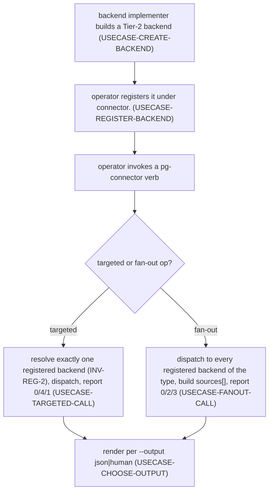

```mermaid
sequenceDiagram
    actor Op as operator
    participant Umb as umbrella
    participant BE as Tier-2 backend
    Op->>Umb: pg-connector <capability> <verb> [--output ...] [args]
    Umb->>Umb: validate --output pre-dispatch (INV-OUT-2)
    Umb->>Umb: resolve connector.<type> (INV-REG-1, INV-REG-2)
    Umb->>BE: INTF-WIRE: {"op": "...", "args": {...}}
    BE-->>Umb: {protocolVersion, schemaVersion, result} or {..., error: {code, message}}
    Umb->>Umb: classify outcome -> pg-connector's own exit code (INV-EXIT-1), never INTF-WIRE's own 0/1
    Umb-->>Op: rendered result/outcome; process exit code
```

## Use cases

### `USECASE-CREATE-BACKEND` — implement a Tier-2 backend for one capability <!-- uuid: da0238bf-1142-4c94-84e1-418457911e72 -->

**Actors:** `ACTOR-OP` (as the backend's implementer), `ACTOR-BACKEND`.
**Level:** user-goal.
**Preconditions:** none.
**Intent:** build a Tier-2 backend against exactly one capability's Provider interface and
`INTF-WIRE`'s common wire contract, so the umbrella can dispatch to it without any code change of
its own.
_Requires:_ `INV-CAP-1`, `INV-WIRE-1`, `INV-WIRE-2`, `INV-AUTH-1`, `INV-COMP-1`, `GOAL-MIN-1`.

**Flow.** The implementer picks exactly one capability (`pr`, `issue`, `ci`, or `scm`) and
implements that capability's own small Go Provider interface (never a monolithic
multi-capability interface, `INV-CAP-1`); wires it into a `NewDispatchTable` that answers that
capability's own op catalog (`interfaces.md`) plus the common `capabilities` op (mandatory,
`INV-WIRE-2`) and, if it has anything to check, `auth_status` via the optional `AuthChecker`
sub-interface (`INV-AUTH-1`); and ships it as its own binary speaking `INTF-WIRE`'s envelope
(`INV-WIRE-1`). Any data the implementation needs that belongs to a **different** capability MUST
be resolved through this backend's own direct system access, never by executing the umbrella or a
sibling backend binary (`INV-COMP-1`) — the umbrella gains no new dependency and no new process in
the call graph just because one backend happens to need data another capability's backend usually
supplies.

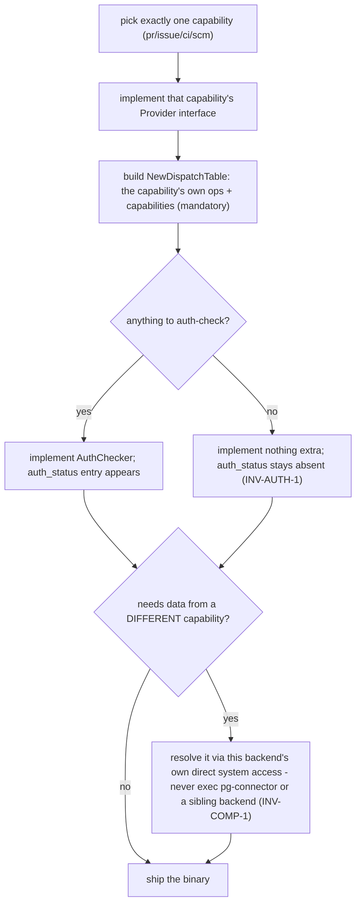

Extensions:

- The backend has no remote-credential concept at all (e.g. a purely local-git `scm` backend): it
  simply does not implement `AuthChecker`, and any `auth_status`/`capabilities`-driven fan-out
  reports it as `disabled: "not applicable"` (`INV-AUTH-1`), not a forced or broken answer.

### `USECASE-REGISTER-BACKEND` — register an implemented backend under `connector.<type>` <!-- uuid: 0fdc74b6-b29f-4518-b3fc-2e75f150944e -->

**Actor:** `ACTOR-OP`.
**Level:** user-goal.
**Preconditions:** the backend has been implemented (`USECASE-CREATE-BACKEND`).
**Intent:** put an implemented backend's binary name into the `connector.<type>` registry so the
umbrella can dispatch to it.
_Requires:_ `INV-REG-1`, `INV-REG-2`, `INV-REG-4`.

**Flow.** The operator adds the backend's bare binary name, or an instance `{name, command}` when
the same binary must run more than once with different arguments, under its capability's
`connector.<type>` entry — appending to the list for `pr`/`issue`/`ci`, or setting the single
value for `scm`. No `exec:` prefix or other built-in/external marker is written, because nothing
is compiled into the umbrella (`INV-REG-1`). Registering a second backend for a capability that
already has one does not, by itself, break every targeted op against it (`INV-REG-2`): an
**id-keyed** targeted op (`show`, `files`, …) resolves via the try-each policy
`USECASE-TARGETED-CALL` describes regardless of how many backends end up registered. Only an
**id-less write** (`issue create` today, the one member) still requires either exactly one
registered backend or an explicit `--backend` pin once a second is added — that op alone
hard-fails at N > 1 with no pin.

Extensions:

- The capability is `scm`: the registry entry is a single scalar value, not a list; registering a
  second backend under it is a configuration error the registry itself rejects, never a silent
  overwrite.
- The same binary must serve two data sources (two bead trackers): the operator registers two
  instances with distinct names and per-instance arguments (`INV-REG-4`); each is a separate
  backend for fan-out, pinning, config and cache purposes, and an id-keyed op tries them in
  registration order like any other pair.

### `USECASE-TARGETED-CALL` — invoke a targeted op and read its outcome <!-- uuid: e799d106-9348-4dcc-be8c-cc36111f8823 -->

**Actor:** `ACTOR-OP`.
**Level:** user-goal.
**Preconditions:** the target capability's registry entry resolves to exactly one backend, or —
for an **id-keyed** op — to more than one, resolved via the try-each policy below
(`USECASE-REGISTER-BACKEND`, `INV-REG-2`).
**Intent:** call an op that resolves to exactly one backend's own answer and get back a result or
a definitive, correctly-coded negative — never a health problem misreported as one, or the
reverse.
_Requires:_ `INV-REG-2`, `INV-WIRE-1`, `INV-ERR-1`, `INV-ERR-2`, `INV-EXIT-1`.
_Includes:_ `USECASE-CHOOSE-OUTPUT`.

**Flow.** The umbrella resolves the capability's registered backend(s). With exactly one
registered, or an explicit `--backend` pin, it dispatches one `INTF-WIRE` request directly to
that backend. With more than one registered and no pin: an **id-keyed** op (`show`,
`files`, …) tries each in registration order, dispatching to the next only when the current
one answers `not_found`, and short-circuiting immediately on any other outcome (`INV-REG-2`); an
**id-less write** (`issue create` today) instead fails as a CLI-level error before any wire call
is made at all — the try-each policy does not extend to it. Whichever path produced a reply, the
umbrella classifies it into its own targeted exit code: `0` on a well-formed `result` (including
a successful write); `4` when the reply's (or, on the try-each path, the aggregate) `error.code`
is `not_found` — a well-formed negative answer, not a failure; `1` for any other error, or for a
CLI-level failure before any well-formed response existed at all (no backend registered, an
id-less write ambiguous at N > 1 with no pin, a bad flag). The result is then rendered per the
operator's chosen output mode (`USECASE-CHOOSE-OUTPUT`).

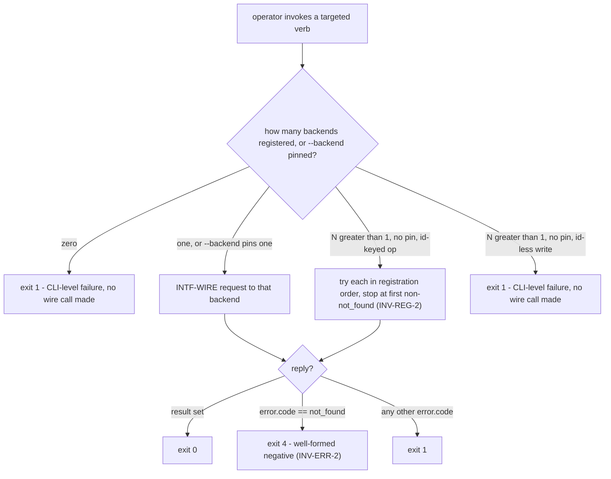

Extensions:

- The reply's `error.code` is `invalid_argument`: the request itself was malformed — exit `1`,
  identical to every other non-`not_found` error, since sharpening `invalid_argument` from
  `unavailable` is a wire-body precision, not a new CLI exit-code bucket (`INV-ERR-2`,
  `INV-EXIT-1`).
- The op is an id-less write (`issue create`) and more than one backend is registered with no
  `--backend` pin: the umbrella fails before any wire call at all, rather than trying each as the
  id-keyed path above does — the multi-instance try-each policy is scoped to id-keyed ops only
  (`INV-REG-2`).

### `USECASE-FANOUT-CALL` — invoke a fan-out op across every registered backend and read its outcome <!-- uuid: f325a8b7-c43f-4b97-839f-2e32871a68d7 -->

**Actor:** `ACTOR-OP`.
**Level:** user-goal.
**Preconditions:** none — a fan-out MAY run against zero registered backends (reported as total
failure, `INV-EXIT-1`) rather than requiring any minimum registration.
**Intent:** call an op that queries every backend registered for a type/capability at once (`ci
list`, `auth status`, `config validate`) and get back a per-backend outcome breakdown plus one
exit code distinguishing all-succeeded from partial from total failure.
_Requires:_ `INV-VER-1`, `INV-AUTH-1`, `INV-EXIT-1`, `INV-EXIT-2`, `INV-OUT-1`, `INV-FANOUT-1`.
_Includes:_ `USECASE-CHOOSE-OUTPUT`.

**Flow.** The umbrella dispatches one `INTF-WIRE` request per registered backend of the type
(concatenating results across backends for `ci list`; combining two checks — `auth_status` and
`capabilities` — into one row per backend for `config validate`), builds one `sources[]` row per
backend queried (`succeeded`/`degraded`/`disabled`, never collapsed), and computes its own exit
code from those rows: `0` if none are `degraded`; `2` if at least one is `degraded` and at least
one is healthy (`succeeded` or `disabled`); `3` if none are healthy at all, including the
zero-backends-registered case. A `disabled` row (a backend correctly answering "not applicable" —
e.g. no `AuthChecker` implemented) counts as healthy, never as a failure (`INV-EXIT-2`). For
`config validate` specifically, a `capabilities` response's self-declared `schemaVersions` is also
checked against this build's own expectations, and any recognized-capability disagreement is
folded into that backend's row as `degraded` with a `version_mismatch` reason (`INV-VER-1`). The
per-backend requests run concurrently, so a backend that is down or slow delays only its own row
and the fan-out takes as long as its slowest backend, not the sum of every backend's deadline;
the rows and every merged result still come out in registration order (`INV-FANOUT-1`). The
merged result is then rendered per the operator's chosen output mode (`USECASE-CHOOSE-OUTPUT`).

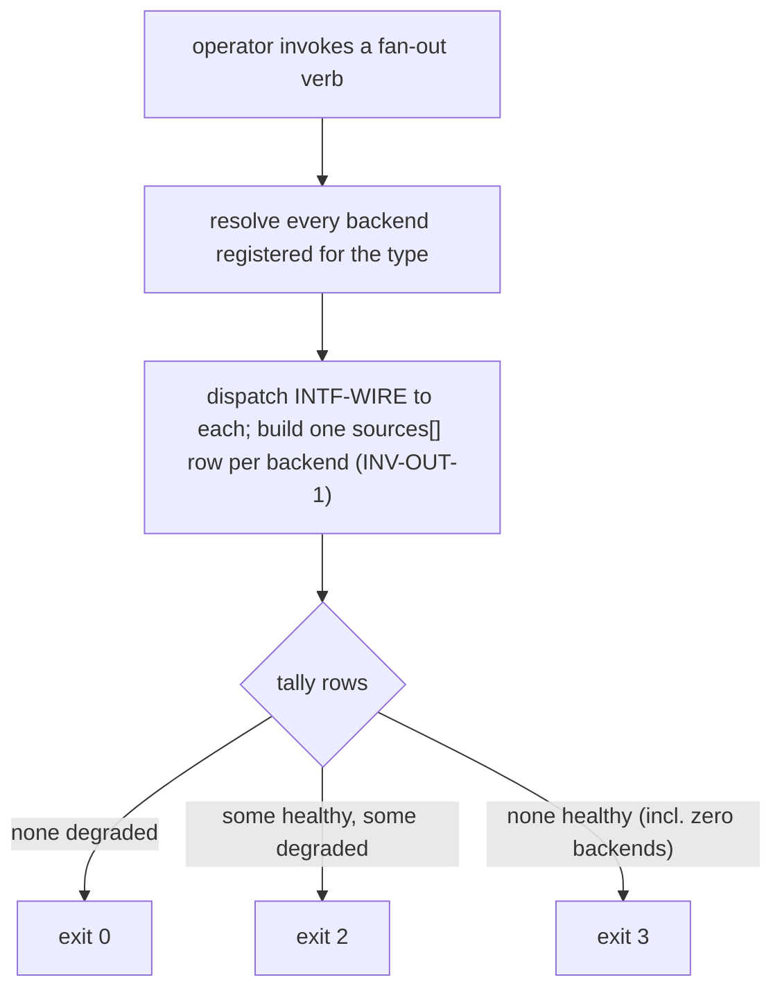

Extensions:

- The op is `config validate`: each backend's row combines its `auth_status` outcome and a
  `schemaVersions` comparison from its `capabilities` response into one verdict — a `disabled`
  `auth_status` (no `AuthChecker`) does not by itself degrade the row (`INV-AUTH-1`,
  `INV-EXIT-2`), but a recognized-capability `schemaVersion` mismatch does (`INV-VER-1`).

### `USECASE-NAMED-QUERY-CALL` — invoke `list` by name and read a distinct unrecognized-query signal <!-- uuid: 2e7c9a41-5b83-4f96-a1d2-8e3c6b9f4d70 -->

**Actor:** `ACTOR-OP`.
**Level:** user-goal.
**Preconditions:** the operator has authored a `backends.<binary>.queries.<name>` block for at
least one registered `pr`/`issue` backend.
**Intent:** enumerate every entity a named query matches, fanned out across every backend that
recognizes the name (or pinned to one via `--backend`), with a query name no backend recognizes
reported distinctly rather than as a crash, a usage error, or a silently empty result.
_Requires:_ `INV-WIRE-3`, `INV-STATE-1`, `INV-ERR-3`, `INV-REG-2`, `INV-EXIT-1`, `INV-OUT-1`.
_Includes:_ `USECASE-CHOOSE-OUTPUT`.

**Flow.** The umbrella resolves the backend set exactly as `USECASE-FANOUT-CALL` does — every
backend registered for the type, or exactly one if `--backend` pins it — and, for each, attaches
that backend's own registered `config` block VERBATIM onto the `list` request (`INV-WIRE-3`).
Each backend resolves the caller's query name against its own `config.queries` (never a name it
ships built in — `INV-STATE-1`) and returns matching entities, or `query_not_recognized` if its
own config doesn't define that name. The umbrella reports a `query_not_recognized` backend as
`disabled` in `sources[]` (excluded from degraded accounting, same as any other `disabled` row) —
unless EVERY queried backend answers it, in which case the whole call fails as the umbrella's own
`invalid_argument` CLI-level error instead of the ordinary fan-out exit-code scheme (`INV-ERR-3`).
The merged result is rendered per the operator's chosen output mode (`USECASE-CHOOSE-OUTPUT`).

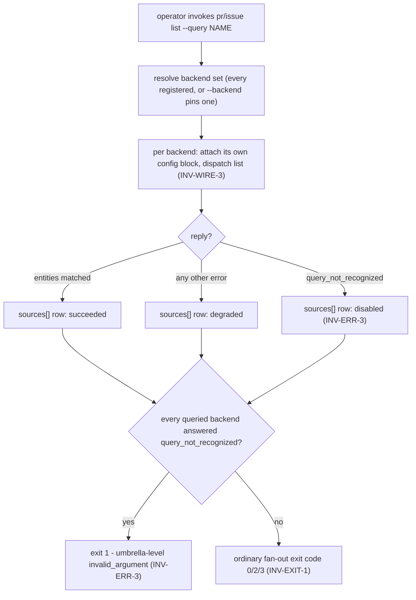

Extensions:

- A `config.queries` value is a list of expressions: the backend runs each, unions the results
  deduplicated by id, and reports `truncated` if any one member's own search reported truncated
  (`INV-STATE-1`).

### `USECASE-CROSSCUT-FANOUT-CALL` — invoke the attention or search fan-out and read its aggregated outcome <!-- uuid: 8794553a-233c-44b4-9480-851511311eab -->

**Actor:** `ACTOR-OP`.
**Level:** user-goal.
**Preconditions:** none — like `USECASE-FANOUT-CALL`, MAY run against zero registered sources
(reported as total failure, `INV-EXIT-1`).
**Intent:** call `attention list` or `search <query>` — the two capabilities with no targeted
form at all — and get back every registered source's own contribution, aggregated per that
capability's own rule, plus the ordinary fan-out exit code.
_Requires:_ `INV-REG-3`, `INV-EXIT-1`, `INV-OUT-1`, `INV-ATTN-1`, `INV-ATTN-URL-1`, `INV-ATTN-GROUP-1`,
`INV-ATTN-CONTENT-1`, `INV-CONOBS-4`, `INV-SEARCH-1`, `INV-ATTN-BEADS-1`, `INV-SEARCH-BEADS-1`.
_Includes:_ `USECASE-CHOOSE-OUTPUT`.

**Flow.** The umbrella resolves the backend set from the capability's own top-level key
(`attention.sources` or `search.sources`, never `connector.<type>` — `INV-REG-3`) and dispatches
one `INTF-WIRE` request per registered source, building one `sources[]` row each exactly as
`USECASE-FANOUT-CALL` does. It then aggregates the per-source raw items by that capability's own
rule — `attention list` dedups by `{type, id}` and ranks by severity (`INV-ATTN-1`), passing each
item's optional own-page `url` and optional work-context `group` through unread and never
defaulting either (`INV-ATTN-URL-1`, `INV-ATTN-GROUP-1`); `search`
keeps every source's results in its own group, ordered by registration order, with no
cross-source merge at all (`INV-SEARCH-1`) — and computes the SAME fan-out exit code
`USECASE-FANOUT-CALL` does from the `sources[]` rows. Neither verb accepts `--backend` or
attaches a `backends.<binary>` config block (unlike every `pr`/`issue`/`ci`/`scm` verb), and
neither participates in `auth status`'s or `config validate`'s own fan-out. The aggregated
result is then rendered per the operator's chosen output mode (`USECASE-CHOOSE-OUTPUT`).

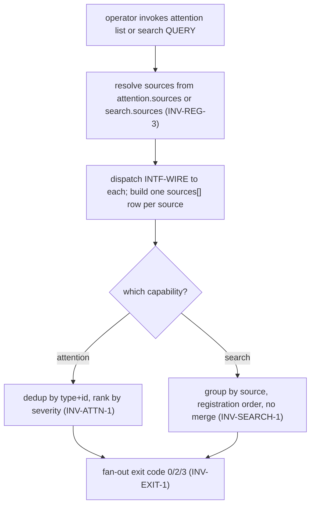

Extensions:

- `attention list --cap N` truncates the already-merged/ranked list, setting `truncated`/
  `total_before_cap` only when the cap actually cuts items — the fan-out exit code is unaffected.
- `search --fields ...` requests specific result attributes; an unrecognized one produces a
  `warnings[]` entry, never an error and never a `sources[]`-level failure.
- A beads backend among the sources contributes to `attention list` only the beads of its tracker
  that carry one of its configured attention labels, and answers `unavailable` naming the setting
  when none is configured (`INV-ATTN-BEADS-1`). It answers `search` by wrapping the tracker's own
  search over every status, closed beads included (`INV-SEARCH-BEADS-1`).

### `USECASE-ALERT-READ` — read currently-firing alerts, their history, and the unknown-versus-none distinction <!-- uuid: 32809625-aff9-4052-9f86-523438b9e392 -->

**Actor:** `ACTOR-OP` (directly, or via a Tier-3 consumer such as a menu bar indicator or a
triage tool).
**Level:** user-goal.
**Preconditions:** zero or more backends registered under `connector.alert` and/or
`attention.sources`.
**Intent:** (1) an indicator reads `attention list` and renders "no alerts", the surviving items
plus an "incomplete" marker, or "unknown"; (2) a triage tool reads `alert list` and
`alert history` and applies its own grouping policy; (3) either can tell none from unknown.
_Requires:_ `INV-ALERT-1`, `INV-ALERT-2`, `INV-ALERT-3`, `INV-ALERT-4`, `INV-ALERT-5`,
`INV-ALERT-6`, `INV-ALERT-7`, `INV-ALERT-8`, `INV-EXIT-1`, `INV-OUT-1`, `INV-ATTN-1`,
`INV-CONOBS-4`.
_Includes:_ `USECASE-FANOUT-CALL`, `USECASE-CROSSCUT-FANOUT-CALL`.

**Flow.** `alert list [--query NAME]` and `alert history --since T --until T [--query NAME]` fan out
across `connector.alert` and concatenate (no cross-source dedup); `alert show ID` is targeted.
`attention list` reads `attention.sources`, where an alert backend answers `list_attention`
itself (`INV-ALERT-7`). Reachable with nothing firing is `succeeded`, `count: 0`, exit `0`; an
unreachable backend is `degraded` (exit `2` with surviving sources, `3` when none survive) and a
consumer MUST read that as UNKNOWN, never as an empty list (`INV-ALERT-5`).

Each backend maps its source's own severity onto the attention severity scale itself and omits a
severity it cannot map rather than inventing one (`INV-ALERT-4`). An acknowledged alert stays in the
attention result, one severity level lower than the same alert unacknowledged, so unacknowledged
alerts are read first (`INV-ALERT-8`). The capability is read-only: there is no verb to
acknowledge, silence or hide an alert (`INV-ALERT-6`).

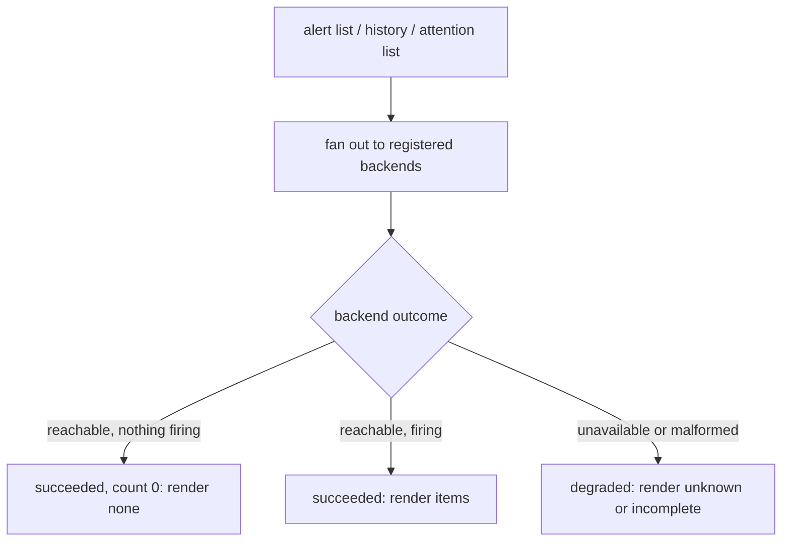

### `USECASE-POLL-CHANGES` — poll a daemon-backed backend's `changes` and acknowledge only what was delivered <!-- uuid: 95adcf12-95c5-4bfb-90db-1532eed2ca77 -->

**Actor:** `ACTOR-OP` (a polling consumer: a scheduler role or a script).
**Level:** user-goal.
**Preconditions:** the target capability has a backend that declares `owns_changes`
(`INTF-WIRE`'s section "A daemon-backed backend"), and the consumer polls with a stable
`--consumer` name and a `--query` the backend recognizes.
**Intent:** learn every change to the entities of one query, at least once and in order, without
the umbrella deciding what changed, so a crash between receiving and acting loses nothing.
_Requires:_ `INV-CACHE-9`, `INV-LEDGER-FRESH-5`, `INV-LEDGER-FRESH-2`, `INV-EXIT-1`, `INV-OUT-1`,
`INV-ERR-1`.
_Includes:_ `USECASE-CHOOSE-OUTPUT`.

**Flow.** The consumer runs `changes --query Q --consumer C`. The umbrella forwards the call to the
backend instead of diffing its ledger (`INV-CACHE-9`) and receives the changes after C's
acknowledged position for Q, each with its `seq`, `kinds` and `fields`, a `next_seq` per source, and
`sources_freshness[]`. It stamps the ledger's `refreshed_at` and `last_error` for each of the
backend's queries and the consumer's `last_seen` from that answer (`INV-LEDGER-FRESH-5`), writes the
output to the consumer and flushes it, and only then sends `changes_ack` with the `next_seq` it
received. The rows are not acknowledged by being returned: a consumer that crashes before the flush
is handed the same changes again on its next poll. A poll that returns no change still sends
`changes_ack`, so a quiet query's position keeps moving. The first poll of a new
(consumer, kind, query) key starts at the tail of the log, so a new consumer is not handed every open
entity at once. The result is rendered per the operator's chosen output mode
(`USECASE-CHOOSE-OUTPUT`) and the call's exit code follows `INV-EXIT-1`.

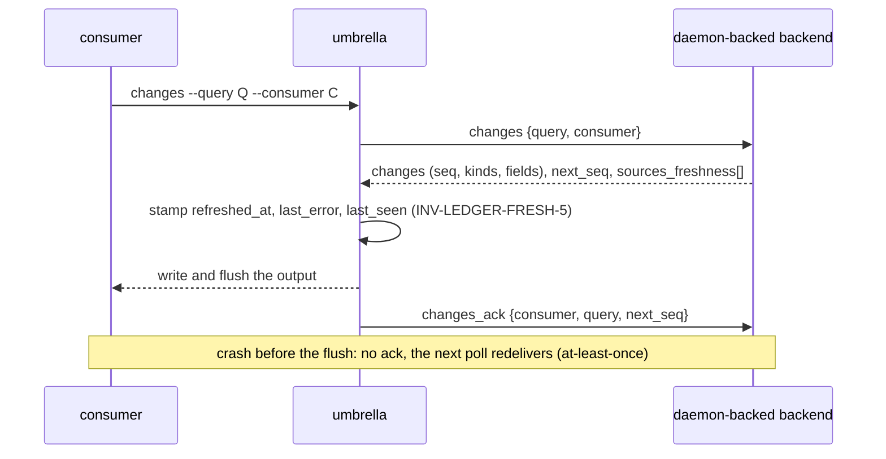

Extensions:

- The backend cannot answer (its daemon is down): the source is `degraded` with the `unavailable`
  reason, nothing is delivered, no `changes_ack` is sent and the position does not move, and the
  umbrella never falls back to a ledger diff (`INV-CACHE-9`). The consumer retries the same poll
  (`USECASE-DAEMON-DOWN-READ`).
- The consumer's position fell outside the backend's retention, or the backend recovered from a
  corrupt store: the call is answered `invalid_argument` whose message starts with `cursor_expired:`
  and tells the consumer to re-run with `--reset`, which replays the query's current members as
  `added` and moves the consumer to the tail of the log (`INV-ERR-1`).
- `--cached`: the backend answers from what it already has without running the query, and the answer
  advances no `refreshed_at` (`INV-LEDGER-FRESH-2`).
- The consumer wants the CI view of the same query: `ci changes` (PLANNED, not available) returns
  the PR rows whose kinds include `ci_changed`, `entered_query`, `left_query` or `removed`, with the
  same acknowledgement and retention rules. Against a `ci` backend that does not declare
  `owns_changes` the umbrella itself answers `invalid_argument` for that source, naming the instance
  and saying it does not own changes, and does not forward the call.

### `USECASE-DAEMON-DOWN-READ` — read from a daemon-backed backend whose daemon is down, and retry <!-- uuid: 85f23c4e-f32c-4b58-bfa9-f0975195541c -->

**Actor:** `ACTOR-OP` (a person, a script, or a skill that reads `pr` or `ci`).
**Level:** user-goal.
**Preconditions:** the target capability has a daemon-backed backend that declares `cache_opt_out`,
and its daemon cannot be reached.
**Intent:** tell an outage from a real answer, learn where to look, and recover by retrying, without
the umbrella serving old content it does not hold or hiding the outage.
_Requires:_ `INV-CACHE-9`, `INV-ERR-1`, `INV-EXIT-1`, `INV-OUT-1`.
_Includes:_ `USECASE-TARGETED-CALL`, `USECASE-FANOUT-CALL`.

**Flow.** The umbrella still learns the backend's declarations, because the backend answers
`capabilities` without its daemon (`INTF-WIRE`), so the outage is never mistaken for a backend that
opted out of the cache. The read is forwarded; the backend retries a refused connection for part of
the request's deadline, then answers `unavailable` with a message naming the socket path and the
supervisor's restart hint. The umbrella holds no cache entry for this backend and so serves nothing
in its place (`INV-CACHE-9`): a targeted read exits `1`, and a fan-out read reports the source
`degraded` (`INV-EXIT-1`, `INV-OUT-1`). The caller treats `unavailable` as retryable, retries after
a short wait, and gets a normal answer once the supervisor has restarted the daemon. The operator
who needs the cause reads the backend's own `status`, which still reports the supervisor probe's
answer, the socket path, the store's size and age, and the log paths when the daemon is down, and
which `auth status` and `config validate` also show as rows.

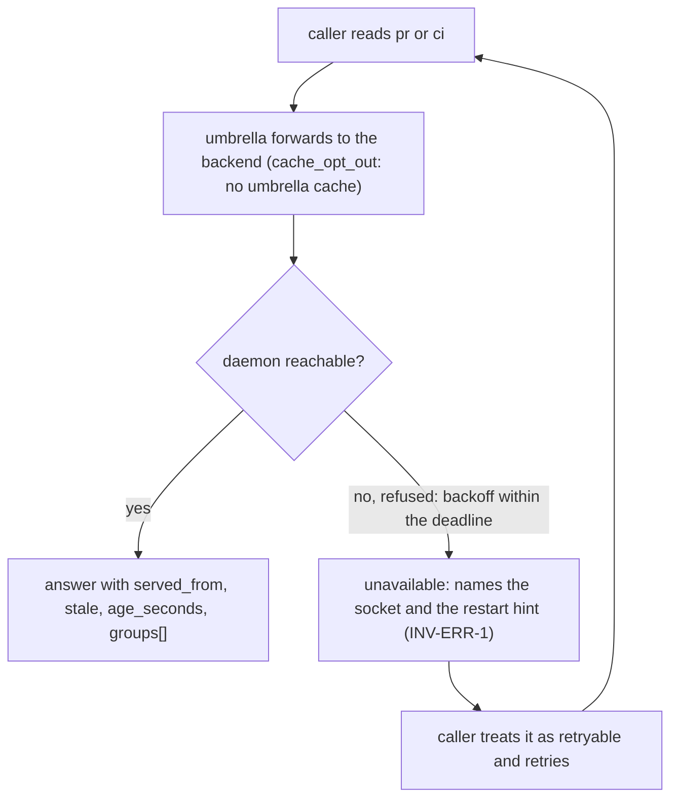

Extensions:

- The daemon answers `unavailable` with a `migrating:` message: it is up but still migrating its
  store, and the caller retries as above.
- The caller needs a read of its own write after a push or a PR creation: it passes `--fresh` on the
  read or runs `pr refresh <id>` (PLANNED, not available); a polling caller does neither.

### `USECASE-CACHED-READ` — read an entity through the umbrella's cache and tell how fresh the answer is <!-- uuid: 556f9d0e-57cb-48aa-b844-4267ebad6f25 -->

**Actor:** `ACTOR-OP`.
**Level:** user-goal.
**Preconditions:** the `pr` or `issue` backend does not own its cache and changes (a backend that
does is `USECASE-POLL-CHANGES`'s and `USECASE-DAEMON-DOWN-READ`'s case), and neither the type nor
the backend has opted out of the cache.
**Intent:** read an entity repeatedly without every reader calling the origin, and learn for each
answer whether it came from the origin or from a cache entry and how old it is, so the cache never
passes stale content off as current.
_Requires:_ `INV-CACHE-1`, `INV-CACHE-2`, `INV-CACHE-3`, `INV-CACHE-4`, `INV-CACHE-5`,
`INV-CACHE-6`, `INV-CACHE-7`, `INV-CACHE-8`, `INV-CACHE-10`, `INV-LEDGER-FRESH-1`,
`INV-LEDGER-FRESH-2`, `INV-LEDGER-FRESH-3`, `INV-LEDGER-FRESH-4`, `INV-EXIT-1`, `INV-OUT-1`.
_Includes:_ `USECASE-CHOOSE-OUTPUT`.

**Flow.** The operator runs `show`. A live full-detail cache entry within `read_ttl` answers it
without calling the backend; an older or missing entry is fetched from the origin, and concurrent
readers of one entity collapse to one origin call. A list summary never answers a `show`, and a
summary never replaces a detail entry (`INV-CACHE-2`, `INV-CACHE-4`). The answer says whether it
was `served_from` the origin or the cache and its `age_seconds`; `--fresh` skips the read-through
but never the stale fallback (`INV-CACHE-5`). When the origin is `unavailable` the umbrella serves
the stale entry marked `stale` rather than failing, and a `list` fallback serves only the entities
that are live members of the requested query (`INV-CACHE-1`, `INV-CACHE-3`). `changes` always asks
the origin, so that it can detect change; in its refresher mode it fetches full entities only for
members that are new or aged, and confirms a disappearance with one read before reporting `removed`
(`INV-CACHE-6`, `INV-CACHE-7`). A write the backend accepted drops the written entity's entry, so the
next `show` reads the origin rather than the pre-write entity (`INV-CACHE-10`). Every completed origin fetch is stamped on the query's ledger key:
a whole-query answer records `refreshed_at`; a partial or failed one records `last_error` and
leaves `refreshed_at` alone; an answer served from the cache or ledger advances nothing; and
`ledger show` reports both fields for every key, as `null` when absent
(`INV-LEDGER-FRESH-1`, `INV-LEDGER-FRESH-2`, `INV-LEDGER-FRESH-3`, `INV-LEDGER-FRESH-4`). The
result is rendered per the operator's chosen output mode (`USECASE-CHOOSE-OUTPUT`), and the
opt-outs, the fail-open rule and the exit codes of `show`, `list` and `changes` are unchanged by
the cache policy (`INV-CACHE-8`, `INV-EXIT-1`).

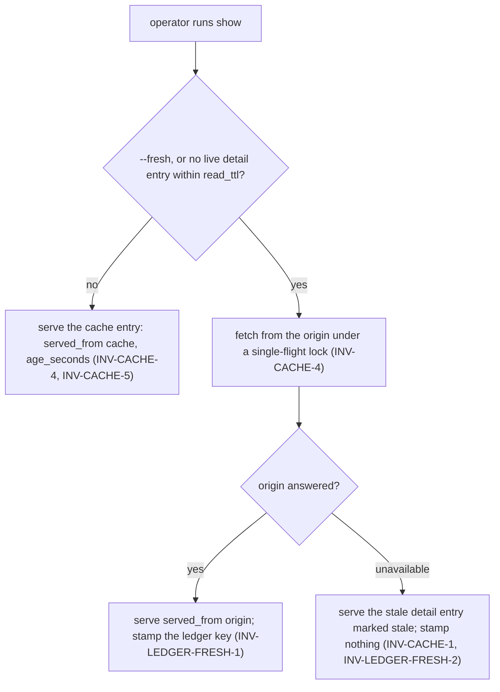

Extensions:

- The type or the backend opted out of the cache: `show` is neither read through nor written, and
  the ledger is still kept (`INV-CACHE-1`, `INV-CACHE-4`).
- A consumer that has just detected a change and needs the current entity passes `--fresh`, because
  a detail entry younger than `read_ttl` is otherwise served (`INV-CACHE-8`).

### `USECASE-CALENDAR-ATTENTION` — see calendar events in the attention feed, ramped by time alone <!-- uuid: 8bf21ca6-1f5e-43be-a397-436ef2252c5d -->

**Actor:** `ACTOR-OP` (typically a consumer reading `attention list`, such as an indicator).
**Level:** user-goal.
**Preconditions:** a `calendar` backend that reports calendar events as attention items is
registered under `attention.sources`.
**Intent:** see what is coming up on the calendar and what is happening now, at an attention level
that depends only on where the current time falls relative to the event.
_Requires:_ `INV-CAL-1`, `INV-CAL-2`, `INV-CAL-3`, `INV-CAL-4`, `INV-CAL-5`, `INV-CAL-6`,
`INV-STATE-1`.

**Flow.** The backend considers every event that has not ended and starts before `now` plus the
look-ahead window (`attention_window`, default 24 hours); an in-progress event is a candidate
however long ago it started, and a declined event is never reported (`INV-CAL-5`, `INV-CAL-6`). An
event that starts later than the lead time (`attention_lead_time`, default 15 minutes) from now is
`low`; one that starts within the lead time is `high`; one in progress is `critical` for its whole
duration and drops out once it ends. An all-day event is always `low` (`INV-CAL-2`, `INV-CAL-3`).
The level depends on time only: the event's priority, a match against `important_people` and a
tentative reply never change it, and the backend keeps no state between calls (`INV-CAL-4`,
`INV-STATE-1`). A malformed duration, a negative lead time or a non-positive window is answered as
`invalid_argument` (`INV-CAL-5`).

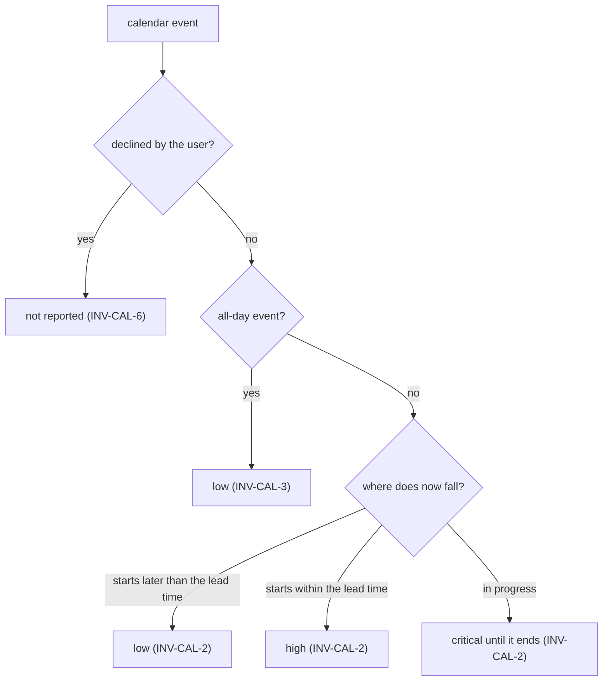

Extensions:

- A backend that matches an attendee against a configured `important_people` list, for a purpose
  other than attention, matches case-insensitively: an entry containing `@` is compared only to the
  attendee's email, with no domain normalization, and any other entry only to the attendee's name,
  by exact match, never by substring (`INV-CAL-1`).

### `USECASE-MAIL-READ` — read and triage mail with no way to delete it <!-- uuid: a9d4d76b-5fd6-4a66-b5b3-6e71097b621b -->

**Actor:** `ACTOR-OP`.
**Level:** user-goal.
**Preconditions:** a `mail` backend is registered under `connector.mail`.
**Intent:** list, read, search and sort mail through the umbrella, certain that no operation of the
whole stack can destroy a message, and without mail producing attention items of its own.
_Requires:_ `INV-MAIL-1`, `INV-MAIL-2`, `INV-MAIL-3`, `INV-MAIL-4`, `INV-CAL-1`.

**Flow.** The only operations a `mail` backend offers are `list`, `show`, `search_messages`,
`mark_read`, `mark_unread`, `archive`, `unarchive` and `fetch_attachment`; none removes, trashes or
purges a message, and an archived message stays retrievable (`INV-MAIL-1`). `list` and
`search_messages` with no mailbox named cover every configured mailbox in order, skip a configured
mailbox the bridge does not know, and show a message filed under several mailboxes once
(`INV-MAIL-4`). When a backend matches a sender against `important_people`, it first splits the
one `"Name <email>"` sender string into a name and an email by the fixed rule, then applies the
calendar matching rules unchanged (`INV-MAIL-2`, `INV-CAL-1`). The backend derives no attention
level from a mailbox's priority tag or from that match, and its `list_attention`, where it is
registered under `attention.sources` at all, answers an empty, successful list (`INV-MAIL-3`,
`INV-MAIL-4`).

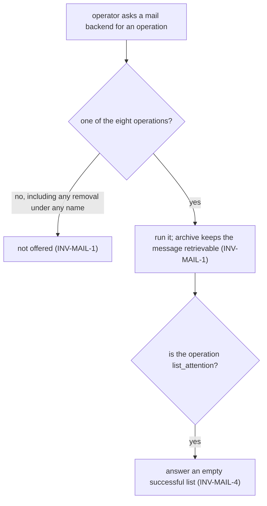

### `USECASE-AGENTSESSION-ATTENTION` — see which agent sessions need a person, without repeating an alert <!-- uuid: 6f77845a-c61b-4a16-9c1f-39899d822da1 -->

**Actor:** `ACTOR-OP` (typically a consumer reading `attention list`).
**Level:** user-goal.
**Preconditions:** an `agentsession` backend that answers `list_attention` is registered under
`attention.sources`.
**Intent:** learn which agent sessions are waiting on a person, and how urgently, without the same
account-wide fact appearing twice.
_Requires:_ `INV-AGS-1`, `INV-AGS-2`, `INV-ATTN-URL-1`, `INV-CONOBS-4`.

**Flow.** The backend reports one `agentsession` item per session that needs a person and no other:
a blocked session is `high` when it waits on human input or authentication and `medium` for a usage
limit or any other blocker, and a session flagged long-idle is `low`. Each item's id is the session
id and it carries no `url` (`INV-AGS-1`, `INV-ATTN-URL-1`). The backend does not report that the
account's 5-hour or weekly usage cap was hit, because an alert already raises that fact and reaches
the same consumer through the `alert` backend (`INV-AGS-2`, `INV-CONOBS-4`); a single session
blocked on a usage limit is a per-session fact no alert covers and is still reported.

### `USECASE-BACKEND-OBSERVABILITY` — keep a backend's own health out of attention and in its own telemetry <!-- uuid: a4bd8e4a-e378-496e-8d6b-42bfd7f119b8 -->

**Actor:** `ACTOR-OP`, acting as backend-implementer (see the [actors](actors.md) page).
**Level:** subfunction.
**Preconditions:** a backend, new or existing, for an external service.
**Intent:** the operator learns that a connector is unhealthy (unauthenticated, unavailable, out
of quota) from that connector's own logs, metrics and alert rules, and learns what deserves their
attention (a meeting soon, an unread chat, a pull request awaiting their review) from
`attention list`, without the two ever being mixed.
_Requires:_ `INV-ATTN-CONTENT-1`, `INV-CONOBS-1`, `INV-CONOBS-2`, `INV-CONOBS-3`, `INV-CONOBS-4`.

**Flow.** The backend writes its own rotating log/event stream, emits its own metrics where
useful and declares its own alert rules; for an external service it tracks availability,
authentication health and, where exposed, quota (`INV-CONOBS-1`, `INV-CONOBS-2`). Registering
those with the observability stack is done per connector in the nix configuration, never in
pg-connector's own configuration (`INV-CONOBS-3`). The backend's `list_attention` reports only
interesting things in the data (`INV-ATTN-CONTENT-1`), and omits any fact an alert already raises
(`INV-CONOBS-4`).

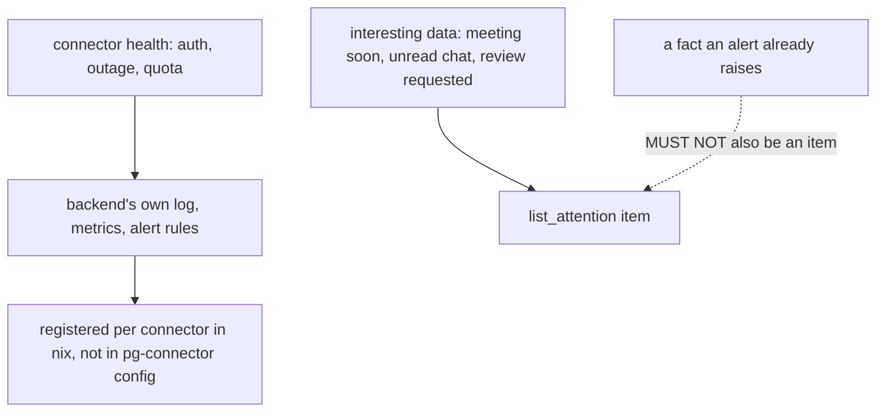

### `USECASE-CHOOSE-OUTPUT` — choose the CLI's presentation mode <!-- uuid: 632b7e23-25c8-43e2-9572-65f3547023bd -->

**Actor:** `ACTOR-OP`.
**Level:** subfunction.
**Preconditions:** none — this applies identically to every targeted or fan-out call.
**Intent:** render a call's already-decoded result as the stable JSON envelope, or as readable
text, chosen explicitly rather than inferred.
_Requires:_ `INV-OUT-2`.

**Defined once, included by reference.** Both `USECASE-TARGETED-CALL` and `USECASE-FANOUT-CALL`
include this rather than restating it, because the choice and its validation timing are identical
for either call shape.

**Flow.** `--output` defaults to `json`. The value is validated the moment the umbrella parses
its arguments, strictly **before** any backend is dispatched, so an invalid value is rejected with
zero side effects — no backend has been invoked, no write has happened. On the success path,
`json` mode prints the wire envelope (or the merged fan-out envelope) verbatim, byte-for-byte what
pg-connector has always printed; `human` mode renders the same already-decoded, already-typed
result as text instead. Neither mode alters `INTF-WIRE`'s own protocol.

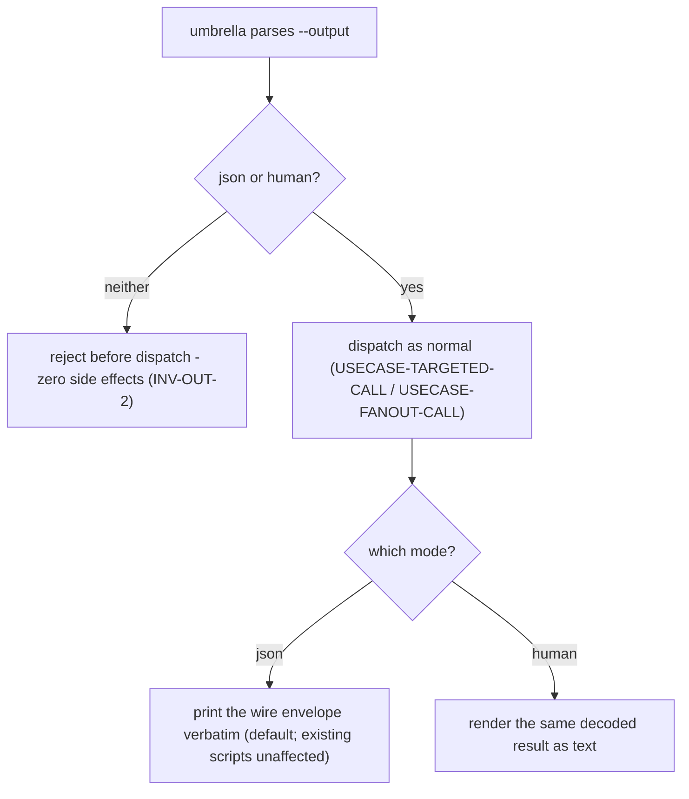

## Open questions

- **`OQ-EXIT-1`** <!-- uuid: 8f72c935-6feb-473d-a73f-ee1e02b3ca48 --> — `INTF-WIRE`'s own
  exit codes stay a plain `0`/`1` (`INV-WIRE-1`), which does not meet this workspace's own
  code-file convention that a branchable meaning uses a distinct exit code ≥ 2, with `1` reserved
  for a generic/unexpected error. Is this an accepted, deliberate exemption — because
  classification already lives entirely in the JSON `error.code` (`INV-ERR-1`), and the wire
  layer's exit code genuinely carries no branchable meaning of its own beyond "did a well-formed
  envelope come back" — or should `INTF-WIRE` widen its own exit-code scheme to satisfy that
  convention directly? Unresolved as of this writing; not blocking, since every consumer today
  already reads the JSON body rather than branching on the wire-level exit code.

- **`OQ-REVHEAD-1`** <!-- uuid: 61b91b5b-82ce-4904-bbba-a8036d1e02a7 --> — **Settled
  (2026-10-08, live introspection and the real verb against a scratch repository).** Is the host
  operation that appends a comment to a pending review at an explicit commit, by diff position
  (the one `INV-REVHEAD-2` relies on, as opposed to the line-and-side one used for the live head),
  deprecated or scheduled for removal in the host's schema? No. Introspecting the host's GraphQL
  schema on 2026-10-08 (the host publishes no schema version number, so the date is the record)
  showed `addPullRequestReviewComment` not deprecated, with none of its input fields deprecated
  (`pullRequestReviewId`, `commitOID`, `path`, `position`, `body`, `inReplyTo`); the only deprecated
  mutations were the classic-projects ones. The host also accepted a variable declared
  `GitObjectID!` for `commitOID` and `Int!` for `position` in the mutation document the backend
  sends. What introspection cannot show is a future removal; a later deprecation is detectable by
  repeating the introspection, and is not guarded against by the backend.
- **`OQ-REVHEAD-2`** <!-- uuid: 0b3c7e52-9a4d-4f18-8e6b-5d2c1a7f9e30 --> — **Settled
  (2026-10-08, scratch repository).** A pending review that was started at a THIRD commit (neither
  the live head nor `head_sha`), then appended to with the explicit commit `head_sha`: does each
  comment stay anchored at `head_sha`? Yes. A pending review started at the live head (a third
  commit) and then appended to at each of two earlier commits kept its review-level commit at the
  live head, while each appended comment was recorded against the commit named in its own request,
  and the host re-mapped each comment's current line (a line 5 at the earlier commit showed as
  line 6 after a line was inserted above it). A review that an earlier-head save itself creates
  carries `head_sha` as its review-level commit and counts as stale for the live head
  (`INV-REVHEAD-3`).
- **`OQ-REVHEAD-3`** <!-- uuid: c4d8a1f6-3e07-4b92-a5d0-7f1e8b2c6a49 --> — **Settled for the
  situations observed (2026-10-08, scratch repository).** Positions are computed from the
  difference between the base branch's CURRENT tip and `head_sha`, because that is what the host's
  compare read offers; the host's own diff view may use the commit the PR diverged from. Observed
  with the base branch advanced by a commit that edits the top of a file the PR also edits, a file
  renamed with a content change, and a second file in the same difference: the two agreed in every
  case. Each comment landed on the line it named, on both sides (`RIGHT` on an added line and on a
  context line, `LEFT` on a removed line), in each file independently. A `LEFT` comment named by
  the OLD path of a renamed file, and one named by the NEW path, both landed on the old line under
  the new path; a `RIGHT` comment named by the OLD path of a renamed file failed alone as
  `anchor_rejected` while the others landed. Not observed, and so still not guaranteed: an advance
  of the base that changes where the PR diverged from it (for example a merge of the base into the
  PR), and a patch the host omits.
