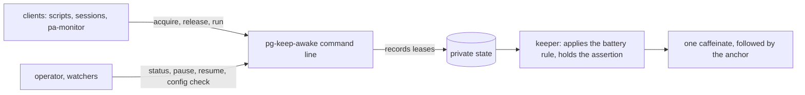

# pg-keep-awake

The single holder of the Mac keep-awake assertion. Every program that wants the Mac to stay awake
while agents work asks `pg-keep-awake`, and every ask passes one low-battery rule. One keeper process
holds the assertion (one `caffeinate`) on behalf of every request.

## The command line is the only supported interface

Use the commands below. Nothing else is a contract: a client MUST NOT read or write the keeper's state
files, which are private and MAY change shape in any release. To learn what is going on, run
`pg-keep-awake status` (or `status --json` for a program). To ask for or withdraw a hold, run
`acquire`, `release` or `run`.



A request only records a lease (one reason to stay awake). The keeper reads the leases and the battery
and holds the Mac awake exactly when the rule allows, so a request still succeeds while the keeper is
down.

## Commands

Every command accepts `--help` (and `-h`); `pg-keep-awake help <command>` is the same.

| Command        | What it does                                                                                 |
| -------------- | -------------------------------------------------------------------------------------------- |
| `acquire`      | Create or refresh a lease for an owner and a key, and print its id.                          |
| `release`      | Remove one lease of an owner, or every lease of the owner with `--all`.                      |
| `run`          | Hold a lease for the life of one command and pass its exit status through.                   |
| `status`       | Show what holds the Mac awake. `--json` prints one JSON object; `--check` is a health check. |
| `pause`        | Drop the assertion for a while (`--for DUR`) without removing any lease.                     |
| `resume`       | End a pause.                                                                                 |
| `config check` | Validate a configuration file without changing anything.                                     |
| `keeper`       | Long-running mode, not for interactive use: the one process that holds the assertion.        |
| `anchor`       | Long-running mode, not for interactive use: the watchdog the keeper's `caffeinate` follows.  |

`keeper` is started and restarted by launchd; `anchor` is started by the keeper with every parameter on
its command line. Neither is typed at a prompt.

## Quick start

```bash
# Keep the Mac awake while this shell's parent process lives
pg-keep-awake acquire --owner myscript

# ... or for a set time, or bound to a named process
pg-keep-awake acquire --owner myscript --for 30m
pg-keep-awake acquire --owner myscript --pid 1234

# Withdraw it (exits 0 even when there was nothing to release)
pg-keep-awake release --owner myscript

# Hold the Mac awake for exactly the life of one command
pg-keep-awake run --owner build -- make all

# What is holding my Mac awake?
pg-keep-awake status
pg-keep-awake status --json

# Let the Mac sleep for an hour without losing any request
pg-keep-awake pause --for 1h
pg-keep-awake resume
```

An owner and a key are each 1 to 64 letters, digits, underscores or hyphens. The key is `default` when
`--key` is not given. `-d`, `-i`, `-m` and `-s` follow `caffeinate`; `-i` is the default.

`status` marks an external holder `managed by claude` when it is Claude Code's own `caffeinate -i -t N`
(its parent is a `claude` process). Claude Code starts that holder with a search path of its own, so the
shim never sees it; instead the keeper stops it while the battery gate is `released` and leaves it alone
otherwise (ADR 0100 decision 8). No other holder is ever stopped.

## Exit codes

| Code | Meaning                                           |
| ---- | ------------------------------------------------- |
| 0    | Success.                                          |
| 1    | Unexpected failure.                               |
| 2    | Usage error (nothing was written).                |
| 3    | The state directory cannot be written.            |
| 4    | A configuration file is invalid (`config check`). |
| 5    | The keeper is down (`status --check`).            |
| 6    | The keeper is degraded (`status --check`).        |

`run` is the exception: it passes through the command's own exit status, gives 128 plus the signal
number for a command killed by a signal, and 127 for a command that is not found.

Standard output carries data and standard error carries diagnostics.

## Configuration

Only the keeper reads a configuration file, `config.toml` under `pg-keep-awake` in
`XDG_CONFIG_HOME` (default `~/.config`), once at startup. An absent file means the built-in defaults, and
a bad file never stops the keeper: it falls back to the last good copy and then to the defaults.
Check a file before shipping it:

```bash
pg-keep-awake config check --config path/to/config.toml
```

The keys are `heartbeat_interval`, `watchdog_timeout` and `linger` (durations), `[battery]` with
`hold_pct`, `release_pct` and `hysteresis_pct`, and `[otel]` with `endpoint` (empty means no
telemetry). The state directory is under `XDG_STATE_HOME` (default `~/.local/state`).

## Installed files

The package installs `pg-keep-awake` and `pg-caffeinate-shim` (a stand-in for `/usr/bin/caffeinate`),
bash and zsh completions, and a tldr page (`pg-keep-awake`, under `share/tldr/pages.common`). The
home-manager module registers the tldr page.

## Further reading

- Intended behavior: `docs/behavior/pg-keep-awake/` (start at `cli-contract.md`).
- Design: `docs/superpowers/specs/2026-10-14-pg-keep-awake-design.md`.
- Decision: `docs/adr/0100-pg-keep-awake-is-the-single-holder-of-the-keep-awake-assertion.md`.
