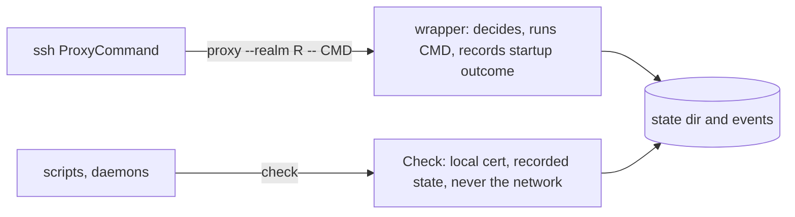

# pg-origin-guard

Stops unattended git authentication retries from opening browser login windows, and tells the operator
when git auth to a realm is unavailable. The contract (rules W1 to W11, the state and config layout,
events, tests) is `docs/contract.md` in this directory; this README is the operator summary.

A realm is one authentication domain (one certificate). Two entry points share one config and one state:



## Commands

```text
pg-origin-guard check (--realm R | --remote URL | --repo PATH) [--json]
pg-origin-guard status [--json]
pg-origin-guard ignore REALM
pg-origin-guard unignore REALM
pg-origin-guard proxy --realm R -- CMD ARGS...
```

## Exit codes

| Code | Meaning                                                                                                       |
| ---- | ------------------------------------------------------------------------------------------------------------- |
| 0    | available (`check`), or CMD's own status (`proxy`)                                                            |
| 3    | unavailable or refused; the reason is in the output (a caller MUST NOT count it as a failure of its own work) |
| 2    | usage error                                                                                                   |
| 7    | config error                                                                                                  |
| 1    | internal fault (carries no branchable meaning)                                                                |

Only 0 means go ahead. Reasons: `ok`, `ignored`, `cert-expired`, `cert-missing`, `agent-unreachable`,
`no-human`, `backoff`, `attempting`, `auth-rejected`, `network`, `timeout`, `unknown`, `mount-missing`.

## Config

`${XDG_CONFIG_HOME:-~/.config}/pg-origin-guard/config.toml`. A missing file means defaults and no realms.
The tool needs no nix; the home module (below) is one way to render it.

```toml
[presence]
file           = "~/.local/state/host-activity/userpresence.json"  # default
max_age        = "60s"
refresh_seconds = 30

[breaker]
failure_threshold = 2
open_duration     = "60s"
startup_window    = "10s"
established_after = "1s"

[events]
retention_days     = 14
heartbeat_interval = "5m"

[realm.example]
match = { host = "git.example.com", user = "org-*" }   # used only by `check --remote`
# agent_socket = "/path/to/agent.sock"
[realm.example.login]
attempt_timeout = "3m"
backoff = ["5m", "10m", "30m"]
```

Unknown keys, a bad realm name (lowercase letters, digits, `_`, `-`) and out-of-range values exit 7.

## State layout

`${XDG_STATE_HOME:-~/.local/state}/pg-origin-guard/` (directory 0700, files 0600, local disk only):

```text
realms/<realm>.json         breaker and login state
realms/<realm>.state.lock   short flock around load-modify-store
realms/<realm>.login.lock   flock held for a whole login attempt
realms/<realm>.ignore       marker file (see "How to ignore a realm")
events-YYYY-MM-DD.jsonl     UTC date; one event per line; files older than retention_days are pruned
```

A corrupt state file is moved aside as `<name>.corrupt` and treated as no state.

## How to read status

`pg-origin-guard status` lists each realm with its availability, reason, since-when and last (redacted)
error. `status --json` is the same for a program. Typical reasons: `cert-expired` or `cert-missing` means
renew the certificate (an interactive terminal login is always allowed); `no-human` means the wrapper
refused a window because presence says asleep or away; `backoff` and `attempting` mean a login attempt is
spaced out or in flight; `network`, `timeout` and `auth-rejected` are recorded startup failures.

## How to ignore a realm

`pg-origin-guard ignore REALM` writes `realms/<realm>.ignore`; from then on the wrapper runs its command
unchanged and `check` answers `ignored`. `pg-origin-guard unignore REALM` removes it. An unknown realm is a
usage error.

## Events and logs

Events are JSONL, `guard_state` (realm, `available` 0 or 1, reason, transition flag, login attempt outcome)
and `guard_fault`. Events carry the realm name, reason and timings only, never host, user, principal or
stderr text. The darwin module registers `${XDG_STATE_HOME}/pg-origin-guard/events-*.jsonl` as an
observability log source with service name `pg-origin-guard`. The collector's filelog receiver takes an
include glob, re-evaluates it as it polls, and keeps read offsets in a file store, so each new daily file is
picked up without a restart and a pruned file just disappears.

## Alert

The Grafana rule `pg-origin-guard-auth-unavailable` (`grafana/alerting/alerts.yaml`, folder Work, severity
critical, `noDataState: OK`, static annotations, no awake gate, not registered with `pg-router-probe`) fires per
realm when the last 15 minutes hold an `available="0"` event and no `available="1"` event, for 10 minutes. A
recovery event or a flapping realm keeps it quiet. Known limit: with no caller at all (no wrapper run, no
`check`, no periodic runner) heartbeats stop and the alert resolves after the 15 minute window; the handler gate
(follow-up work) and a periodic runner (planned elsewhere) supply callers. The rule is tested by
`grafana/check-alert-rules.sh` over the fixtures in `grafana/alerting/rule-tests/`.

## Nix

- Package: `pg-origin-guard` (Pattern B: local `replace` of `../pg-failsig`). Refresh Go deps with `./update-deps.sh`.
- Home module: `phillipgreenii.programs.pg-origin-guard` (`enable`, `package`, `presence.*`, `breaker.*`,
  `events.*`, `realms.<name>.{match,agentSocket,login}`). It installs the binary on the per-user PATH,
  renders the config (checked at build time by loading it with the real binary) and registers the tldr page.
  It does not touch ssh config: the consuming flake renders the `ProxyCommand` line.
- Darwin module: `darwin/modules/pg-origin-guard` registers the log source and the alert rule file, following the home-manager enable
  flag and `observability.enable`.
- Checks: `pg-origin-guard-go-tests` (unit tier), `pg-origin-guard-integration-tests` (build tag
  `integration`, real ssh-agent, ssh-keygen, git and a pty; the pty cases skip when no pseudo-terminal can be
  opened, so read its log for SKIP lines), `pg-origin-guard-golangci` and `-golangci-tagged`,
  `test-pg-origin-guard-hm-render`, `test-pg-origin-guard-darwin-module`, `test-pg-origin-guard-alert-rules`.
