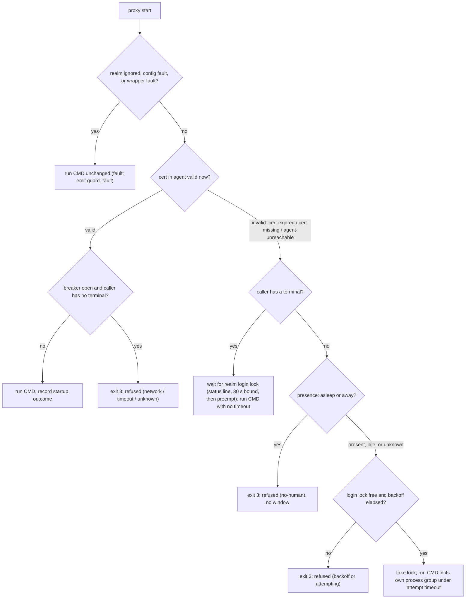

# pg-origin-guard: contract and plan (v4, after the v3 critique)

Target repo: `nix-agent-support` (absolute root `/Volumes/gitrepos/phillipg/nix-agent-support`), new package
`packages/pg-origin-guard` (Go, macOS). The first implementation task commits this document into the package
as `docs/contract.md` (no bead ids in it). Out of scope: migrating the handler probe and prefetch (Phase 2), a
periodic runner (planned in another session), a direct OS-presence fallback. `git-mu`, `git-branch-*` and
`pn workspace` MUST NOT use the tool, and plain `git` MUST keep working everywhere.

## 1. Purpose and shape

Stop unattended credential retries from opening browser windows and tell the operator when git auth to a realm
is unavailable. Two entry points share one config and one state:

- **`pg-origin-guard proxy`**: a wrapper around the ssh `ProxyCommand` of a realm. It decides whether a login
  window may open, runs the real proxy, and records startup outcomes (a passive Circuit Breaker; no active
  probe in Phase 1).
- **`Check` (library and `pg-origin-guard check`)**: a cheap read-only answer to "is auth available now", for
  pre-dispatch gating. It reads the local cert and the recorded state. It NEVER uses the network and NEVER
  starts a login.

Realm = one authentication domain (one cert). State is per realm because the wrapper sees host and user, not a
repo. **Known loss against the handler's current per-origin gate (INV-CCH-10):** per-origin state, per-origin
kill switch and recovery detection without traffic do not exist in Phase 1. Phase 1 changes nothing in the
handler; Phase 2 keeps the handler's active reachability probe and calls `Check` only for the cert-and-presence
part, and records the weakened per-origin kill switch in the behavior docs' realization-gap register.

## 2. Spike results (done)

| Spike         | Finding                                                                                                                                                                                                           | Effect                                                                                                                                                                                                                              |
| ------------- | ----------------------------------------------------------------------------------------------------------------------------------------------------------------------------------------------------------------- | ----------------------------------------------------------------------------------------------------------------------------------------------------------------------------------------------------------------------------------- |
| S1 cert       | The ZR user cert (`ecdsa-sha2-nistp256-cert-v01`, 12 h) is held in the launchd agent behind `SSH_AUTH_SOCK`; its validity window is readable without key material. `ssh-add` ignores an already-expired cert.     | One checker over the agent protocol (`golang.org/x/crypto/ssh/agent`). Tests move an injected clock past expiry. Unverified: that the pg-router daemon's environment resolves to the same socket (blocks Phase 2, not the wrapper). |
| S2 kill       | `Setpgid` plus group SIGTERM kills `git`, ssh and a grandchild holding a TCP port; SIGKILL to a gone group returns EPERM.                                                                                         | Group kill is sound for terminal-less callers; EPERM/ESRCH on follow-up means gone. Real `step oauth` `setsid` behaviour is a live-verify item.                                                                                     |
| S3 latency    | local agent read 10 to 40 ms; `ssh -T` 1.4 to 2.3 s; `git ls-remote` 2.4 to 3.2 s.                                                                                                                                | The local read is the fast check; no active probe in Phase 1.                                                                                                                                                                       |
| S4 test agent | A throwaway CA, key and `ssh-agent -a <tmp>.sock` work offline in a temp dir.                                                                                                                                     | Real OpenSSH agent in the integration tier.                                                                                                                                                                                         |
| S5 tty        | Through real `git` and `ssh`, a ProxyCommand child sees a terminal on stderr and an openable `/dev/tty` when git runs in a terminal; with pipes all are "no"; stdin and stdout are never terminals (ssh's pipes). | `caller-has-terminal` = stderr is a terminal OR `/dev/tty` opens.                                                                                                                                                                   |
| S6 presence   | OS presence signals exist (host-activity derives them); ancestry cannot separate a tool call from a tmux-dispatched session.                                                                                      | Presence comes from the presence file; caller identity beyond S5 is out of scope.                                                                                                                                                   |

## 3. The wrapper (contract)

Invocation (rendered by nix, realm explicit, one source of truth):
`ProxyCommand pg-origin-guard proxy --realm zr -- step ssh proxycommand %r %h %p --provisioner Dex`. The
`Match exec` block that selects ZR connections stays as is, and the same block MUST set `ControlMaster no` and
`ControlPath none` so every connection runs the wrapper (a shared master would skip it).



What the wrapper can and cannot observe (stated so nobody expects more): it sees the ProxyCommand child only. It
does not see ssh-level auth rejection after the relay starts, a mid-stream drop, or git's own errors. It can see
that the child failed to start, exited non-zero quickly, or ran. Hence outcomes are about STARTUP only.

Rules (RFC 2119):

- **W1** On every start the wrapper MUST run the local cert check first (a manual renewal is seen at once). It
  MUST NOT use the network or open a browser. Agent socket order: configured `agent_socket` (its owner MUST be
  the current user, else it is ignored), then `SSH_AUTH_SOCK`; neither usable is `agent-unreachable`; an agent
  holding no user certificate is `cert-missing`; one whose user certificates are all outside their validity
  window is `cert-expired`. Any user certificate valid now counts (no principal matching in v1).
- **W2** `caller-has-terminal` is true when the wrapper's stderr is a terminal OR `/dev/tty` opens. Such a
  caller is human-initiated: it MUST NOT be refused for presence, backoff or an open breaker.
- **W3** A caller without a terminal and with an invalid cert MUST be refused (exit 3) only when presence says
  `asleep` or `away`. `present`, `idle`, and a missing, stale (older than `max(60 s, 2 x the writer's
refreshSeconds)`), unparsable, symlinked, foreign-owned or group/world-writable presence file all mean
  "assume human".
- **W4** At most one login attempt per realm MAY be in flight. Terminal-less callers take a NON-blocking
  `flock` on `<state>/realms/<realm>.login.lock`. A terminal caller waits on it, MUST print a status line to
  stderr ("pg-origin-guard: waiting for a login already in progress, started Ns ago"), and after 30 s of
  waiting MUST preempt: it sends SIGTERM to the holder's process group (holder pid AND a process start-time
  token are persisted in the realm state and verified before signalling, so a reused pid is never signalled)
  and takes the lock. The holder persists `attempt_started_at`, pid and token; a `attempt_started_at` whose
  lock is free MUST be ignored (a crash cannot leave a stale "attempting").
- **W5** Terminal-less callers with an invalid cert: the child runs in its own process group and is bounded by
  `login.attempt_timeout` (default 3 min): SIGTERM to the group, SIGKILL after 2 s, EPERM/ESRCH meaning gone.
  A terminal caller's child MUST NOT get a separate process group and MUST NOT have a timeout (a real SSO
  sign-in can take long, and Ctrl-C reaches the whole foreground group natively). The wrapper MUST forward
  SIGINT, SIGTERM and SIGHUP to the child and its group when it has one. The child MUST end when the wrapper's
  stdin closes or the wrapper dies (test with a SIGKILLed wrapper).
- **W6** Data path: stdin and stdout go to CMD directly (inherited); the wrapper relays nothing. When stderr is
  NOT a terminal the wrapper captures the last 4 KiB of CMD's stderr (still writing it through) to classify a
  startup failure; when stderr IS a terminal it MUST be inherited unchanged and a non-zero exit is `unknown`.
- **W7** Startup outcome: the child still running `established_after` (default 1 s) after start is `ok`; exit 0
  is `ok`; a non-zero exit within `startup_window` (default 10 s) is a startup failure, classified from the
  captured stderr through the shared failure-signature table (`git-auth` to `auth-rejected`, `git-network` to
  `network`, timeout to `timeout`, otherwise `unknown`); a non-zero exit after `startup_window` is `ok` (it
  relayed). Outcomes are recorded at the `established_after` moment or at exit, whichever comes first.
- **W8** On `ok` with a valid cert the wrapper resets backoff and the breaker and emits `guard_available` when
  the realm was unavailable. A failed login attempt (invalid cert after the child ended) does `attempts++` and
  sets `next_attempt_at` from `login.backoff` (default `5m, 10m, 30m`, last repeats). A terminal caller bypasses
  backoff.
- **W9** Breaker (startup failures only): with a valid cert, `failure_threshold` (default 2) consecutive
  non-auth startup failures open the realm for `open_duration` (default 60 s); during it terminal-less callers
  are refused and one caller per window is let through as a trial; the first `ok` closes it.
- **W10** The wrapper MUST pass CMD's exit status through unchanged, except its own refusals (exit 3, with the
  stderr line `pg-origin-guard: refused (<reason>)`) and faults (it runs CMD unchanged and emits `guard_fault`).
  The refusal token MUST be added to the shared failure-signature table as its own signature, so the handler
  never classifies a refusal as a network failure.
- **W11** The wrapper MUST NOT read, print or log credential material. Failure text is redacted FIRST, then cut
  to its last 300 bytes on a UTF-8 boundary; redaction MUST cover a step login URL (query parameters such as
  `state`, `code_challenge`, one-time `code`) and the cert principal. Events carry the realm name, reason and
  timings only: never host, user, principal or stderr text.

## 4. Check, the library, and the CLI

```go
type Request struct{ Realm, Remote, RepoPath string } // one of them; RepoPath also does the mount check
type Result struct {
    Realm     string
    Available bool
    Reason    Reason
    Since     time.Time
    LastError string // redacted, <= 300 bytes
}
type Guard interface {
    Check(ctx context.Context, req Request) (Result, error) // error = tool fault only, never "unavailable"
}
```

`Check` = realm ignored? then the local cert check, then the recorded breaker state (`open` within
`open_duration`), then (when `RepoPath` is given) the `.git`-exists check (`mount-missing`). It never uses the
network and never logs in. A state-write failure MUST NOT change a verdict. Seams: one `cmdrun.Runner` (the
wrapped command), `Clock`, `StateStore`, `AgentDialer`, `PresenceSource`, `EventSink`, `IsTTY`.

CLI: `check (--realm R | --remote URL | --repo PATH) [--json]`; `status [--json]`; `ignore REALM` and
`unignore REALM` (marker file; unknown realm is a usage error); `proxy --realm R -- CMD ARGS...`. Exit codes:
`0` available; `3` unavailable or refused (reason in the output); `2` usage; `7` config; `1` internal
fault (no branchable meaning). These are the shared x/exitcode codes. A caller MUST treat only `0` as "go
ahead" and MUST NOT count `3` as a failure of its own work.

Decision (ssh ProxyCommand wrapper): `proxy` relays CMD's own exit status (W10), so a refusal exit `3`
collides with a wrapped command that itself exits `3`. The collision is accepted: the exit status alone cannot
distinguish them. From `proxy` exit `3` a caller can conclude only "either the guard refused or CMD exited 3";
it cannot conclude that CMD never ran. To tell them apart it MUST read stderr for the
`pg-origin-guard: refused (<reason>)` line (or use `check`, which never runs CMD). Exit `0` still means CMD ran
and succeeded. The guard's own usage, config and fault codes (`2`, `7`, `1`) collide with CMD's the same way.

Reasons (closed set): `ok`, `ignored`, `cert-expired`, `cert-missing`, `agent-unreachable`, `no-human`,
`backoff`, `attempting`, `auth-rejected`, `network`, `timeout`, `unknown`, `mount-missing`.

## 5. State, config and events

State: `${XDG_STATE_HOME:-~/.local/state}/pg-origin-guard/` (local disk only; directory 0700, files 0600),
one writer per file under its lock; atomic temp-file-plus-rename writes; a corrupt file is moved aside as
`<name>.corrupt` (overwriting any earlier one) and treated as no state.

```text
realms/<realm>.json         breaker + login state: consecutive_failures, class, since, open_until, attempts,
                            next_attempt_at, last_success_at, attempt_started_at, holder_pid, holder_token,
                            last_heartbeat_at, last_error
realms/<realm>.state.lock   short flock around load-modify-store
realms/<realm>.login.lock   flock held for the whole login attempt
realms/<realm>.ignore       marker file
events-YYYY-MM-DD.jsonl     UTC date; one O_APPEND write per event, closed after each
```

Backoff times are wall-clock; on read cap `next_attempt_at` at `now + max(backoff)`.

Config: `${XDG_CONFIG_HOME:-~/.config}/pg-origin-guard/config.toml`; the tool needs no nix, and nix/home-manager
renders the file for this machine.

```toml
[presence]
file    = "~/.local/state/host-activity/userpresence.json"   # default; = <stateDir>/host-activity/userpresence.json
max_age = "60s"

[breaker]
failure_threshold = 2
open_duration     = "60s"
startup_window    = "10s"
established_after = "1s"

[events]
retention_days     = 14
heartbeat_interval = "5m"

[realm.zr]
match = { host = "github.com", user = "org-*" }   # used only by `check --remote`
# agent_socket = "/path"
[realm.zr.login]
attempt_timeout = "3m"
backoff = ["5m", "10m", "30m"]
```

Events (Loki via the existing `phillipgreenii.observability.logSources` glob `events-*.jsonl`): `guard_state`
(realm, `available` 0 or 1, reason, whether it is a transition, and `login_attempt` outcome when one ended) is
written on every transition and as a heartbeat by `Check` and the wrapper whenever the last heartbeat is older
than `heartbeat_interval` while the realm is unavailable; `guard_fault` on a config or wrapper fault. Never one
event per check or per connection while available. The first write of a new day deletes `events-*.jsonl` older
than `retention_days`; a prune failure MUST NOT fail the write; no size cap.

Alert (Grafana, folder and conventions of `packages/pg-router/grafana/alerting/alerts.yaml`, severity critical,
`noDataState: OK`): `pg-origin-guard-auth-unavailable` fires when
`sum by (realm)(count_over_time({service_name="pg-origin-guard"} | json | available="0" [15m])) > 0 unless
sum by (realm)(count_over_time({service_name="pg-origin-guard"} | json | available="1" [15m])) > 0` holds for
10 minutes; this shape fits the existing Loki checker (`check-loki-rules.sh`). No awake gate (a sleeping host
runs nothing, so no heartbeats, so no data). Annotations are STATIC text describing the problem (git
authentication to a realm has been unavailable; the reason is in the event), with no remedy and no
templating. Known limit: with no caller at all (no wrapper run, no `Check`, no periodic runner) heartbeats stop
and the alert resolves after the 15 minute window; the handler's gate in Phase 2 and the periodic runner
planned elsewhere supply the callers. Not registered with `pg-router-probe` (no bead filing).

## 6. Presence

Source: `<stateDir>/host-activity/userpresence.json` from the host-activity presence-file work item. Only
`asleep` and `away` mean no human; `idle` counts as a human (operator ruling, this session); anything missing,
stale or unreadable is "assume human". The file MUST be a regular file (no symlink) owned by the current user
and not writable by group or others, else it is treated as unreadable. Residual risk, stated plainly: while the
daemon is down or the file is stale, a terminal-less caller with an invalid cert can open a window; the login
lock and backoff bound that to one attempt per backoff step.

## 7. Tests

Unit tier (fast, any order, no network, no real credentials, no real origin): W1 to W11 with a fake clock and
`cmdruntest.Fake` for the wrapped command; presence cases (asleep, away, present, idle, missing, stale,
unparsable, symlink, foreign owner, group-writable); an in-process agent from `golang.org/x/crypto/ssh/agent`
holding a real certificate with expiry driven by the injected clock; terminal detection through an `IsTTY`
seam; state races between goroutines on real `flock`; corrupt state; redaction (a fake step printing a login
URL with `state`, `code_challenge` and `code`; a credential split at the 300-byte boundary); exit-code
separation (3 versus 1); event pruning by date; heartbeat timing; the stale-"attempting" case.

Integration tier (build tag `integration`, its own nix check, never in the unit gate): the real OpenSSH
`ssh-agent` and `ssh-keygen` with a throwaway CA in a temp dir (no network); the real `proxy` binary under real
`git` and `ssh` driven through a pseudo-terminal (`github.com/creack/pty`) and through pipes, with a fake proxy
command: foreground Ctrl-C, a SIGKILLed wrapper, a child that writes to the terminal from its own group,
terminal waiter preempting a stuck holder, a terminal-less refusal under `asleep`; the real process-group kill
with a port-holding grandchild; multi-process races on the login lock. No test reaches the real ZR origin, the
real `step`, a browser, or the operator's agent.

Live tier (a post-deploy bead gated on the apply, not a test): confirm on this machine that the wrapper runs for
a real ZR `git fetch`, that a real `step oauth` login is cleaned up by the group kill, and (for Phase 2) that the
daemon environment sees the launchd agent socket. Mutation testing is not part of this work.

## 8. Decomposition (each is a bead; order is by dependency edges)

1. Extract the failure-signature table and redaction from `pg-router-handlers/internal` into a shared package
   both modules import, and add the refusal token signature (keeps the handler's "one table" rule).
2. Core library: config, state store, cert checker, presence reader, `Check`, events with heartbeat and
   pruning, unit tests (depends on 1 for redaction).
3. CLI and `proxy` wrapper, with the integration tier (depends on 2).
4. Nix package and module (config rendering, `logSources` entry), docs and tldr page (depends on 2 and 3).
5. Grafana rule, rule-tests, checker fixtures (depends on 4).
6. ZR ssh `ProxyCommand` switch in `nix-ziprecruiter` with `ControlMaster no` / `ControlPath none` and a gated
   live-verify bead (depends on 3, 4 and 1's refusal signature).
7. Phase 2 (separate, after this contract is accepted): handler dispatch gate keeps its reachability probe and
   adopts `Check`; prefetch, `pg-repo-runner` and `rc-branch.sh` adopt `check`.
