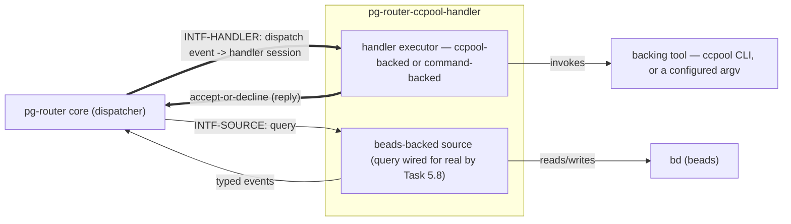

# pg-router-ccpool-handler — behavior docs

`pg-router-ccpool-handler` is `packages/pg-router`'s **downstream deployment set** for the
ccpool-backed and command-backed participant kinds: it is an **implementer** of
`INTF-HANDLER`/`INTF-SOURCE` as those interfaces are defined by pg-router's own behavior docs
(`phillipgreenii-nix-agent-support · packages/pg-router/docs/behavior`), the same way that set's own
README's `## Scope` names "concrete participant
implementations ... and any deployment-specific behavior" as content that "live[s] in a downstream
deployment set that implements these interfaces" and excludes from its own extent. This set follows
the behavior-docs method (`phillipgreenii-nix-agent-support · behavior-docs/docs/behavior`).

**The handler split.** `phillipgreenii-nix-agent-support` ADR 0065's Addendum of 2026-10-20 splits
this module's one binary into two **adapter** binaries, one per kind of runner, and each adapter
carries its own set, in the sub-directories `pg-router-handler-command` and `pg-router-handler-ccpool`
of this directory. This set remains the owner of every rule below **while the compat window lasts**,
because the earlier binary is what a role without its own `handler` still runs; the session adapter's
set cites these rules instead of restating them. When the window ends, the rules that belong to one
adapter move to that adapter's set in the same change that deletes the earlier binary, and this set
is removed.

Start here, then the [glossary](glossary.md); the rules are in [invariants](invariants.md), the
boundaries in [interfaces](interfaces.md), the actors in [actors](actors.md), and the stories,
journeys, and open questions in [journeys](journeys.md).

## The model

This module sits **on the participant side** of both interfaces the diagram crosses: pg-router's
core knows only the interface, and this module is one concrete implementer standing behind it —
`INTF-HANDLER`'s `ACTOR-HDL` and `INTF-SOURCE`'s `ACTOR-SRC`
(`packages/pg-router/docs/behavior/interfaces.md`). Nothing on the core side of that line is
restated here; this set cites it rather than duplicating it (`INV-18`-style inter-set
consistency).

## Scope (extent + floor)

- **Extent (in)** — realized by Task 5.2/5.3 (folded together, docket pg2-oju6w) onward: the ccpool-backed handler session lifecycle
  and the command-backed handler session lifecycle, both realizing `INTF-HANDLER`'s
  dispatch/accept-or-decline/deferred-ack contract; watchdog and budget policy that gate a handler
  session; prompt templating that shapes what a handler session is asked to do; the beads-backed
  event source realizing `INTF-SOURCE`'s query-reply contract. This is exactly the "concrete participant
  behavior" `phillipgreenii-nix-agent-support`
  ADR 0065's "New module" decision names as belonging here rather than in
  `packages/pg-router/docs/behavior`.
- **Extent (out)** — pg-router's own generic dispatch, queue, and wiring-validation behavior, which
  stays owned by `packages/pg-router/docs/behavior` and is cited here, never restated;
  deployment-specific configuration, credentials, and any organization-specific wiring, which live
  further downstream in whatever deployment set assembles pg-router and this module together for a
  real installation — mirroring `packages/pg-router/docs/behavior/README.md`'s own "Extent (out)"
  pattern, applied one layer down.
- **Floor** — this set speaks in handler sessions, dispatch, accept/decline, deferred acks,
  self-status, and source queries/events — never in package names, executor source paths, ccpool
  CLI flags, or deployment secrets.

## Realization gaps

This set's realization-gap register (`INV-23`): intended behavior this set's implementation has
not built yet, one row per gap, keyed by the element id the gap is against. Not an open
question — the intent below is settled and the build has not caught up (`INV-15`).

| Element        | Intended                                                                                                                                                                                                                                                                                                                                           | Where the implementation stands                                                                                                                                                                                                                                                                                                                                                                                                                                                                                                                                                                                                                                                                                                                                                                                                                                                                                                                   | Tracked by                              |
| -------------- | -------------------------------------------------------------------------------------------------------------------------------------------------------------------------------------------------------------------------------------------------------------------------------------------------------------------------------------------------- | ------------------------------------------------------------------------------------------------------------------------------------------------------------------------------------------------------------------------------------------------------------------------------------------------------------------------------------------------------------------------------------------------------------------------------------------------------------------------------------------------------------------------------------------------------------------------------------------------------------------------------------------------------------------------------------------------------------------------------------------------------------------------------------------------------------------------------------------------------------------------------------------------------------------------------------------------- | --------------------------------------- |
| `INTF-HANDLER` | this module realizes `INTF-HANDLER` for the ccpool-backed and command-backed handler kinds                                                                                                                                                                                                                                                         | realized: `cmd/pg-router-ccpool-handler`'s `dispatch` subcommand runs the moved ccpool/command executor logic and replies inline; a truly long-running ccpool session correctly holding the call open for its duration (rather than a daemonized deferred reply) is left as-is                                                                                                                                                                                                                                                                                                                                                                                                                                                                                                                                                                                                                                                                    | `pg2-oju6w.4`                           |
| `INV-CCH-2`    | a handler session MUST support the deferred-ack reply form (its duplicate-tolerance half is realized: only the same event's turn in progress is absorbed, `INV-CCH-30`)                                                                                                                                                                            | not yet: `dispatch` replies INLINE for every dispatch today (`cmd/pg-router-ccpool-handler/dispatch.go`'s own doc comment) — the `deferred` branch `handler.dispatch-reply.schema.json` declares is never taken. Same underlying residual `INTF-HANDLER`'s row above already names (a long-running ccpool session correctly holds the call open rather than a daemonized deferred reply), traced here against its own element id too                                                                                                                                                                                                                                                                                                                                                                                                                                                                                                              | `pg2-oju6w.4`                           |
| `INV-CCH-9`    | every recorded session or pre-launch-check failure carries one closed-set failure signature and redacted, bounded evidence                                                                                                                                                                                                                         | realized: the shared classifier and redaction exist (`internal/failsig`, whose tests cover each rule, each redaction pattern, and redaction before truncation), and the pre-launch origin probe (`internal/originprobe`, `INV-CCH-10`) calls it for every failed probe. The `dispatch_result` event of a failed or hard-stopped session calls it too (`internal/executor/failure_signature.go`; tests cover the oauth fixture, empty or unreadable transcript, truncated first line, success text on an errored session, redaction, capture before teardown, non-empty evidence for an errored-before-complete session, and each API-error and session-exit shape), so this invariant is realized EXCEPT the `wrap-failed` signature (`INV-CCH-9`, "Wrap-failed"): the closed set has no such member, nothing writes a ready marker, and no error carries the wrap-failed sentinel, so a wrap failure is classified from its text or as `unknown` | `pg2-8rgnl`, `pg2-4gi2c`, `pg2-12gr4.8` |
| `INV-CCH-22`   | the `review` precheck's pending-review read is served from the daemon-backed backend's pending group, and an `unavailable` answer is a retryable connector failure that fails open                                                                                                                                                                 | no daemon-backed backend exists yet, so the read is still answered by the per-call backend and no `unavailable` answer is produced                                                                                                                                                                                                                                                                                                                                                                                                                                                                                                                                                                                                                                                                                                                                                                                                                | `pg2-z5fax` (later phases)              |
| `INV-CCH-28`   | a `wrap-failed` end is exempt from the unclaimed-end strike policy as the limit and outage class is: no strike label, no `human`, an existing strike left as it was (the "Wrap-failure exemption")                                                                                                                                                 | not built: the policy has no `wrap-failed` class, so a wrap failure of a drain session is struck like any unexplained end and can park a bead as `human` for a configuration fault                                                                                                                                                                                                                                                                                                                                                                                                                                                                                                                                                                                                                                                                                                                                                                | `pg2-12gr4.8`                           |
| `INV-CCH-6`    | a command-backed role's exit `9` is the busy decline only when the run's ready marker exists; without it the exit is a wrap failure                                                                                                                                                                                                                | not built: the exit `9` mapping is unconditional, because no marker exists                                                                                                                                                                                                                                                                                                                                                                                                                                                                                                                                                                                                                                                                                                                                                                                                                                                                        | `pg2-12gr4.8`                           |
| `INV-CCH-32`   | the handler sets `PG_WRAP_ROLE`, `PG_WRAP_ITEM_ID`, `PG_WRAP_ITEM_TYPE` and `PG_WRAP_READY_MARKER` (never the title), applies the explicit-name keep-list behind a per-role `strictBaseEnv` switch, carries `wrap` and `strictBaseEnv` in the per-role JSON, rejects a templated wrap entry for a ccpool-backed role, and cancels by process group | not built: the command-backed executor sets no environment, the per-role JSON has neither `wrap` nor `strictBaseEnv`, no base environment is applied, and a cancel reaches only the direct child                                                                                                                                                                                                                                                                                                                                                                                                                                                                                                                                                                                                                                                                                                                                                  | `pg2-12gr4.8`                           |
| `INV-CCH-33`   | every dispatch ends its chain with the handler's own ready-marker stage; a non-zero end or death without the marker is a wrap failure; every launch and resume re-sends the marker path and item context; an unset marker variable fails loudly                                                                                                    | not built: no marker stage, path or variable exists, a resume passes no per-dispatch environment, and no end is told apart as a wrap failure                                                                                                                                                                                                                                                                                                                                                                                                                                                                                                                                                                                                                                                                                                                                                                                                      | `pg2-12gr4.8`                           |
| `INV-CCH-34`   | a `wrap-failed` end pauses its one role through a handler-side gate (state file, `wrap-gated` busy decline, cleared by a changed configuration hash or `wrap-gate clear <role>`, listed by `wrap-gate list`, not cleared by `run-role`)                                                                                                            | not built: there is no role gate, no state file and no `wrap-gate` subcommand; a role with a broken wrap re-dispatches every item without limit                                                                                                                                                                                                                                                                                                                                                                                                                                                                                                                                                                                                                                                                                                                                                                                                   | `pg2-12gr4.8`                           |
| `INV-CCH-35`   | one `dispatch_start` event-log record per started payload names the wrap entries, the base-environment variable names and the launcher path, never a value                                                                                                                                                                                         | not built: no `dispatch_start` kind exists in the event log                                                                                                                                                                                                                                                                                                                                                                                                                                                                                                                                                                                                                                                                                                                                                                                                                                                                                       | `pg2-12gr4.8`                           |
| `INV-CCH-36`   | a ccpool-backed pool's agent executable is a rendered launcher (keep-list reset, wrap layers, marker stage, per-stage stderr files, then the agent); a resume runs the currently applied launcher; roles sharing a pool declare identical wraps                                                                                                    | not built: the pool's agent executable is the agent itself, no launcher is rendered, and nothing asserts identical wraps for roles on a shared pool                                                                                                                                                                                                                                                                                                                                                                                                                                                                                                                                                                                                                                                                                                                                                                                               | `pg2-12gr4.8`                           |

## External references

This set follows the behavior-docs method and cites elements the method and pg-router's own set
define, so a cross-set reference resolves by the owner's stable UUID, not the mutable name.

| Name             | What it is                                                                                                                                                  | Owner set-path                                                         | Owner UUID                                                                                                                                           |
| ---------------- | ----------------------------------------------------------------------------------------------------------------------------------------------------------- | ---------------------------------------------------------------------- | ---------------------------------------------------------------------------------------------------------------------------------------------------- |
| `INTF-SOURCE`    | typed events into the core, over the one opaque source contract                                                                                             | `phillipgreenii-nix-agent-support · packages/pg-router/docs/behavior`  | [fe42416a-5f10-4db1-b8c3-46b1609213c7](https://github.com/phillipgreenii/nix-agent-support/blob/main/packages/pg-router/docs/behavior/interfaces.md) |
| `INTF-HANDLER`   | dispatch to a handler and its accept-or-decline/deferred-ack reply                                                                                          | `phillipgreenii-nix-agent-support · packages/pg-router/docs/behavior`  | [10939663-7a48-4d44-8c4a-9a2df8ae4654](https://github.com/phillipgreenii/nix-agent-support/blob/main/packages/pg-router/docs/behavior/interfaces.md) |
| `INV-23`         | the realization-gap register is set-level, named `## Realization gaps`, never an element                                                                    | `phillipgreenii-nix-agent-support · behavior-docs/docs/behavior`       | [f3bba3e7-440f-4109-a4de-9d37daa34bcf](https://github.com/phillipgreenii/nix-agent-support/blob/main/behavior-docs/docs/behavior/invariants.md)      |
| `INV-15`         | the behavior docs set is the source of truth; a realization gap is normal, not a defect                                                                     | `phillipgreenii-nix-agent-support · behavior-docs/docs/behavior`       | [375b542f-2a9f-4cfd-a77e-7aed45a416d5](https://github.com/phillipgreenii/nix-agent-support/blob/main/behavior-docs/docs/behavior/invariants.md)      |
| `INV-18`         | inter-consistency at every interface, reconciled by the counterparty's kind                                                                                 | `phillipgreenii-nix-agent-support · behavior-docs/docs/behavior`       | [4c6a764b-02f5-4c85-afae-a082fe6c21cd](https://github.com/phillipgreenii/nix-agent-support/blob/main/behavior-docs/docs/behavior/invariants.md)      |
| `INV-22`         | traceability is a per-element listing obligation, not a coverage section                                                                                    | `phillipgreenii-nix-agent-support · behavior-docs/docs/behavior`       | [b2502527-1340-4a1f-858c-aaa80c601317](https://github.com/phillipgreenii/nix-agent-support/blob/main/behavior-docs/docs/behavior/invariants.md)      |
| `ACTOR-HDL`      | event handler — responds to bound events as handler sessions, replying with its outcome                                                                     | `phillipgreenii-nix-agent-support · packages/pg-router/docs/behavior`  | [a5997046-d20a-445d-bf10-328855b03810](https://github.com/phillipgreenii/nix-agent-support/blob/main/packages/pg-router/docs/behavior/actors.md)     |
| `ACTOR-SRC`      | event source — emits typed events (pull or push)                                                                                                            | `phillipgreenii-nix-agent-support · packages/pg-router/docs/behavior`  | [39e28ce5-ef60-47bb-8aa7-2d93d267447f](https://github.com/phillipgreenii/nix-agent-support/blob/main/packages/pg-router/docs/behavior/actors.md)     |
| `INTF-CLI`       | operator commands (and the manager callbacks)                                                                                                               | `phillipgreenii-nix-agent-support · packages/pg-router/docs/behavior`  | [746dd5a6-34c4-4294-b727-e442c2afa723](https://github.com/phillipgreenii/nix-agent-support/blob/main/packages/pg-router/docs/behavior/interfaces.md) |
| `GOAL-MIN-1`     | keep the core minimal: anything source/handler/monitor/deployment-specific lives behind an interface, never in the core                                     | `phillipgreenii-nix-agent-support · packages/pg-router/docs/behavior`  | [e0be6f1c-8eb9-4d7e-9900-bc14e7a38d4a](https://github.com/phillipgreenii/nix-agent-support/blob/main/packages/pg-router/docs/behavior/invariants.md) |
| `INV-CONC-1`     | capacity is handler-enforced and declared nowhere, never a core-tracked number                                                                              | `phillipgreenii-nix-agent-support · packages/pg-router/docs/behavior`  | [20c84e0f-8ffb-428c-9acc-dcaabb4fdf1b](https://github.com/phillipgreenii/nix-agent-support/blob/main/packages/pg-router/docs/behavior/invariants.md) |
| `INV-FAIL-1`     | failure classes split at the acceptance boundary: a pre-accept decline is the core's to re-offer, and every decline reason re-offers at the one cadence     | `phillipgreenii-nix-agent-support · packages/pg-router/docs/behavior`  | [2da0d587-f116-42e6-b986-8abf80ed023c](https://github.com/phillipgreenii/nix-agent-support/blob/main/packages/pg-router/docs/behavior/invariants.md) |
| `INV-EVT-2`      | a handler MUST tolerate a duplicate event (be idempotent)                                                                                                   | `phillipgreenii-nix-agent-support · packages/pg-router/docs/behavior`  | [06649d39-2734-409a-8098-f3c2cef44cbe](https://github.com/phillipgreenii/nix-agent-support/blob/main/packages/pg-router/docs/behavior/invariants.md) |
| `INV-EVT-3`      | the core de-duplicates by event `id` across the retained id set                                                                                             | `phillipgreenii-nix-agent-support · packages/pg-router/docs/behavior`  | [d54ad229-ed48-4862-aa27-bc2181b4d6c4](https://github.com/phillipgreenii/nix-agent-support/blob/main/packages/pg-router/docs/behavior/invariants.md) |
| `INV-EVT-4`      | retry is bounded by the event's expiry, evaluated at attempt time: an attempt made after it expired is that handler's last                                  | `phillipgreenii-nix-agent-support · packages/pg-router/docs/behavior`  | [840afb74-2159-447f-985b-33b27dfc35da](https://github.com/phillipgreenii/nix-agent-support/blob/main/packages/pg-router/docs/behavior/invariants.md) |
| `INV-INTF-2`     | every interface is accompanied by a conformance suite an implementer verifies against before the core is trusted to route through it                        | `phillipgreenii-nix-agent-support · packages/pg-router/docs/behavior`  | [26f9be4d-8481-4a44-9f1a-d79a92c0016a](https://github.com/phillipgreenii/nix-agent-support/blob/main/packages/pg-router/docs/behavior/invariants.md) |
| `INV-LIFE-2`     | a gate prevents the core from routing to the participants that block on it                                                                                  | `phillipgreenii-nix-agent-support · packages/pg-router/docs/behavior`  | [376c7af0-95a7-4b24-a0c2-466031352d65](https://github.com/phillipgreenii/nix-agent-support/blob/main/packages/pg-router/docs/behavior/invariants.md) |
| `INV-POOL-4`     | a pool MUST NOT accept work while the account's usage window is at its limit                                                                                | `phillipgreenii-nix-agent-support · packages/ccpool/docs/behavior`     | [627882d5-f2ad-4be6-97be-f24e6963f0c1](https://github.com/phillipgreenii/nix-agent-support/blob/main/packages/ccpool/docs/behavior/invariants.md)    |
| `INV-ROLE-4`     | a payload starts from a minimal base environment that only its wrap expands                                                                                 | `phillipgreenii-nix-agent-support · packages/pg-router/docs/behavior`  | [de6d321d-9322-46ff-abd9-36b4024d9b52](https://github.com/phillipgreenii/nix-agent-support/blob/main/packages/pg-router/docs/behavior/invariants.md) |
| `INV-ENV-1`      | wrap entries are string or array form and compose one layer per entry                                                                                       | `phillipgreenii-nix-agent-support · packages/pg-router/docs/behavior`  | [47e93315-907d-4169-9c6e-9dc779e5da26](https://github.com/phillipgreenii/nix-agent-support/blob/main/packages/pg-router/docs/behavior/invariants.md) |
| `INV-ENV-2`      | the base environment is a documented list that only a wrap expands, behind a strict-env switch                                                              | `phillipgreenii-nix-agent-support · packages/pg-router/docs/behavior`  | [6e2d52e6-b43b-4894-84a4-8e5538d24b47](https://github.com/phillipgreenii/nix-agent-support/blob/main/packages/pg-router/docs/behavior/invariants.md) |
| `INV-ENV-3`      | the wrapper contract, nine rules every wrap entry and chain-starting participant obeys                                                                      | `phillipgreenii-nix-agent-support · packages/pg-router/docs/behavior`  | [932ae0f1-b0d4-466f-9971-2fb73a47d74d](https://github.com/phillipgreenii/nix-agent-support/blob/main/packages/pg-router/docs/behavior/invariants.md) |
| `INV-ENV-5`      | a wrap failure is told from a payload failure by the ready marker, reported with the wrap-failed sentinel, and is never a gate                              | `phillipgreenii-nix-agent-support · packages/pg-router/docs/behavior`  | [56c3fe86-ca47-43d8-b659-394c9663c751](https://github.com/phillipgreenii/nix-agent-support/blob/main/packages/pg-router/docs/behavior/invariants.md) |
| `INV-WORKFLOW-1` | the wiring (a routing graph) ties sources → event types → handlers; the core validates it but is a flat edge-router, never a workflow engine                | `phillipgreenii-nix-agent-support · packages/pg-router/docs/behavior`  | [66dfe98d-a564-4414-a3db-77b518d27f31](https://github.com/phillipgreenii/nix-agent-support/blob/main/packages/pg-router/docs/behavior/invariants.md) |
| `INV-FRESH-1`    | don't act on stale truth — a readiness signal derived from data past its bound MUST NOT be presented as current                                             | `your-private-flake · modules/zm/pg-router/docs/behavior`              | [ceac8879-4bfd-45c7-94ed-9d8c3bd11c38](https://github.com/your-org/your-private-flake/blob/main/modules/zm/pg-router/docs/behavior/invariants.md)    |
| `DEC-WIRE-1`     | the default transport is a CLI invocation carrying JSON, with coarse exit codes                                                                             | `phillipgreenii-nix-agent-support · packages/pg-router/docs/decisions` | [6450eed7-228f-4a99-bfd9-6705a6c552ee](https://github.com/phillipgreenii/nix-agent-support/blob/main/packages/pg-router/docs/decisions/wire.md)      |
| `DEC-WIRE-2`     | the core is reached over a socket, and a callback command arrives with its address and token already baked in                                               | `phillipgreenii-nix-agent-support · packages/pg-router/docs/decisions` | [70fea0a8-45f7-45cb-9f4a-915e27765663](https://github.com/phillipgreenii/nix-agent-support/blob/main/packages/pg-router/docs/decisions/wire.md)      |
| `DEC-EVENT-5`    | an adopting handler reports the dispatch's original start in its reply's optional `startedAt`, so a restart neither lengthens the wait nor shortens the run | `phillipgreenii-nix-agent-support · packages/pg-router/docs/decisions` | [7c3e9a14-5d82-4b6f-9e07-d1a8f4c26b35](https://github.com/phillipgreenii/nix-agent-support/blob/main/packages/pg-router/docs/decisions/event.md)     |
