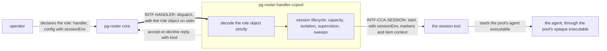

# pg-router-handler-ccpool — behavior docs

`pg-router-handler-ccpool` is one of two **adapter** participants that run pg-router roles. A role
that names it as its `handler` runs one agent **session** per dispatched event, through the session
tool, and keeps supervising that session even when the core restarts. This set follows the
behavior-docs method (`phillipgreenii-nix-agent-support · behavior-docs/docs/behavior`) and is the
**implementer** side of `INTF-HANDLER` for that one kind of runner, as pg-router's own set defines the
interface (`phillipgreenii-nix-agent-support · packages/pg-router/docs/behavior`). Every adapter
carries its own set (`phillipgreenii-nix-agent-support` ADR 0065's Addendum of 2026-10-20, "the
handler split"); the other is the command adapter's set
(`phillipgreenii-nix-agent-support · packages/pg-router-ccpool-handler/docs/behavior/pg-router-handler-command`).

Start here, then the [glossary](glossary.md); the rules are in [invariants](invariants.md), the
boundaries in [interfaces](interfaces.md), the actors in [actors](actors.md), and the stories and use
cases in [journeys](journeys.md).

## The model

The adapter is an **Adapter** between the core's handler contract and the session tool. The role's
`sessionEnv` passes through it to the session uninterpreted, so the adapter and the session tool need
no concept of any prefix tool the operator puts in front of the agent: such a tool is external and
owns its own configuration.

## Scope (extent + floor)

This section makes the set's scope explicit (`INV-13`); its actors are in [actors](actors.md) and its
interfaces in [interfaces](interfaces.md).

- **Extent (in)** — how this adapter reads its role's own configuration; how a role's `sessionEnv`,
  the markers and the item context reach the agent at every start of a session; how a failure before
  the session is ready is declined, and how each decline is classified and recorded; how every send
  first checks that the session is live; how `validate` checks the role; and what holds across the
  move of a role from the earlier combined handler to this adapter.
- **Extent (out)** — a session's own lifecycle (capacity, isolation, the supervision lease, orphan
  sweeps, failure signatures, the budget watchdog, completion policy), which the earlier combined
  handler's set states and this set **cites** (`INV-CCA-1`); the session tool's own behavior; pg-router's
  dispatch, queue and wiring; and any prefix tool an operator puts in front of the agent, which is an
  external tool with its own configuration.
- **Floor** — this set speaks in roles, sessions, pools, environment variables, declines and the
  cutover. It names no source path and no command-line flag, and it carries no credential concern.

## Realization gaps

This set's **realization-gap register** (`INV-23`): intended behavior this set's implementation has
not built yet, one row per gap, each keyed by the element id the gap is against. The intent is
settled and the build has not caught up (`INV-15`), so none of these is an open question.

| Element      | Intended                                                                                                                                          | Where the implementation stands                                                                                                                                                             | Tracked by    |
| ------------ | ------------------------------------------------------------------------------------------------------------------------------------------------- | ------------------------------------------------------------------------------------------------------------------------------------------------------------------------------------------- | ------------- |
| `INV-CCA-1`  | the adapter is its own full participant, run for each role that names it as `handler`                                                             | the session runner is one of two executors inside the earlier combined handler, chosen by a role `type`; no separate adapter binary exists yet. Its lifecycle rules live in the earlier set | `pg2-12gr4.6` |
| `INV-CCA-2`  | the adapter reads its settings from the role object, strictly, and ships a build-time check                                                       | the settings are read from the earlier per-role file, an unknown field is ignored, and no build-time check exists                                                                           | `pg2-12gr4.6` |
| `INV-CCA-3`  | a role's survival is the role's own TOML key, asserted for every role of this adapter                                                             | the core reads a per-role JSON flag the deployment renders, and nothing asserts that every session-backed role has it                                                                       | `pg2-12gr4.6` |
| `INV-CCA-4`  | a role's `sessionEnv` reaches the session through the session tool uninterpreted, and a colliding, empty or `=`-bearing key is a load error       | no `sessionEnv` exists, so nothing is passed through and nothing rejects a key                                                                                                              | `pg2-12gr4.8` |
| `INV-CCA-5`  | every start passes `sessionEnv`, the markers and the item context (`PG_ROUTER_ROLE`, `PG_ROUTER_ITEM_ID`, `PG_ROUTER_ITEM_TYPE`), never the title | no item context exists, and a start passes only what it passes today                                                                                                                        | `pg2-12gr4.8` |
| `INV-CCA-6`  | a failure before the session is ready is a `launch-failed` decline of kind `fault` that writes no bead, and each reason maps to a kind            | a failed launch stamps the bead and the second escalates it to `human`, and a decline carries only its reason                                                                               | `pg2-12gr4.8` |
| `INV-CCA-7`  | every send first checks that the session is live, so a send never resumes a session                                                               | the watchdog's reminder and wrap-up and the nudge send without the check, and a cold resume drops the markers                                                                               | `pg2-12gr4.8` |
| `INV-CCA-8`  | `validate` checks the role's configuration strictly, the `sessionEnv` keys and the pool directories, and runs nothing                             | the adapter has no `validate` subcommand                                                                                                                                                    | `pg2-12gr4.8` |
| `INV-CCA-10` | `dispatch_start` and `dispatch_decline` records say what each dispatch ran and why each declined                                                  | neither record kind exists                                                                                                                                                                  | `pg2-12gr4.8` |
| `INV-CCA-9`  | a session the earlier handler started is adopted at a cutover, and the alert contract is preserved                                                | the adoption exists for a redelivery to the same handler; a cutover between two binaries is untested                                                                                        | `pg2-12gr4.6` |

## External references

This set follows the behavior-docs method and cites elements pg-router's set, pg-router's decision
docs, the session tool's set and the earlier combined handler's set define, so a cross-set reference
resolves by the owner's stable UUID, not by a name that can change.

| Name           | What it is                                                                                                                                                | Owner set-path                                                                       | Owner UUID                                                                                                                                                          |
| -------------- | --------------------------------------------------------------------------------------------------------------------------------------------------------- | ------------------------------------------------------------------------------------ | ------------------------------------------------------------------------------------------------------------------------------------------------------------------- |
| `INV-13`       | a set MUST make its scope explicit and define all its actors and interfaces                                                                               | `phillipgreenii-nix-agent-support · behavior-docs/docs/behavior`                     | [94285c70-da89-4402-8ae2-af27925008bd](https://github.com/phillipgreenii/nix-agent-support/blob/main/behavior-docs/docs/behavior/invariants.md)                     |
| `INV-15`       | the behavior docs set is the source of truth; a realization gap is normal, not a defect                                                                   | `phillipgreenii-nix-agent-support · behavior-docs/docs/behavior`                     | [375b542f-2a9f-4cfd-a77e-7aed45a416d5](https://github.com/phillipgreenii/nix-agent-support/blob/main/behavior-docs/docs/behavior/invariants.md)                     |
| `INV-20`       | a borrowed term at a reference seam MUST be inherited or renamed, never silently redefined                                                                | `phillipgreenii-nix-agent-support · behavior-docs/docs/behavior`                     | [bafdd784-81ed-46fe-88f0-1a8c5fc4caf0](https://github.com/phillipgreenii/nix-agent-support/blob/main/behavior-docs/docs/behavior/invariants.md)                     |
| `INV-22`       | traceability is a listing obligation on every story, use case and journey, not a coverage section                                                         | `phillipgreenii-nix-agent-support · behavior-docs/docs/behavior`                     | [b2502527-1340-4a1f-858c-aaa80c601317](https://github.com/phillipgreenii/nix-agent-support/blob/main/behavior-docs/docs/behavior/invariants.md)                     |
| `INV-23`       | the realization-gap register is set-level, named `## Realization gaps`, and never an element                                                              | `phillipgreenii-nix-agent-support · behavior-docs/docs/behavior`                     | [f3bba3e7-440f-4109-a4de-9d37daa34bcf](https://github.com/phillipgreenii/nix-agent-support/blob/main/behavior-docs/docs/behavior/invariants.md)                     |
| `INTF-HANDLER` | dispatch to a handler and its accept-or-decline or deferred-ack reply                                                                                     | `phillipgreenii-nix-agent-support · packages/pg-router/docs/behavior`                | [10939663-7a48-4d44-8c4a-9a2df8ae4654](https://github.com/phillipgreenii/nix-agent-support/blob/main/packages/pg-router/docs/behavior/interfaces.md)                |
| `INV-ROLE-2`   | the core carries a role's own configuration, as the role object in every request's payload, and never reads it                                            | `phillipgreenii-nix-agent-support · packages/pg-router/docs/behavior`                | [68e781f9-ca4a-4713-9ba2-e2839a9d6e6a](https://github.com/phillipgreenii/nix-agent-support/blob/main/packages/pg-router/docs/behavior/invariants.md)                |
| `INV-ROLE-3`   | surviving the core's shutdown is a generic property a role declares in the core's own configuration                                                       | `phillipgreenii-nix-agent-support · packages/pg-router/docs/behavior`                | [e7fb732e-a4c4-4bd7-a9ad-172d451e48ea](https://github.com/phillipgreenii/nix-agent-support/blob/main/packages/pg-router/docs/behavior/invariants.md)                |
| `INV-ROLE-4`   | a role, and a query, is a command plus the minimal base environment and the item context, and the core declares nothing else about how the command is run | `phillipgreenii-nix-agent-support · packages/pg-router/docs/behavior`                | [de6d321d-9322-46ff-abd9-36b4024d9b52](https://github.com/phillipgreenii/nix-agent-support/blob/main/packages/pg-router/docs/behavior/invariants.md)                |
| `INV-ROLE-5`   | a role whose validation fails stays registered and is unavailable                                                                                         | `phillipgreenii-nix-agent-support · packages/pg-router/docs/behavior`                | [3c8e5f2a-91b4-4d07-b6a3-5e12f0c7d894](https://github.com/phillipgreenii/nix-agent-support/blob/main/packages/pg-router/docs/behavior/invariants.md)                |
| `INV-OBS-3`    | per-role progress is observable, so a stalled role differs from a busy or an idle one                                                                     | `phillipgreenii-nix-agent-support · packages/pg-router/docs/behavior`                | [a7d41e96-2b58-4c3f-8e01-9f6b3d25c7a0](https://github.com/phillipgreenii/nix-agent-support/blob/main/packages/pg-router/docs/behavior/invariants.md)                |
| `DEC-WIRE-1`   | the default transport is a CLI invocation carrying JSON, with coarse exit codes                                                                           | `phillipgreenii-nix-agent-support · packages/pg-router/docs/decisions`               | [6450eed7-228f-4a99-bfd9-6705a6c552ee](https://github.com/phillipgreenii/nix-agent-support/blob/main/packages/pg-router/docs/decisions/wire.md)                     |
| `DEC-WIRE-3`   | lifecycle hooks, and the role object that rides in every request                                                                                          | `phillipgreenii-nix-agent-support · packages/pg-router/docs/decisions`               | [8a1f2c4d-6e0b-4a5e-9d3c-2b7f1e9a4c60](https://github.com/phillipgreenii/nix-agent-support/blob/main/packages/pg-router/docs/decisions/wire.md)                     |
| `INV-POOL-6`   | the agent executable a pool launches is opaque to ccpool                                                                                                  | `phillipgreenii-nix-agent-support · packages/ccpool/docs/behavior`                   | [3d499bd3-7e63-4c2c-a526-25bf37ce83cc](https://github.com/phillipgreenii/nix-agent-support/blob/main/packages/ccpool/docs/behavior/invariants.md)                   |
| `INV-CCH-2`    | a handler session tolerates a duplicate event and supports the deferred-ack form                                                                          | `phillipgreenii-nix-agent-support · packages/pg-router-ccpool-handler/docs/behavior` | [af2237aa-da29-47c2-922e-95a3c7cea2c9](https://github.com/phillipgreenii/nix-agent-support/blob/main/packages/pg-router-ccpool-handler/docs/behavior/invariants.md) |
| `INV-CCH-6`    | a handler queries pool capacity before preparing isolation or launching                                                                                   | `phillipgreenii-nix-agent-support · packages/pg-router-ccpool-handler/docs/behavior` | [e610349b-f6eb-4273-a87a-952bf2821108](https://github.com/phillipgreenii/nix-agent-support/blob/main/packages/pg-router-ccpool-handler/docs/behavior/invariants.md) |
| `INV-CCH-9`    | every recorded session or pre-launch failure carries one closed-set failure signature and redacted, bounded evidence                                      | `phillipgreenii-nix-agent-support · packages/pg-router-ccpool-handler/docs/behavior` | [07323b67-c77c-417c-8f24-684ca5eabaa9](https://github.com/phillipgreenii/nix-agent-support/blob/main/packages/pg-router-ccpool-handler/docs/behavior/invariants.md) |
| `INV-CCH-10`   | a dispatch is declined while its git origin is unavailable                                                                                                | `phillipgreenii-nix-agent-support · packages/pg-router-ccpool-handler/docs/behavior` | [b9cc174c-4c9f-43e0-bc9a-8d36fadbd36e](https://github.com/phillipgreenii/nix-agent-support/blob/main/packages/pg-router-ccpool-handler/docs/behavior/invariants.md) |
| `INV-CCH-14`   | the shutdown sweep spares every actively working session                                                                                                  | `phillipgreenii-nix-agent-support · packages/pg-router-ccpool-handler/docs/behavior` | [9f2a7d86-926a-41ac-8c26-851e459c40b0](https://github.com/phillipgreenii/nix-agent-support/blob/main/packages/pg-router-ccpool-handler/docs/behavior/invariants.md) |
| `INV-CCH-17`   | a settled, quiet session is closed when its dispatch reaches a terminal outcome                                                                           | `phillipgreenii-nix-agent-support · packages/pg-router-ccpool-handler/docs/behavior` | [63bd1585-4262-45c5-b8fe-46f1ffa22d7d](https://github.com/phillipgreenii/nix-agent-support/blob/main/packages/pg-router-ccpool-handler/docs/behavior/invariants.md) |
| `INV-CCH-18`   | a launched session never stays unsupervised: a supervision lease and an orphan reconcile                                                                  | `phillipgreenii-nix-agent-support · packages/pg-router-ccpool-handler/docs/behavior` | [ac18ca7c-745d-476c-b9a0-f568e673fda6](https://github.com/phillipgreenii/nix-agent-support/blob/main/packages/pg-router-ccpool-handler/docs/behavior/invariants.md) |
| `INV-CCH-22`   | a role with a pre-launch precheck declines a dispatch it has proven moot, with a skipped-\* reason                                                        | `phillipgreenii-nix-agent-support · packages/pg-router-ccpool-handler/docs/behavior` | [347d82ef-4149-4a35-945b-754ba35a8e6a](https://github.com/phillipgreenii/nix-agent-support/blob/main/packages/pg-router-ccpool-handler/docs/behavior/invariants.md) |
| `INV-CCH-28`   | a session that ends unclaimed on a usage limit or an API outage earns no strike                                                                           | `phillipgreenii-nix-agent-support · packages/pg-router-ccpool-handler/docs/behavior` | [dea93749-b558-4331-9b46-5ac4c4d399ae](https://github.com/phillipgreenii/nix-agent-support/blob/main/packages/pg-router-ccpool-handler/docs/behavior/invariants.md) |
| `INV-CCH-30`   | every dispatch runs in a fresh session, and one whose bead and role already have one in flight is declined as session-in-flight                           | `phillipgreenii-nix-agent-support · packages/pg-router-ccpool-handler/docs/behavior` | [7c2e9f4a-31d8-4b6e-9a05-d2f8e61c4b73](https://github.com/phillipgreenii/nix-agent-support/blob/main/packages/pg-router-ccpool-handler/docs/behavior/invariants.md) |
| `INV-CCH-32`   | the handler sets the three item-context variables for every payload, never the title, and applies the explicit-name keep-list to a command-backed payload | `phillipgreenii-nix-agent-support · packages/pg-router-ccpool-handler/docs/behavior` | [38febdc2-f642-4817-9104-c4bbc9029df7](https://github.com/phillipgreenii/nix-agent-support/blob/main/packages/pg-router-ccpool-handler/docs/behavior/invariants.md) |
| `INV-CCH-33`   | a ccpool-backed role carries a generic `sessionEnv` that is passed to the session uninterpreted and holds no secret                                       | `phillipgreenii-nix-agent-support · packages/pg-router-ccpool-handler/docs/behavior` | [e2cb7026-8b23-4812-858d-76969c96cbc5](https://github.com/phillipgreenii/nix-agent-support/blob/main/packages/pg-router-ccpool-handler/docs/behavior/invariants.md) |
| `INV-CCH-34`   | a failure before a ccpool-backed session is ready is a pre-accept decline that escalates no bead                                                          | `phillipgreenii-nix-agent-support · packages/pg-router-ccpool-handler/docs/behavior` | [0864dce3-0619-4b24-a86e-8b58072bd3a6](https://github.com/phillipgreenii/nix-agent-support/blob/main/packages/pg-router-ccpool-handler/docs/behavior/invariants.md) |
| `INV-CCH-35`   | `dispatch_start` and `dispatch_decline` records say what a dispatch ran and why one declined                                                              | `phillipgreenii-nix-agent-support · packages/pg-router-ccpool-handler/docs/behavior` | [dafefee7-edda-40ef-af3c-de3a08b40a1f](https://github.com/phillipgreenii/nix-agent-support/blob/main/packages/pg-router-ccpool-handler/docs/behavior/invariants.md) |
| `INV-CCH-36`   | the handler provides `validate`, which checks the role and runs nothing                                                                                   | `phillipgreenii-nix-agent-support · packages/pg-router-ccpool-handler/docs/behavior` | [aa67ccb6-b7ca-4d1d-b111-726493428b0a](https://github.com/phillipgreenii/nix-agent-support/blob/main/packages/pg-router-ccpool-handler/docs/behavior/invariants.md) |
| `INV-CCH-37`   | every decline carries a kind mapped from its reason by the handler, and an optional bounded, redacted detail                                              | `phillipgreenii-nix-agent-support · packages/pg-router-ccpool-handler/docs/behavior` | [a4dc6e2a-97a2-4570-8d29-86ba87c361a9](https://github.com/phillipgreenii/nix-agent-support/blob/main/packages/pg-router-ccpool-handler/docs/behavior/invariants.md) |
| `INV-CCH-38`   | a session is started or resumed through one launch path, and every send first checks that the session is live                                             | `phillipgreenii-nix-agent-support · packages/pg-router-ccpool-handler/docs/behavior` | [356cc628-ea43-4068-9423-ab520efbcfb0](https://github.com/phillipgreenii/nix-agent-support/blob/main/packages/pg-router-ccpool-handler/docs/behavior/invariants.md) |
