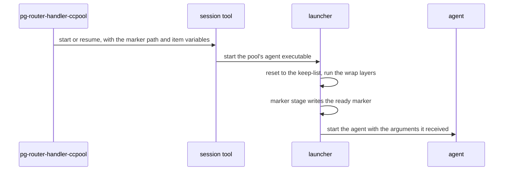

# Journeys — pg-router-handler-ccpool

Stories and use cases, typed per the behavior-docs method; each carries on its own definition what it
requires and includes (`INV-22`).

## Stories

- **`STORY-CCA-RUN`** <!-- uuid: e07c24a8-add4-4335-ba53-6860749d18dc --> — As pg-router's core, I want a role to run an agent session for one
  event and tell me whether it was accepted, declined or finished, and I want a restart of me never
  to lose the session. _(→ `USECASE-CCA-DISPATCH`; `INV-CCA-1`, `INV-CCA-2`, `INV-CCA-3`.)_
- **`STORY-CCA-ENV`** <!-- uuid: 9738bd68-28f8-4537-b371-958ed721ffde --> — As an operator, I want each role's session to start in the
  environment I declared for it, resumed or new, so a tool the role needs is on its path and nothing
  else leaks in. _(→ `USECASE-CCA-LAUNCH`, `USECASE-CCA-VALIDATE`; `INV-CCA-2`, `INV-CCA-4`,
  `INV-CCA-5`, `INV-CCA-6`, `INV-CCA-7`, `INV-CCA-8`.)_
- **`STORY-CCA-CUTOVER`** <!-- uuid: c0325999-4547-4f9a-ab61-11550f8d94c6 --> — As an operator, I want to move one role at a time from the
  earlier handler to this adapter without dropping a running session or changing what my alerts
  read. _(→ `USECASE-CCA-CUTOVER`; `INV-CCA-9`.)_

## Use cases

### `USECASE-CCA-DISPATCH` — run a dispatched event as a session <!-- uuid: d322ec5c-571d-4c95-b07d-a9d64bc152f1 -->

**Primary actor:** `ACTOR-CCA-CORE`.
**Level:** user-goal.
**Preconditions:** the role names this adapter as its `handler`.
_Requires:_ `INTF-HANDLER`, `INV-CCA-1`, `INV-CCA-2`, `INV-CCA-3`.
_Includes:_ `INTF-CCA-SESSION`, `USECASE-CCA-LAUNCH`.

1. The core dispatches one event, with the role object, under one tracking id.
2. The adapter decodes the role's configuration strictly (`INV-CCA-2`) and applies the lifecycle
   rules of a session-backed role (`INV-CCA-1`): it checks capacity, prepares isolation, and starts
   or adopts a session (`USECASE-CCA-LAUNCH`).
3. It supervises the session, and replies inline or defers, and the session outlives a restart of
   the core, whose next dispatch adopts it (`INV-CCA-3`).

Extensions:

- 2a. The configuration has an unknown or mistyped field: the call fails with the field named and
  nothing is launched.
- 2b. The role is at capacity, its origin is unavailable, or its precheck proves the dispatch moot:
  the adapter declines before launching, exactly as the earlier set states (`INV-CCA-1`).

### `USECASE-CCA-LAUNCH` — start or resume a session in the role's environment <!-- uuid: f08ab96e-3e53-4f99-9930-861e0dce87bd -->

**Primary actor:** `ACTOR-CCA-CORE`.
**Level:** subfunction, included by `USECASE-CCA-DISPATCH`.
**Preconditions:** the deployment has rendered the role's launcher and set it as its pool's agent
executable.
_Requires:_ `INV-CCA-4`, `INV-CCA-5`, `INV-CCA-6`, `INV-CCA-7`, `INV-CCA-8`.
_Includes:_ `INTF-CCA-LAUNCHER`.

1. The adapter asks the session tool to start the session, or to resume a record that exists,
   passing the dispatch's marker path and item-context variables explicitly (`INV-CCA-7`).
2. The session tool starts the pool's launcher, which resets the environment to the keep-list
   (`INV-CCA-5`), runs the wrap layers, writes the ready marker and starts the agent
   (`INV-CCA-4`).

Extensions:

- 2a. The launcher dies before it writes the marker: the session failed in its environment, and the
  adapter reads the per-stage standard error to say why (`INV-CCA-7`).
- 2b. The marker variable is unset: the marker stage fails loudly, never silently (`INV-CCA-7`).

### `USECASE-CCA-VALIDATE` — check a role's configuration and environment at build time <!-- uuid: 5873b485-f027-4242-ab5b-74aa10b92fd8 -->

**Primary actor:** `ACTOR-CCA-OP`.
**Level:** user-goal.
**Preconditions:** the role's configuration has been rendered by the deployment.
_Requires:_ `INTF-CCA-CONFIG`, `INV-CCA-2`, `INV-CCA-6`, `INV-CCA-8`.

1. The deployment's build runs the adapter's check over each role's rendered table.
2. A table with an unknown or mistyped field fails the build, naming the role and the field.
3. A role with a templated wrap entry, or two roles on a shared pool with different wraps, fail the
   evaluation (`INV-CCA-6`, `INV-CCA-8`).

### `USECASE-CCA-CUTOVER` — move one role from the earlier handler to this adapter <!-- uuid: f31b9c82-83ee-4d1d-acd6-1b5947a829f1 -->

**Primary actor:** `ACTOR-CCA-OP`.
**Level:** user-goal.
**Preconditions:** the role's own configuration has been moved into its `[role.config]` table.
_Requires:_ `INV-CCA-9`, `INV-CCA-3`.
_Includes:_ `USECASE-CCA-VALIDATE`.

1. The operator sets the role's `handler`, builds (`USECASE-CCA-VALIDATE`), exercises the role once
   with the smoke-test command, and applies.
2. A session the earlier handler left running is adopted by this adapter's redelivered dispatch
   (`INV-CCA-9`).
3. The operator reads the failure-rate alert's inputs and finds the reason strings unchanged
   (`INV-CCA-9`).

Extensions:

- 2a. The adoption does not happen: a second session is launched, or one is orphaned. The move is
  reverted, which puts the role back on the earlier path with nothing else to undo.
