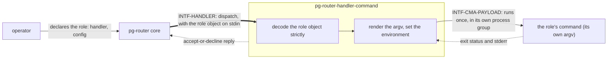

# pg-router-handler-command — behavior docs

`pg-router-handler-command` is one of two **adapter** participants that run pg-router roles. A role
that names it as its `handler` runs one command per dispatched event and finishes when that command
does. This set follows the behavior-docs method
(`phillipgreenii-nix-agent-support · behavior-docs/docs/behavior`) and is the **implementer** side of
`INTF-HANDLER` for that one kind of runner, as pg-router's own set defines the interface
(`phillipgreenii-nix-agent-support · packages/pg-router/docs/behavior`). Every adapter carries its own
set (`phillipgreenii-nix-agent-support` ADR 0065's Addendum of 2026-10-20, "the handler split"); the
other is the session adapter's set
(`phillipgreenii-nix-agent-support · packages/pg-router-ccpool-handler/docs/behavior/pg-router-handler-ccpool`).

Start here, then the [glossary](glossary.md); the rules are in [invariants](invariants.md), the
boundaries in [interfaces](interfaces.md), the actors in [actors](actors.md), and the stories and use
cases in [journeys](journeys.md).

## The model

The adapter is a **Command** runner behind an **Adapter**: the core hands it one event, the adapter
renders the role's argv for that event, runs it once, and reports acceptance and outcome in one inline
reply. It keeps no state between calls.

## Scope (extent + floor)

This section makes the set's scope explicit (`INV-13`); its actors are in [actors](actors.md) and its
interfaces in [interfaces](interfaces.md).

- **Extent (in)** — what the adapter does with one dispatched event: how it reads its role's own
  configuration, renders and runs the command with the base environment and the item context, tells a
  busy command from a failed one, reports a failure's evidence, records what it ran, and ends the
  command when the dispatch is cancelled; and how the role's configuration is checked by `validate`.
- **Extent (out)** — what the command itself does, which the adapter never interprets; pg-router's
  dispatch, queue and wiring, which pg-router's set owns and this set cites; any prefix tool the argv
  starts with, which is an external tool with its own configuration; and the session-backed kind of
  role, which is the other adapter's set.
- **Floor** — this set speaks in roles, dispatches, commands, exit status, process groups and
  failure evidence. It names no source path, no flag and no concrete tool.

## Realization gaps

This set's **realization-gap register** (`INV-23`): intended behavior this set's implementation has
not built yet, one row per gap, each keyed by the element id the gap is against. The intent is
settled and the build has not caught up (`INV-15`), so none of these is an open question.

| Element     | Intended                                                                                                                                             | Where the implementation stands                                                                                                                | Tracked by    |
| ----------- | ---------------------------------------------------------------------------------------------------------------------------------------------------- | ---------------------------------------------------------------------------------------------------------------------------------------------- | ------------- |
| `INV-CMA-1` | the adapter is its own participant, run for each role that names it as `handler`                                                                     | the command runner is one of two executors inside the earlier combined handler, chosen by a role `type`; no separate adapter binary exists yet | `pg2-12gr4.6` |
| `INV-CMA-2` | the adapter reads its argv from the role object's configuration table, decoded strictly                                                              | the argv is read from the earlier per-role file, and an unknown field is ignored; no build-time check exists                                   | `pg2-12gr4.6` |
| `INV-CMA-9` | a failing command, a prefix tool included, is an accepted dispatch that ends in a handler error, and exit `9` is busy whichever layer exited with it | the busy mapping is unconditional already, and the outcome carries the stderr tail; the progress counting by kind is not built                 | `pg2-12gr4.8` |

## External references

This set follows the behavior-docs method and cites elements pg-router's set and decision docs define,
so a cross-set reference resolves by the owner's stable UUID, not by a name that can change.

| Name           | What it is                                                                                                                                                | Owner set-path                                                                       | Owner UUID                                                                                                                                                          |
| -------------- | --------------------------------------------------------------------------------------------------------------------------------------------------------- | ------------------------------------------------------------------------------------ | ------------------------------------------------------------------------------------------------------------------------------------------------------------------- |
| `INV-13`       | a set MUST make its scope explicit and define all its actors and interfaces                                                                               | `phillipgreenii-nix-agent-support · behavior-docs/docs/behavior`                     | [94285c70-da89-4402-8ae2-af27925008bd](https://github.com/phillipgreenii/nix-agent-support/blob/main/behavior-docs/docs/behavior/invariants.md)                     |
| `INV-15`       | the behavior docs set is the source of truth; a realization gap is normal, not a defect                                                                   | `phillipgreenii-nix-agent-support · behavior-docs/docs/behavior`                     | [375b542f-2a9f-4cfd-a77e-7aed45a416d5](https://github.com/phillipgreenii/nix-agent-support/blob/main/behavior-docs/docs/behavior/invariants.md)                     |
| `INV-20`       | a borrowed term at a reference seam MUST be inherited or renamed, never silently redefined                                                                | `phillipgreenii-nix-agent-support · behavior-docs/docs/behavior`                     | [bafdd784-81ed-46fe-88f0-1a8c5fc4caf0](https://github.com/phillipgreenii/nix-agent-support/blob/main/behavior-docs/docs/behavior/invariants.md)                     |
| `INV-22`       | traceability is a listing obligation on every story, use case and journey, not a coverage section                                                         | `phillipgreenii-nix-agent-support · behavior-docs/docs/behavior`                     | [b2502527-1340-4a1f-858c-aaa80c601317](https://github.com/phillipgreenii/nix-agent-support/blob/main/behavior-docs/docs/behavior/invariants.md)                     |
| `INV-23`       | the realization-gap register is set-level, named `## Realization gaps`, and never an element                                                              | `phillipgreenii-nix-agent-support · behavior-docs/docs/behavior`                     | [f3bba3e7-440f-4109-a4de-9d37daa34bcf](https://github.com/phillipgreenii/nix-agent-support/blob/main/behavior-docs/docs/behavior/invariants.md)                     |
| `INTF-HANDLER` | dispatch to a handler and its accept-or-decline or deferred-ack reply                                                                                     | `phillipgreenii-nix-agent-support · packages/pg-router/docs/behavior`                | [10939663-7a48-4d44-8c4a-9a2df8ae4654](https://github.com/phillipgreenii/nix-agent-support/blob/main/packages/pg-router/docs/behavior/interfaces.md)                |
| `INV-CONC-1`   | capacity is handler-enforced and declared nowhere, never a core-tracked number                                                                            | `phillipgreenii-nix-agent-support · packages/pg-router/docs/behavior`                | [20c84e0f-8ffb-428c-9acc-dcaabb4fdf1b](https://github.com/phillipgreenii/nix-agent-support/blob/main/packages/pg-router/docs/behavior/invariants.md)                |
| `INV-FAIL-1`   | failure classes split at the acceptance boundary: a pre-accept decline is the core's to re-offer                                                          | `phillipgreenii-nix-agent-support · packages/pg-router/docs/behavior`                | [2da0d587-f116-42e6-b986-8abf80ed023c](https://github.com/phillipgreenii/nix-agent-support/blob/main/packages/pg-router/docs/behavior/invariants.md)                |
| `INV-ENV-2`    | a command starts from a minimal base environment plus the item context, behind a strict-env switch that is off by default                                 | `phillipgreenii-nix-agent-support · packages/pg-router/docs/behavior`                | [6e2d52e6-b43b-4894-84a4-8e5538d24b47](https://github.com/phillipgreenii/nix-agent-support/blob/main/packages/pg-router/docs/behavior/invariants.md)                |
| `INV-ENV-4`    | the processes pg-router starts itself get the base environment when their switch is on, run in their own process group, and exit 9 stays busy             | `phillipgreenii-nix-agent-support · packages/pg-router/docs/behavior`                | [9b643f31-384c-41a5-a6c9-95382b0fa936](https://github.com/phillipgreenii/nix-agent-support/blob/main/packages/pg-router/docs/behavior/invariants.md)                |
| `INV-OBS-3`    | per-role progress is observable, so a stalled role differs from a busy or an idle one                                                                     | `phillipgreenii-nix-agent-support · packages/pg-router/docs/behavior`                | [a7d41e96-2b58-4c3f-8e01-9f6b3d25c7a0](https://github.com/phillipgreenii/nix-agent-support/blob/main/packages/pg-router/docs/behavior/invariants.md)                |
| `INV-ROLE-1`   | a role names the adapter that runs it, and the core never distinguishes kinds of role                                                                     | `phillipgreenii-nix-agent-support · packages/pg-router/docs/behavior`                | [6495b5ef-cb0a-45e2-a43c-300564f30d2c](https://github.com/phillipgreenii/nix-agent-support/blob/main/packages/pg-router/docs/behavior/invariants.md)                |
| `INV-ROLE-2`   | the core carries a role's own configuration, as the role object in every request's payload, and never reads it                                            | `phillipgreenii-nix-agent-support · packages/pg-router/docs/behavior`                | [68e781f9-ca4a-4713-9ba2-e2839a9d6e6a](https://github.com/phillipgreenii/nix-agent-support/blob/main/packages/pg-router/docs/behavior/invariants.md)                |
| `INV-ROLE-3`   | surviving the core's shutdown is a generic property a role declares in the core's own configuration                                                       | `phillipgreenii-nix-agent-support · packages/pg-router/docs/behavior`                | [e7fb732e-a4c4-4bd7-a9ad-172d451e48ea](https://github.com/phillipgreenii/nix-agent-support/blob/main/packages/pg-router/docs/behavior/invariants.md)                |
| `INV-ROLE-4`   | a role, and a query, is a command plus the minimal base environment and the item context, and the core declares nothing else about how the command is run | `phillipgreenii-nix-agent-support · packages/pg-router/docs/behavior`                | [de6d321d-9322-46ff-abd9-36b4024d9b52](https://github.com/phillipgreenii/nix-agent-support/blob/main/packages/pg-router/docs/behavior/invariants.md)                |
| `INV-ROLE-5`   | a role whose validation fails stays registered and is unavailable                                                                                         | `phillipgreenii-nix-agent-support · packages/pg-router/docs/behavior`                | [3c8e5f2a-91b4-4d07-b6a3-5e12f0c7d894](https://github.com/phillipgreenii/nix-agent-support/blob/main/packages/pg-router/docs/behavior/invariants.md)                |
| `INV-CCH-35`   | `dispatch_start`, outcome and `dispatch_decline` records say what a dispatch ran, how it ended and why one declined                                       | `phillipgreenii-nix-agent-support · packages/pg-router-ccpool-handler/docs/behavior` | [dafefee7-edda-40ef-af3c-de3a08b40a1f](https://github.com/phillipgreenii/nix-agent-support/blob/main/packages/pg-router-ccpool-handler/docs/behavior/invariants.md) |
| `DEC-WIRE-1`   | the default transport is a CLI invocation carrying JSON, with coarse exit codes                                                                           | `phillipgreenii-nix-agent-support · packages/pg-router/docs/decisions`               | [6450eed7-228f-4a99-bfd9-6705a6c552ee](https://github.com/phillipgreenii/nix-agent-support/blob/main/packages/pg-router/docs/decisions/wire.md)                     |
| `DEC-WIRE-3`   | lifecycle hooks, and the role object that rides in every request                                                                                          | `phillipgreenii-nix-agent-support · packages/pg-router/docs/decisions`               | [8a1f2c4d-6e0b-4a5e-9d3c-2b7f1e9a4c60](https://github.com/phillipgreenii/nix-agent-support/blob/main/packages/pg-router/docs/decisions/wire.md)                     |
| `DEC-ROLE-1`   | a role names its own handler; the core carries an opaque config and survives_shutdown, and chooses the dispatch path per role                             | `phillipgreenii-nix-agent-support · packages/pg-router/docs/decisions`               | [ab21b9c1-ca8d-4f13-a791-ea7c5a8b203b](https://github.com/phillipgreenii/nix-agent-support/blob/main/packages/pg-router/docs/decisions/role.md)                     |
