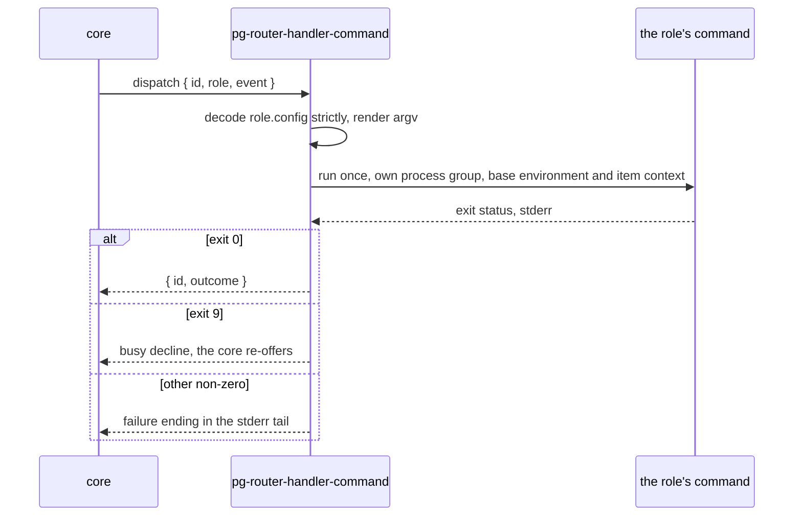

# Journeys — pg-router-handler-command

Stories and use cases, typed per the behavior-docs method; each carries on its own definition what it
requires and includes (`INV-22`).

## Stories

- **`STORY-CMA-RUN`** <!-- uuid: faa10f84-5c63-403c-b8a6-97f291d3cde0 --> — As pg-router's core, I want a role to run one command for one event
  and tell me whether it was busy, failed or finished, so a plain command is a role with no agent in
  it. _(→ `USECASE-CMA-DISPATCH`; `INV-CMA-1`, `INV-CMA-3`, `INV-CMA-4`, `INV-CMA-5`, `INV-CMA-6`,
  `INV-CMA-8`, `INV-CMA-9`, `INV-CMA-10`.)_
- **`STORY-CMA-DECLARE`** <!-- uuid: fcdf1045-7888-4e66-af38-e4248f183c88 --> — As an operator, I want a mistake in a command role's own
  configuration to fail my build, so it never reaches a dispatch. _(→ `USECASE-CMA-VALIDATE`;
  `INV-CMA-2`.)_

## Use cases

### `USECASE-CMA-DISPATCH` — run a dispatched event as one command <!-- uuid: b80bd4f5-0b46-4347-bdbf-d580a32a6ab3 -->

**Primary actor:** `ACTOR-CMA-CORE`.
**Level:** user-goal.
**Preconditions:** the role names this adapter as its `handler`.
_Requires:_ `INTF-HANDLER`, `INV-CMA-1`, `INV-CMA-2`, `INV-CMA-3`, `INV-CMA-4`, `INV-CMA-5`,
`INV-CMA-6`, `INV-CMA-8`, `INV-CMA-9`, `INV-CMA-10`.
_Includes:_ `INTF-CMA-PAYLOAD`.

1. The core dispatches one event, with the role object, under one tracking id.
2. The adapter decodes the role's configuration strictly (`INV-CMA-2`) and renders the argv for the
   event (`INV-CMA-3`).
3. It starts the command in its own process group (`INV-CMA-6`), with the base environment and the
   item context (`INV-CMA-8`), writes one `dispatch_start` record (`INV-CMA-10`), and runs the
   command once.
4. The command exits zero: the adapter writes one `dispatch_end` record (outcome `completed`,
   `INV-CMA-10`) and replies inline with a completion.

Extensions:

- 2a. The configuration has an unknown or mistyped field, or the argv cannot be rendered: the
  dispatch fails before anything runs, with the field named.
- 4a. The command exits with the busy code, whichever layer of its argv exited with it: the adapter
  declines as busy (kind `busy`), and the core re-offers while the event is unexpired
  (`INV-CMA-4`).
- 4b. The command exits non-zero with any other code, a prefix tool in its argv included: the
  dispatch is accepted and fails, and the error ends with the stderr tail, where a line of the
  prefix tool names the failing layer (`INV-CMA-4`, `INV-CMA-9`).
- 5a. The core is shutting down: the adapter's role does not survive it (`INV-CMA-5`), so after the
  drain the core cancels the call, and the adapter ends the whole process group (`INV-CMA-6`).

### `USECASE-CMA-VALIDATE` — check a command role's configuration at build time <!-- uuid: 265151f8-a29f-45d4-8cc3-63638432e267 -->

**Primary actor:** `ACTOR-CMA-OP`.
**Level:** user-goal.
**Preconditions:** the role's configuration table has been rendered by the deployment.
_Requires:_ `INTF-CMA-CONFIG`, `INV-CMA-2`.

1. The deployment's build runs the adapter's `validate` over each role's rendered table.
2. A table with an unknown or mistyped field fails the build, naming the role and the field.
3. A clean table lets the build finish, and the same decoding runs again on every call.
4. The core runs the same `validate` at startup and `doctor` runs it on demand, so a role that fails
   it stays registered and is unavailable (`INV-ROLE-5`). `validate` never runs the command or any
   prefix tool in its argv.
