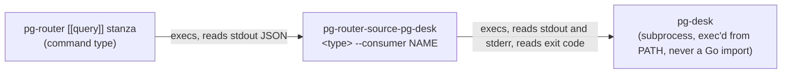

# pg-router-source-pg-desk — behavior docs

`pg-router-source-pg-desk` is a small, standalone Go binary that lets a pg-router `[[query]]`
command-type stanza consume pg-desk's change feed. It knows exactly two contracts: pg-desk's
`changes` envelope (`pg-desk.changes/v1`), and pg-router's command-query rawItem array shape. It
holds NO state of its own: the consumer's position lives in pg-desk's own consumer row, never in a
file this binary writes.

This document is a plain statement of this adapter's own behavior, not a full application of the
repo's `behavior-docs` method (no separate actors, journeys or interfaces registers): the adapter
has no interface surface of its own beyond the two contracts above, both owned and documented
elsewhere (pg-desk's own `docs/behavior`, pg-router's own `internal/query/command.go` rawItem
shape). It is a pure translation layer between them, and it is the sibling of
[pg-router-source-pg-connector](../../../pg-router-source-pg-connector/docs/behavior/README.md),
which does the same for pg-connector.

Where this document says **intended**, the behavior is stated ahead of the code and is listed in
the realization-gap register below. Everything else describes what the adapter does today.

## What it does

- **`<type> --consumer <name> [--query <q>] [--limit <n>]`** runs
  `pg-desk <type> changes --consumer <name> [--query <q>] [--limit <n>] --json` and reprints the
  `pg-desk.changes/v1` envelope it answers as one rawItem per changed entity. `<type>` is the
  entity type pg-desk names (for example `issue`), exactly one positional argument. `--consumer`
  is required and names the pg-desk consumer whose cursor the call reads and advances. `--query`
  and `--limit` are passed through to pg-desk when given and omitted from the call when not; `0` for
  `--limit` still means all records. The adapter never passes `--cached`, because a cached read does
  not advance the cursor, and so would hand the router the same changes on every tick.
- **One item per entity per poll.** The envelope's records are grouped by entity id, in the order of
  each entity's first record. Each item is
  - `id` = `<entity id>@<max seq>`, where the max seq is the largest `seq` among the poll's records
    for that entity. The seq is pg-desk's own change-log sequence number, so a later change to the
    same entity always has a different id, and two polls never mint the same id for different
    changes;
  - `emit` = `<type>.changed`, the only event type the adapter produces. pg-router types an event
    from `emit`, so a query that runs this adapter MUST declare the same `emit`;
  - `type` and `title` from the maximum-seq record, which is the latest state of the entity;
  - `metadata` = `{entity_type, entity_id, kinds, seq, version, origin, degraded_sources}`. `kinds`
    is every kind of every record for the entity in the poll, coalesced, with no duplicates, in
    order of first appearance. `seq`, `version` and `origin` come from the maximum-seq record
    (`version` and `seq` are kept as JSON numbers). `entity_id` is the bare entity id, for a
    handler that needs the real id behind the suffixed event id.
  - `degraded_sources` is the `query` name of every envelope source whose status is not `ok`, the
    same list on every item of the call, never a per-entity fact.

  A poll with no records prints `[]`, never `null`.

- **Exit codes.** The adapter's own exit scheme is two values. pg-desk exit `0` (every source ok)
  and `2` (some sources degraded, records written, cursor advanced) both end as `0` with every
  entity emitted, the degraded detail carried in `metadata.degraded_sources`, because pg-router
  discards a source's whole output on any non-zero exit and mirroring `2` would drop records that
  pg-desk has already advanced past. pg-desk exit `3`, any other exit code, an envelope that is not
  decodable and a pg-desk that cannot be started all end as `1` with nothing on stdout; pg-desk's
  own stderr, when it wrote any, and a one-line diagnostic go to this adapter's stderr.
- **No telemetry.** The adapter emits no metrics or traces and has no persistent process. Logging
  is stderr-only, and only on a failure path. On success it writes nothing to stderr.

## `--retry-window` (intended)

> **Intended, not built.** The adapter today defines only `--consumer`, `--query` and `--limit`
> and sets no expiry, so every item it prints is born expired. The rest of this section states what
> the flag will do once it exists.

pg-router retries a failed dispatch of an event only while the event has not expired, and an event
whose `expiresAt` is absent is born expired, so an item without an expiry is offered once and then
dropped (`INV-EVT-4`, [the router's invariants](../../../pg-router/docs/behavior/invariants.md)). A
poll that carries a pg-desk issue therefore never reaches the router's retry for a transient
dispatch failure today. `--retry-window` gives each item the expiry that turns retry on.

- **Syntax and default.** `--retry-window <duration>`, a Go duration such as `10m`. The default is
  `0`, which means **off**, as it is on the sibling adapter for pg-connector. A negative window is a
  usage error: the adapter exits `1` and runs no pg-desk call.
- **Off (`0`, or the flag absent).** The output is byte-identical to a call made without the flag:
  no `at` and no `expiresAt` is printed, so every event is born expired and a failed dispatch is
  offered once.
- **On (a window greater than zero).** Every item of the call additionally carries `at`, this
  invocation's emit time in UTC to whole seconds (one value for every item of the call), and
  `expiresAt` = `at` + the window. The router then re-offers a failed dispatch of that event until
  `expiresAt`, and an attempt made after it has expired is the handler's last (`INV-EVT-4`: the
  expiry is evaluated at attempt time, and `expiresAt` IS the retry window). The window is anchored
  at the emit time and never at the time of the change, so an old row that is delivered late still
  gets its whole window.
- **The id does not change.** The id stays `<entity id>@<max seq>` with the flag on and off. It
  needs no digest, unlike the sibling adapter's, because the seq already names exactly the rows it
  covers: the same rows always give the same id, and any later change to the entity gives a new one.
  The consequences, which follow from the router's de-duplication by id across the retained id set
  (`INV-EVT-3`):
  - if the same rows are ever reported twice, both reports carry the same id and de-duplicate
    within the retention a window buys: "a duplicate, never a loss". With the flag off the
    retention collapses to roughly one dispatch cycle, so the same repetition is NOT
    de-duplicated;
  - a new change to an entity whose earlier event is still being retried has a larger max seq, so
    it is a different id and is queued as its own event while the first is in flight. The adapter
    does not coalesce across polls and does not withdraw the earlier event; a handler that reads the
    entity's current state when it runs sees the newer change in either event.
- **What it does not do.** The flag does not change which events are emitted, their ids, their
  `metadata`, the exit codes or the cursor. It applies to every `<type>` the adapter is run for, not
  only `issue`.
- **The flag alone does not enable router retry.** The window only gives each event time to be
  re-offered. A role that should retry a dispatch that failed with a transient class MUST also opt
  in itself with `max_dispatch_retries` on that role, which defaults to `0` (no re-run) and is
  capped (`DEC-RETRY-2`, [the router's decisions](../../../pg-router/docs/decisions/retry.md)). It
  is a deployment setting, and a re-run is never made past `expiresAt`. Without the opt-in the
  window still bounds how long a busy handler's decline is re-offered (`INV-FAIL-1`, `INV-EVT-4`),
  but a handler that was dispatched and failed is not re-run.

## Realization gaps

This set's **realization-gap register**: intended behavior this adapter has not built yet, one row
per gap. This README states behavior in sections rather than in id-bearing elements, so the first
column names the section the gap is against.

| Element                     | Intended                                                                                                                                                                                     | Where the implementation stands                                                                                               | Tracked by                 |
| --------------------------- | -------------------------------------------------------------------------------------------------------------------------------------------------------------------------------------------- | ----------------------------------------------------------------------------------------------------------------------------- | -------------------------- |
| `--retry-window (intended)` | the flag gives each item `at` and `expiresAt` = `at` + the window (default `0` = off) so the router can retry a transient dispatch failure of an `issue.changed` event until the window ends | the adapter defines only `--consumer`, `--query` and `--limit`, prints no `at` or `expiresAt`, so every event is born expired | `pg2-2qyyh` (later phases) |

## External references

This adapter cites invariants and a decision that the pg-router set owns, because pg-router's
event queue is the consumer of what it prints. It cites them by name and does not restate them.

| Name          | What it is                                                                                                                 | Owner set-path                                                         | Owner UUID                                                                                                                                           |
| ------------- | -------------------------------------------------------------------------------------------------------------------------- | ---------------------------------------------------------------------- | ---------------------------------------------------------------------------------------------------------------------------------------------------- |
| `INV-EVT-3`   | the core de-duplicates by event `id` across the retained id set                                                            | `phillipgreenii-nix-agent-support · packages/pg-router/docs/behavior`  | [d54ad229-ed48-4862-aa27-bc2181b4d6c4](https://github.com/phillipgreenii/nix-agent-support/blob/main/packages/pg-router/docs/behavior/invariants.md) |
| `INV-EVT-4`   | retry is bounded by the event's expiry, evaluated at attempt time: an attempt made after it expired is that handler's last | `phillipgreenii-nix-agent-support · packages/pg-router/docs/behavior`  | [840afb74-2159-447f-985b-33b27dfc35da](https://github.com/phillipgreenii/nix-agent-support/blob/main/packages/pg-router/docs/behavior/invariants.md) |
| `INV-FAIL-1`  | a pre-accept decline is re-offered, on a backoff cadence, until the event expires                                          | `phillipgreenii-nix-agent-support · packages/pg-router/docs/behavior`  | [2da0d587-f116-42e6-b986-8abf80ed023c](https://github.com/phillipgreenii/nix-agent-support/blob/main/packages/pg-router/docs/behavior/invariants.md) |
| `DEC-RETRY-2` | a role MAY opt in to a bounded, transient-class-only re-run of a failed dispatch, never past `expiresAt`                   | `phillipgreenii-nix-agent-support · packages/pg-router/docs/decisions` | [3441f46c-18ee-4a18-a5c5-ab5eb07766af](https://github.com/phillipgreenii/nix-agent-support/blob/main/packages/pg-router/docs/decisions/retry.md)     |

## Out of scope

- The change feed itself, its envelope and its per-entity change rows: owned by pg-desk.
- Whether a role opts in to retry, and the retry cadence: owned by pg-router and by each role's
  deployment setting (`max_dispatch_retries`).
- The `<type>.changed` handlers, such as the issue-decider role: they consume the items this adapter
  prints and are documented with their own roles.
