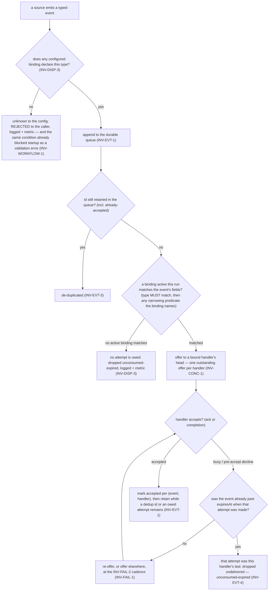
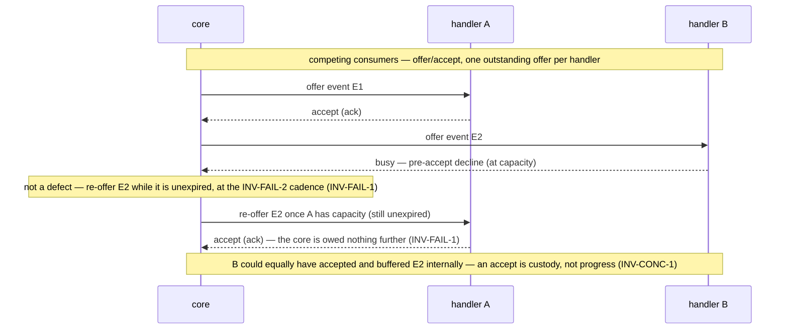

# Invariants — pg-router

The rules pg-router's **core** follows. These bound the core's own behavior and the **common manager
contract** it holds with its participants; they do **not** govern what a handler _does_ once
dispatched. See the [glossary](glossary.md), [interfaces](interfaces.md), [actors](actors.md), and
[journeys](journeys.md). IDs are **topical and stable**; numbering gaps are legal, and each rule
uses RFC 2119 language (`MUST` / `SHOULD` / `MAY`). The ID convention and the invariant / goal /
concept distinction come from the behavior-docs method
(`phillipgreenii-nix-agent-support · behavior-docs/docs/behavior`).

## Dispatch (the event model)

An event's path from a source to a handler is a match-then-route decision. (An operator MAY also
inject an event directly via the `push-inject` `INTF-CLI` subcommand — the same push-ingest path,
governed by these same delivery invariants, `INV-EVT-*`.)

- **`INV-DISP-1`** <!-- uuid: 5ad7c9a4-37ea-4496-8f23-51964a8aae54 --> — Sources **emit typed events**; handlers **bind** to events via a **binding**
  that **matches over event fields**. `type` is the **primary matcher** and **MUST** match: a binding
  never matches an event whose `type` it does not name, whatever else that event carries. A binding
  **MAY** then carry one **narrowing predicate** over a **payload path the binding itself names**,
  applied **only after** the type match has succeeded — a narrowing of an already-matched set, never
  a peer of `type`. **Matchability is the handler's alone**: a source declares nothing about which of
  its fields may be matched, and the core reads **only the path a binding names** and nothing else in
  the payload, so `payload` stays opaque everywhere the binding does not point. A named field or path
  that is **absent** on an event **does not match** — a non-match, **not** an error. The core routes a
  matched event to a bound handler, and a handler responds to **any** of its bound events. _(A named
  path cannot be checked when the config is authored, because no per-`type` payload shape is declared
  anywhere — `OQ-EVT-CATALOG`. So **while that open question stands**, a mistyped path narrows to
  nothing and nothing can report it; that is a consequence of the deferred catalog, **not** a property
  of path matching, and settling `OQ-EVT-CATALOG` is what makes a named path checkable at config
  time.)_
- **`INV-DISP-2`** <!-- uuid: 06662087-a4de-4732-9417-f7440c9aa471 --> — The core reaches every source and handler **only through a manager interface**
  (`INTF-SOURCE` / `INTF-HANDLER`); their implementations are opaque to it. Nothing specific to a
  source, handler, or deployment lives in the core.
- **`INV-DISP-3`** <!-- uuid: 421db242-e1fc-49ba-a1a6-38211abf5569 --> — **An unknown event type is
  rejected; a type whose binding is merely inactive this run waits.** The two cases stay distinct:
  - **Unknown to the configuration** — **no** configured binding declares this `type` at all. The core
    **MUST reject** the event to the caller: it is **not** enqueued, the reply names it as rejected
    (`INTF-CLI`), and the condition is recorded to logs and metrics. The same condition is already a
    **pre-runtime validation error** that blocks startup (`INV-WORKFLOW-1`), so at runtime it can only
    mean a source emitted a `type` its own configuration never declared — an error to report, never a
    silent drop.
  - **Declared but inactive this run** — a binding for the `type` exists and is merely **disabled for
    this run** by a **run-scoped selector**. That event **is** accepted and enqueued, waits, is offered
    to nobody, and **is dropped unconsumed-expired** (`INV-EVT-1`, `INV-EVT-4`). This is **expected and
    is neither an error nor a warning**: validity is judged against the configuration, never against the
    run's active subset (`INV-WORKFLOW-1`, `STORY-OP-3`).

  The **unconsumed-expired** drop is **counted in the metric catalog** `INTF-MON` carries
  (`INV-OBS-1`), covering the second case and the ordinary miss, and under `INV-EVT-4` that count is a
  **genuine miss** rather than a scheduling artifact: every matching handler had at least one
  opportunity and none took it. A busy handler can no longer be the reason an event expired unoffered,
  and — now that an unknown `type` is rejected rather than queued — a misconfiguration can no longer
  inflate the count either, which makes the "no event misses" signal considerably more meaningful. (A
  **field or payload path a binding names** that is _absent_ on an event is a **non-match** on an
  otherwise declared `type`, not a no-binding condition — so it leaves the event in the second case,
  never the first.)

## Delivery

- **`INV-EVT-1`** <!-- uuid: faf59ce3-6a27-42c8-8bfa-0903f895eed6 --> — **The delivery-opportunity
  guarantee.** The core holds a **durable, ordered, de-duped, retention-bounded event queue**
  (`phillipgreenii-nix-agent-support · packages/pg-router/docs/decisions · DEC-EVENT-2`), and **every
  matching handler WILL get at least one opportunity to accept a matching
  event**: nothing is ever dropped **un-offered**. Delivery is **at-least-once** — an event is
  enqueued durably and the core **attempts delivery until a handler accepts it**, over the window
  `INV-EVT-4` bounds. An event carries an optional **`at`** (the source stamp; **absent, the core's
  own "now" at ingest is used**) and an optional **`expiresAt`** (an **absolute instant**; **absent,
  `at` is used**). Nothing computes a duration, and neither field is configured — they ride on the
  event. A **pull source** (command query) supplies them per record, and the producer's enqueue
  carries them onto the queued event unchanged (`DEC-RETRY-2`: an adapter's `expiresAt` is the retry
  window); a record carrying neither is enqueued with neither and stays born expired. The durable record is written **after acceptance is confirmed**, so a narrow crash window MAY
  redeliver (absorbed by idempotent handlers, `INV-EVT-2`). An accepted event is **retained** while
  its `id` is still needed for de-duplication (`INV-EVT-3`) and while any matching handler is still
  owed its opportunity. Delivery therefore **survives a restart** — the storage mechanism
  (jsonl / DB / WAL) is a realization choice, not behavior. _(The `crashing` lifecycle signal in
  `INV-LIFE-1` stays best-effort — that is a separate concern from event-data durability.)_

  **The one sanctioned refusal at ingest: the durable queue is bounded.** The core has a configured
  **maximum size** for its durable queue. When the queue is **at** that maximum, or the core
  **cannot write** it (disk full, I/O error), the core **MUST refuse** a new event at ingest — and
  that admission refusal is the **only** one `INV-EVT-1` allows beyond a malformed event and an
  event whose `type` is unknown to the configuration (`INV-DISP-3`). It is **never silent**: the
  source is told (the event is named in the reply's `rejected` list, with a reason whose fixed
  prefix classifies it — `log_full` or `log_unwritable` — and which says the event was **not**
  queued and that retrying later is safe, because delivery is idempotent, `INV-EVT-2`), and the core
  counts and logs every refusal. It is not a drop: nothing already accepted into the queue is lost,
  every event already queued still gets its delivery opportunity, and a still-retained duplicate
  `id` is still absorbed (`INV-EVT-3`). Refusing admission is the **only** thing the maximum stops:
  delivery, acceptance, retirement and level changes continue above it, so the queue can shrink
  again. Before the maximum, once the queue passes a **soft threshold** below it (and compaction has
  not brought it back under), the core **MUST** stop polling its pull sources (command-source
  emitters) — a reduction in intake, not a drop, and **not** a level (`INV-LIFE-2`): listeners, the
  drain, the **timer emitter** and **pushed** events keep running until the maximum itself is
  reached. Inspection **MUST** say plainly which of these limited-capability states is in force,
  what is halted, what still runs, and what the operator can do about it.

- **`INV-EVT-2`** <!-- uuid: 06649d39-2734-409a-8098-f3c2cef44cbe --> — A handler **MUST tolerate
  duplicate events** (be idempotent) — required, because at-least-once delivery (`INV-EVT-1`) and the
  narrow crash window MAY redeliver an accepted event. A source **MAY** emit the same event more than
  once; the durable queue makes **both pull and push** events durable through their retention, so a
  push-only source no longer loses events it cannot re-derive.
- **`INV-EVT-3`** <!-- uuid: d54ad229-ed48-4862-aa27-bc2181b4d6c4 --> — The core **de-duplicates by
  event `id` across the retained id set** — including ids of events already delivered or accepted — so
  a source never needs to track whether it already emitted an event, and a re-emit **within
  retention** is dropped as a duplicate. **Retention ends when the final attempts owed under
  `INV-EVT-4` are complete**, which has a consequence worth stating rather than discovering: with the
  born-expired default the dedup window **collapses to roughly one dispatch cycle**, so a pull query
  re-emitting on its next trigger will **not** be deduped. That is consistent with "re-emission, not
  resurrection" and is a real change; an operator who wants a wider dedup window sets `expiresAt`.
- **`INV-EVT-4`** <!-- uuid: 840afb74-2159-447f-985b-33b27dfc35da --> — **Retry is bounded, and the
  bound is evaluated at attempt time.** If the event is **already expired at the moment an attempt is
  made, that attempt is the last one for that handler**: accept or decline, the core does not offer
  that event to that handler again, and once no handler is still owed an attempt the event is dropped
  **unconditionally** (**unconsumed-expired**, `INV-DISP-3`). No attempt history is kept — the expiry
  check at attempt time is the whole decision. Before `expiresAt` the re-offer behavior of
  `INV-FAIL-1` holds unchanged, so **`expiresAt` IS the retry window**: setting it in the future is
  how retries are requested, and absent it there is no retry. Because `expiresAt` defaults to `at` and
  `at` defaults to the core's ingest-now, the default event is **born expired**, and the default
  behavior is therefore **offer once to every matching handler, then drop** — a best-effort default
  needing no configuration, and one under which an event can no longer expire without ever having been
  offered to a busy handler. _(Why expiry is an absolute instant rather than a duration — and why that
  shape leaves no clock origin to choose — is recorded in
  `phillipgreenii-nix-agent-support · packages/pg-router/docs/decisions · DEC-EVENT-1`.)_
- **`INV-EVT-5`** <!-- uuid: d3f46c09-300f-4aa1-9e8f-75bac77c12ce --> — **Timer tick content.** A
  `[[query]]` of type timer **MAY** declare **static metadata** (string keys to string values). A timer
  with a **period** trigger **MUST** copy it unchanged into the metadata of every item it emits, and a
  period timer with **no** metadata **MUST** emit exactly the item it emitted before the key existed.
  The core **MUST** refuse a key it sets itself (`scheduled_for`, `on_missed`). A **calendar** tick
  carries the declared metadata plus `scheduled_for` (the slot, RFC 3339) and `on_missed` (`"true"`
  only on a catch-up tick).
- **`INV-EVT-6`** <!-- uuid: 19fbd58c-0ca5-4171-8f7d-708d8e2abaa2 --> — **Calendar trigger.** A timer
  query **MAY** use the **calendar trigger**: it fires at a **local time of day** on chosen weekdays
  (every day by default). The zone is the zone of the router host, read once at process start, unless
  the query names an IANA zone; a fixed offset **MUST** be refused. A configuration whose schedule
  cannot be evaluated **MUST** fail `config check`, never at fire time. Each **slot** **MUST** yield
  **at most one** tick, across restarts and clock changes. **Rule A (spring-forward):** a local time
  that does not exist on a day **MUST** fire once, at the first instant after the gap. **Rule B
  (fall-back):** a local time that occurs twice **MUST** fire once, at its first occurrence.
- **`INV-EVT-7`** <!-- uuid: c9bf96a1-552d-40e5-9ea2-976009dfd6e1 --> — **Missed slots and expiry.** A
  calendar trigger **MUST** declare `on_missed` (**no default**). A slot is **missed** only when the
  router was **not running** at the slot time (the process started after it) or the **host was asleep**
  at the slot time. Every other slot is **on time** and **MUST** fire when the router next evaluates
  it, however late that evaluation is (load back-off or a slow query **MUST NOT** turn a slot into a
  missed one). `run-now` **MUST** fire **exactly one** catch-up tick at once, however many slots were
  missed; `next-slot` **MUST** skip them. A **first start** (no remembered slot) **MUST NOT** count
  anything as missed. The core **MUST** remember, across restarts, the **last handled slot, its
  outcome and the reason**. A calendar tick **MUST** expire at the **next slot** unless the query sets
  `expires_in`; retry stops then (`INV-EVT-4`'s final attempt still applies). The event id is derived
  from the query name and the slot, so two calendar queries that fire at the same slot never share an
  id; it de-duplicates only while retained (`INV-EVT-3`); a slot whose record was lost **MAY** fire
  again after expiry under `run-now`. _(The slot id, the expiry rule and the missed-slot ruling are
  recorded in
  `phillipgreenii-nix-agent-support · packages/pg-router/docs/decisions · DEC-EVENT-6`.)_

## Interfaces

- **`INV-INTF-1`** <!-- uuid: ddffe016-17c0-4673-896a-70532c968b72 --> — Every participant
  interaction follows the **common manager contract** ([interfaces](interfaces.md)): it conforms to
  the interface's **message schema** (`INV-INTF-2`) realized over a **transport contract**, and a
  party that receives a **schema version it cannot handle MUST report it rather than guess**. Each
  call carries a per-call **tracking id** and a reply that is **inline or deferred**; where a deferral
  still owes a result, the participant reaches the core over the **callback** the core handed it,
  which arrives ready to run so the participant assembles neither the core's address nor its
  credential. A reply is the participant's **acceptance** signal: an **inline completion**
  (synchronous — `accept == complete`) or a **deferred ack** reconciled later over the participant's
  callback, keyed by the tracking id (asynchronous — `accept == ack`, outcome reported later). The
  core's delivery responsibility **ends at acceptance** (`INV-EVT-1`, `INV-FAIL-1`). A callback
  bearing a **tracking id the core does not recognize** — never issued, or already expired and
  evicted — is **acknowledged and ignored** (a logged no-op): not an error, and it does not resurrect
  an expired event. The core **accepts messages only after a participant is `started` and before it
  is `stopping`** (the lifecycle is owned by `INV-LIFE-1`).
- **`INV-INTF-2`** <!-- uuid: 26f9be4d-8481-4a44-9f1a-d79a92c0016a --> — Every interface is
  accompanied by a **conformance suite** (positive and negative checks against its JSON Schema) so an
  implementation can verify it adheres **before** the core is trusted to route through it. Because a
  counterparty here is an **implementer** — a pluggable implementation, or a downstream deployment
  set that realizes these interfaces — this suite, not a peer cross-check, is how agreement is
  confirmed (method `INV-18`, implementer form).

## Concurrency, capacity & failure

- **`INV-CONC-1`** <!-- uuid: 20c84e0f-8ffb-428c-9acc-dcaabb4fdf1b --> — Capacity is
  **handler-enforced and declared nowhere**, never a core-tracked number: no configuration states a
  per-handler ceiling and the core keeps none. A handler offered an event therefore has **two**
  legitimate responses, and the core MUST treat both as correct. It MAY **decline pre-accept with
  `busy`**, after which the core re-offers while the event is unexpired (`INV-FAIL-1`, bounded by
  `INV-EVT-4`); or it MAY **accept and buffer the event internally**, starting it whenever its own
  limits allow. The `busy` decline is what the **caller of a participant observes**, so its coarse
  signal is part of the contract and not an implementation detail: on the default CLI transport it is
  **exit `9`**, deliberately clear of the reserved low codes where `2` means a **usage** error
  (`INTF-CLI`,
  `phillipgreenii-nix-agent-support · packages/pg-router/docs/decisions · DEC-WIRE-1`). Both sides
  MUST move together — a caller still reading a decline off the
  usage code would invert both readings, taking a decline for a typo and a typo for "re-offer later".
  A decline a handler makes routinely — a precheck's `skipped-*` reason or
  `session-in-flight`, both reasons the handler's own behavior set defines — is excluded from
  the failures the core's failure-rate alert pages on.
  **Acceptance means the handler took custody, not that work started.** The core MUST
  NOT infer progress from an accept, and MUST NOT assume an accepting handler is idle or free to
  take more; all an accept settles is that delivery is complete and the core is owed nothing further
  (`INV-EVT-1`, `INV-FAIL-1`). **"One event → one session"
  holds _within_ a handler**; **fan-out is
  _across_ handlers** — the core tracks acceptance per `(event, handler)` (`INV-EVT-1`) and keeps
  **one outstanding offer per handler** (per-handler serial FIFO,
  `phillipgreenii-nix-agent-support · packages/pg-router/docs/decisions · DEC-EVENT-2`). Concurrency
  is **not
  assumed safe for every event type** — a `type` **MAY** be marked to **serialize** (e.g. a shutdown
  or time-of-day event) so its events never run in parallel: while a marked type has an unreleased
  event outstanding, the type's **next** event is offered to **no** handler at all — not merely
  withheld from whichever handler holds the outstanding one, since the point is order across **every**
  handler, not just within one. It is offered once the outstanding event **completes or expires**:
  completing means every **currently-bound** handler has **settled** it (accepted, or given its one
  attempt past `expiresAt`, `INV-EVT-4`) — **handled**, not evicted, so a promptly-accepted event does
  not go on withholding its successor merely because it is still retained for its own dedup window
  (`INV-EVT-1`,
  `phillipgreenii-nix-agent-support · packages/pg-router/docs/decisions · DEC-EVENT-2`). _(A
  source-side, per-source
  claim-exclusion role — e.g. a downstream deployment's durable in-session claim — is an **external
  actor's** concern, complementary to and not duplicating the core's acceptance tracking.)_
- **`INV-FAIL-1`** <!-- uuid: 2da0d587-f116-42e6-b986-8abf80ed023c --> — Failure classes split at
  the **acceptance boundary** (`INV-EVT-1`,
  `phillipgreenii-nix-agent-support · packages/pg-router/docs/decisions · DEC-EVENT-2`). **Pre-accept
  declines** — a handler is
  `busy` (at capacity) or `unavailable` — are the **core's** to handle: it re-offers the event **while
  it is unexpired** (`INV-EVT-4`), **at the cadence `INV-FAIL-2` defines**, to the same handler once
  the ceiling lifts or to another bound handler. **The failure reason does not change the
  cadence**: `busy` and `unavailable` share exactly one retry cadence — there is no per-reason
  knob (`INV-FAIL-2`). A **dispatch failure** — the core's own attempt to hand the event over
  failing outright, rather than reaching a handler reply at all (`INV-OBS-1`'s second
  delivery-side class) — is likewise **pre-accept** and gets the identical treatment: the
  core re-offers it while it is unexpired, at the same `INV-FAIL-2` cadence, exactly as a
  `busy`/`unavailable` decline would be. Only the **metric class** distinguishes it from a
  busy/unavailable decline (`INV-OBS-1`); the retry mechanics do not. **Post-accept
  outcomes** — `retryable`, `resource-limit`, or `critical`, reported by a handler that has
  **already accepted** the event — are the **handler's** own (once it accepts, the handler owns
  persistence/resume/retry); the core does **not** re-offer post-accept work, and does **not**
  classify or count it (`INV-OBS-1`), **with one narrow exception** (`DEC-OBS-3`): a handler error
  that carries the documented **budget-stop sentinel** (`interfaces.md`, "Budget-stop sentinel") is
  counted under the existing handler-error class with a `reason` and a `role` label, so an operator can
  tell which role tripped its budget; the core still never re-offers it and still takes no status
  stream — it reads only the error text it was already handed. A single budget stop in an hour **MUST NOT** page;
  the budget-stop alert **MUST** page only when a role records two or more within one hour
  (`DEC-OBS-3`, amended). The same holds for a handler error
  from an escalation-triage role, counted with `reason="triager-failure"` so it stays out of the
  worker/review failure-rate series (`DEC-OBS-3`, amended). A handler error that carries the documented
  **upstream-killed sentinel** (`interfaces.md`, "Upstream-killed sentinel": `scriptout:` with
  `signal: killed` or `deadline exceeded after`) is counted with `reason="upstream-killed"`, ranking below `triager-failure` and
  `budget-exceeded`; it is excluded from the residual failure-rate alert and **MUST** page only on a
  sustained burst (`DEC-OBS-3`, amended). A handler error that carries the documented
  **usage-limit sentinel** (`interfaces.md`, "Usage-limit sentinel":
  `session ended on a usage limit or API outage`, a session that died on an account usage or spend
  limit or an API outage) is counted with `reason="usage-limit"`, ranking below `triager-failure`, `budget-exceeded` and
  `upstream-killed`; it is excluded from the residual failure-rate alert and **MUST NOT** page at
  all, remaining visible as its own series (`DEC-OBS-3`, amended). A handler error the core classifies as transient
  class `unavailable` (the test that decides a router re-run) and that none of the above claims is
  counted with `reason="upstream-unavailable"`, ranking below `usage-limit`; it is excluded from the
  residual failure-rate alert, has no alert of its own, and remains visible as its own series
  (`DEC-OBS-3`, amended). **A failure before a handler's
  payload is ready is a pre-accept decline, never an accepted failure.** A participant that cannot
  bring its payload to the point where it has taken over the work (a launch that fails, times out
  or dies before it is ready) **MUST** answer the offer with a decline, not with a handler error,
  and the event **MUST NOT** count as delivered. The decline MAY carry an optional **kind**
  (`busy`, `fault` or `neutral`; absent means `busy`) and an optional bounded, redacted **detail**
  (`DEC-WIRE-1`), by which the participant, not the core, says how the decline counts toward the
  role's progress gauges (`INTF-MON`). **The core never reads a decline's `reason` for counting**
  (`GOAL-MIN-1`); it reads only the kind. (Removed: the core has no wrap concept, so there is no
  "wrap-failed" counting reason; a failure before the payload is ready is this decline, and
  whether to stop a role that keeps declining is the participant's own concern, never a core level,
  `INV-LIFE-2`.) A **second narrow exception is opt-in per
  role** (`DEC-RETRY-2`): a role MAY declare a small bounded number of re-runs, and the core then
  re-runs a dispatch whose handler failed with a **transient** class (`killed`, `deadline`,
  `unavailable`) — never a deterministic failure — carrying each failed attempt as a pre-accept
  decline at the `INV-FAIL-2` cadence, never past `expiresAt`, and counts each re-run by `role` and
  `class`. Every other post-accept outcome stays
  uncounted. Such an outcome is **surfaced on the handler's own surface** (its
  own logs and metrics) or turned into a **new event**, and `critical` still means **a human is
  needed** — never a silent core retry. The core takes no per-run status stream back from a handler at
  all; the only status a participant pushes to the core is its **own** health (`healthy` / `degraded` /
  `unavailable`), and an `unavailable` report is a pre-accept decline handled above.
- **`INV-FAIL-2`** <!-- uuid: 50a72935-b5f6-4285-8e12-61a3e5353688 --> — **The handler retry
  cadence.** A pre-accept decline's re-offer (`INV-FAIL-1`) is not instantaneous: the core waits
  before trying again, on an **exponential-backoff-with-a-cap** schedule — a short initial wait
  that grows by a fixed factor on each further **consecutive** decline of the same head, capped at
  a maximum interval — **per handler**, because handlers differ in how long they typically stay
  busy. A deployment **MAY** override the cadence per handler. The concrete default values are a
  realization decision, not restated here (the floor names no tuning constant):
  `phillipgreenii-nix-agent-support · packages/pg-router/docs/decisions · DEC-RETRY-1`.

  **This is not a reversal of dropping per-role `cap`.** A per-role concurrency ceiling was removed
  because it was the core enforcing a limit that is the **handler's** own business (`INV-CONC-1`):
  the core tracks no such number, and a handler's capacity stays entirely its own to manage. The
  retry cadence is different in **kind**, not degree: it governs the **core's own act** of
  re-offering — the core is the one thing doing the re-offering, so scheduling it is the core's own
  behavior, exactly the same test `INV-CONC-1`'s capacity boundary already applies ("does the core
  act on the value, or merely hand it over?" — here, the core **acts**: it schedules on the value).
  Configuring the cadence does **not** reopen per-role concurrency and **MUST NOT** become a back
  door for it: nothing here lets a handler declare, or the core enforce, **how many** events a
  handler may hold at once — only **how long the core waits** before its next attempt on the one
  head it already offers per handler (`INV-CONC-1`).

  **Interaction with `expiresAt` — an accepted consequence, not a defect.** The cadence and the
  retry window (`INV-EVT-4`) are independent: nothing shortens one to fit the other. A cadence
  longer than the time remaining before an event's `expiresAt` means the **next** eligible attempt
  **is** the post-expiry final attempt (`INV-EVT-4`) — a long enough cadence silently converts a
  retryable event into a one-shot for that handler. This is coherent with `INV-EVT-4` as stated and
  is **left as is, deliberately**: an operator who wants genuine retries for a handler with a long
  cadence sets that handler's events a proportionately later `expiresAt`, rather than the core
  shortening the cadence on its own initiative.

- **`INV-FAIL-3`** <!-- uuid: 30f71d46-b312-4cdf-a7bf-fd4846e759c6 --> — **The pull-source failure
  backoff.** A pull source's query **trigger** (`USECASE-CREATE-SOURCE`) states the
  **success-path** polling cadence — how often to ask when things are fine. It says nothing about
  a **failed** query (a failed query is an error, never an empty result,
  `USECASE-CREATE-SOURCE`): that is **this** invariant's own, **distinct** configuration surface,
  because the two answer different questions — one paces healthy polling, the other paces recovery
  from a source reporting itself unavailable or out of resources. The **shape** is the **same**
  exponential-backoff-with-a-cap `INV-FAIL-2` uses (one implementation, two independent knobs;
  `DEC-RETRY-1`), but this surface additionally bounds its **own** attempt count: unlike a
  handler's retry, which an event's `expiresAt` bounds externally (`INV-EVT-4`), a pull source's
  failure has no such external bound, so a configured **retry count** caps how many further
  attempts are made before the failure is reported exactly as `USECASE-CREATE-SOURCE` requires — an
  error to logs and metrics, **never** a silently idle pass. The retry count defaults to **zero**
  (fail fast) unless a deployment opts in (`DEC-RETRY-1`), so an unconfigured source's behavior is
  unchanged.

## Payload environment (base environment and item context)

A role, or a `[[query]]`, is a **command** plus the **minimal base environment** it starts from and,
for a role, the **item context** it is given. What the command itself is, and whatever it begins
with, is opaque to the core: pg-router invokes it and never reads inside it (`GOAL-MIN-1`). Nothing
here changes a level or `INV-LIFE-2`.

- **`INV-ENV-2`** <!-- uuid: 6e2d52e6-b43b-4894-84a4-8e5538d24b47 --> — **A command starts from a
  minimal base environment, plus the item context, and nothing else.** The base environment holds
  only: the **system variables** (the user and home identity, the temporary directory and the locale,
  with the executable search path fixed to a short system list); the **terminal variables** the
  payload's terminal supplies, where set, because an interactive payload needs them; and **the
  markers the participant injects**, kept by **explicit name, never by prefix** (a prefix would also
  keep names that are not markers and drop markers that do not share it). This set states the
  base generically; the concrete names live in each adapter's own docs. A marker the participant
  deliberately blanks **MUST NOT** be re-introduced by the base. The list is **revisable**. The
  **item context** is the data of the item a role is dispatched, which the participant hands the
  payload through the templated elements of its argv and through the markers it injects, never
  through text interpolated into a shell. A payload that needs more environment than that names it
  itself, in its own command; pg-router adds nothing. The base applies to the processes pg-router
  starts itself, meaning **query producers (the core)** and **command-role payloads (the command
  adapter)**; the participant's **own** process, as distinct from the payload it starts, keeps its
  ambient environment, because its own work still needs it. It is applied through a **strict-env
  switch**, **off by default**; **while a switch is off the process inherits its parent's
  environment**, as it does today.
- **`INV-ENV-4`** <!-- uuid: 9b643f31-384c-41a5-a6c9-95382b0fa936 --> — **The processes pg-router
  starts itself get the base environment when their switch is on, run in their own process group,
  and exit 9 stays "busy".** A `[[query]]` carries **`strict_base_env`** (a boolean, **default
  off**, the strict-env switch of `INV-ENV-2`); the **adapter owns a role's** switch. **The core
  (for queries) and the command adapter MUST start every payload in its own process group, and
  cancel by `SIGTERM` to the group before escalating to `SIGKILL`.** Otherwise a child that does not
  replace itself (a time-limit layer, a shell script) orphans its payload when only the direct child
  is cancelled. **Exit 9 stays "busy" for a command role** (`DEC-WIRE-1`): a command that ends with
  9 for any other reason is read as a busy decline, which is a consequence of the code's meaning and
  not a defect.
  **When the daemon dies without a graceful cancel** (`SIGKILL`, the watchdog's hard exit, a
  crash), no `SIGTERM` reaches the command adapter, so the core MUST hand each handler call a
  parent-death pipe that reads end-of-file when the core is gone, and the command adapter MUST
  then cancel its payload's process group exactly as for a `SIGTERM` (within its cancel grace plus
  one second). A role with `survives_shutdown` MUST get no such pipe, and an adapter meant to
  outlive the daemon (the ccpool adapter) MUST ignore it: their work is deliberately left running.

## Wiring

- **`INV-WORKFLOW-1`** <!-- uuid: 66dfe98d-a564-4414-a3db-77b518d27f31 --> — The **wiring** (a
  **routing graph**) is the declared flow tying **event sources → event types → event handlers**
  through their **bindings**. The core is a **flat edge-router, not a workflow engine**: it
  **MUST validate the wiring** and **report** pass or fail on it, and it validates **nothing beyond** that
  — **no workflow-completeness and no sequencing** (source semantics are opaque to the core, and the
  core sees only single directed edges, never a handler's outcome or how it correlates to a next
  event). The core defines **delivery** outcomes (accept / decline / delivery-failure class), **not
  work** outcomes (did the review pass?) — those live in the handler and a downstream tracker.
  Declaring or altering the wiring is **configuration**: it **MUST NOT** require changing the core
  (`GOAL-MIN-1`). _(A serialize mark (`INV-CONC-1`) is expressed as part of this same configuration,
  per-type; the concrete declaration is
  `phillipgreenii-nix-agent-support · packages/pg-router/docs/decisions · DEC-CONC-1`.)_

  **Validation runs pre-runtime, and anything determinable as an invalid configuration MUST prevent
  startup.** The rule is stated as that general principle so a later check inherits it rather than
  re-arguing it. Six conditions are determinable from the resolved configuration alone, so all six
  **MUST** be checked before anything runs and each one on its own **MUST** block startup:
  1. an **orphan event type** — a binding matches a `type` no configured source emits;
  2. an **unhandled source output** — a source emits a `type` **no** configured binding declares at
     all (at runtime such a `type` is rejected, `INV-DISP-3`);
  3. a **disconnected handler** — a handler no binding can reach;
  4. a **handler with no events to listen for** — a bound handler that can never receive anything,
     because its binding declares no `type` or because every `type` it binds is emitted by no
     configured source; (1) names the unemitted **type** and (3) names the **unbound** handler,
     whereas this names a **bound** handler whose reachable event set is empty;
  5. an **absent backing command or role configuration** — a configured source or handler whose
     backing command the core cannot invoke, or a role whose own configuration file (where the role
     keeps one) does not exist or does not parse;
  6. a **determinably non-terminating re-entry cycle** — a `handler → query → same type` cycle the
     declared graph shows **cannot** terminate.

  **Exactly one** condition is a **warning** instead: a **re-entry cycle whose termination is not
  determinable**. A cycle is always detectable, but its termination usually is not, so this case is
  detectable without being determinably invalid — it **MUST** be reported and **MUST NOT** block the
  run. **The warning category is closed at one member**: nothing else in this set warns, and it is not
  a slot held open for later additions. Either a check determines the configuration invalid, and then
  it blocks, or it determines nothing — and a cycle's undecidable termination is the only such case
  worth telling the operator about.

  **Asking a role's adapter to validate is not one of the six.** After the checks above pass, the
  core also asks each enabled role's adapter to validate that role's own configuration over the
  optional `validate` subcommand (`INTF-HANDLER`). A role whose validation fails does **not** block
  startup: it stays registered and is marked **unavailable** (`INV-ROLE-5`). Only an error in the
  core's own configuration still refuses to start. The same checks run on demand through `config
check`, and `doctor` adds quick probes of the running system (`INTF-CLI`).

  **Run-scoping is not a config defect.** Configuration divides in two: **ordinary configuration** —
  the participants, bindings and wiring above, which is what validity is judged against — and
  **temporarily enabling or disabling part of it for a single run** (the **run-scoped selectors**,
  `STORY-OP-3`), which selects an **active subset** and changes no declaration. Validity **MUST** be
  judged against the configuration and **MUST NOT** be judged against the run's active subset, so a
  selector-disabled source or handler leaves the configuration **valid** and is neither an error nor
  the warning. This is the boundary that keeps "anything determinable MUST prevent startup" from
  turning an ordinary isolation run into a startup failure.

## Roles (the handler a role runs through, and what the core carries for it)

A role is declared **once**, in the core's configuration. These four rules say what that
declaration gives the core and what the core owes in return. The key names and the dispatch paths
that realize them are `DEC-ROLE-1`; the wire shape of the role object is `DEC-WIRE-3`.

- **`INV-ROLE-1`** <!-- uuid: 6495b5ef-cb0a-45e2-a43c-300564f30d2c --> — **A role names the adapter that runs it, and the core never
  distinguishes kinds of role.** Each role declares the command of its own **adapter**, and the core
  invokes that command, over the common manager contract (`INV-INTF-1`), for every dispatch and
  lifecycle hook of that role. The core has no field, enumeration or branch that says what kind of
  work a role does, so a new kind of runner is a new adapter participant, added by configuration,
  with **no change to the core or to any existing adapter** (`GOAL-MIN-1`, `INV-DISP-2`). The
  adapter owns everything past acceptance: the work, its capacity, its retries and its outcome
  (`INV-FAIL-1`, `INV-CONC-1`).
- **`INV-ROLE-2`** <!-- uuid: 68e781f9-ca4a-4713-9ba2-e2839a9d6e6a --> — **The core carries a role's own configuration and never reads
  it.** A role declares an opaque configuration table. The core **MUST** send the **role object** —
  the role's name and that table, unchanged — in the payload of every request it makes of the role's
  adapter (`dispatch`, `postStartup` and `preShutdown`), and **MUST NOT** carry it by argument,
  environment variable or file, so nothing about it can go stale between the configuration and a
  call. It **MUST NOT** interpret, default or validate the table's contents: that is the adapter's,
  which **MUST** reject a field it does not know or cannot use on every call, and whose deployment
  **SHOULD** also check each role's table when it builds the configuration, so a mistake surfaces
  before the configuration is applied. The core **MUST** decode the role keys it does read strictly:
  a malformed or disallowed value is a pre-flight failure that blocks startup (`INV-WORKFLOW-1`),
  never a silently ignored key.
- **`INV-ROLE-3`** <!-- uuid: e7fb732e-a4c4-4bd7-a9ad-172d451e48ea --> — **Surviving the core's shutdown is a generic property a role
  declares in the core's own configuration.** A role MAY declare that its dispatch survives the
  core's shutdown (default: it does not). The core reads that one declaration directly when it
  registers the role, and **MUST NOT** derive it from the adapter's identity, kind or reply. The
  consequences for an in-flight dispatch are the `stopping` state's (`interfaces.md`, "Lifecycle").
- **`INV-ROLE-4`** <!-- uuid: de6d321d-9322-46ff-abd9-36b4024d9b52 --> — **A role, and a query, is a command plus the minimal base
  environment and the item context, and the core declares nothing else about how the command is
  run.** The command is opaque to the core, which invokes it and never reads inside it, so whatever
  a command begins with is part of the command and neither a role nor a query declares a separate
  list of prefixes. The payload starts from the minimal, documented base environment (`INV-ENV-2`),
  which is a short list and is revisable by decision, so no payload silently inherits the daemon's
  own environment once the strict-env switch is on. The adapter starts a role's payload (so the
  environment reaches the payload itself, not the adapter); the core starts a query's producer.
- **`INV-ROLE-5`** <!-- uuid: 3c8e5f2a-91b4-4d07-b6a3-5e12f0c7d894 --> — **A role whose validation
  fails stays registered and is unavailable.** The core asks each enabled role's adapter to validate
  the role's own configuration (the optional `validate` subcommand, `INTF-HANDLER`). A role whose
  validation fails **MUST** stay registered and be marked **unavailable**, with the reported
  problems as its reason. The core declines every offer for it as `unavailable` (`INV-FAIL-1`), so
  the wiring stays valid (`INV-WORKFLOW-1`), and **keeps the role's unexpired events**; an event
  born expired is dropped as for any decline (`INV-EVT-4`). The role's `postStartup` still runs,
  because work it accepted before a restart outlives the restart; it never holds the role's
  dispatch back. The reason **MUST** be visible in
  the logs, a metric, the TUI and `status`; **no alert** is raised for it. An adapter that has no
  `validate` subcommand answers with the usage exit, is reported **not supported** and is **not**
  marked unavailable on that account. An error in the core's own configuration still refuses to
  start (`INV-WORKFLOW-1`).

## Observability & lifecycle

- **`INV-OBS-1`** <!-- uuid: 1ab39347-6835-40bf-9145-4d5e658780dd --> — The core exposes a declared
  **metric catalog** (each metric's `name`, `kind`, `unit`, labels); a **monitoring sink** pulls or
  pushes a declared subset (`INTF-MON`). Observability covers **metrics and logs** (traces are a later
  concern). The core **MUST** declare that catalog, and it MUST cover **at least** the delivery-side
  minimum — **what those members are is stated by `INTF-MON`, the interface that carries the
  catalog**, because an invariant states the obligation over an enumerated catalog and never the
  enumeration itself. **The failure classes the catalog counts are DELIVERY-SIDE and there are exactly
  two**: a **pre-accept decline** (an `unavailable` report, or a **`busy`** decline, `INV-CONC-1`) and
  a **dispatch failure** where the core could not hand the event over at all. Post-accept classes
  (`retryable`, `resource-limit`, `critical`) are **NOT** counted here: after acceptance the handler
  owns the work (`INV-FAIL-1`), so classifying its outcomes is the handler's own observability concern
  on the handler's own surface. The pure-delivery members of the catalog are unaffected by that
  narrowing. The metric catalog is the neutral **shape**; both the **emission transport** and the
  concrete backend behind it **remain** a deployment binding via `INTF-MON` (`GOAL-MIN-1` still
  holds). The core is unaware of any concrete monitoring backend, and an **observer** reads the sink,
  never the core. A daemon emits continuously, and a **drain-and-exit run DOES emit a final snapshot**
  before it exits. Inspection **MUST** also report, **per calendar query**: its schedule, its zone, the
  last handled slot with its outcome and reason, and its next fire (`INV-EVT-6`, `INV-EVT-7`). **No
  new metrics are added for this**, so the closed metric catalog is untouched.
  **Level metrics (amends the catalog).** The catalog carries the resource and sensor family that
  replaces the retired gate metrics, so levels and the readings behind them can be watched over time
  (the code constant omits `_total`; the exporter adds it):

  | Metric                                                                                           | Labels                                                                                                              |
  | ------------------------------------------------------------------------------------------------ | ------------------------------------------------------------------------------------------------------------------- |
  | `pg_router_resource_level` (gauge, 0 = best) and `pg_router_resource_scale_size`                 | resource                                                                                                            |
  | `pg_router_resource_level_age_seconds`, `_lease_remaining_seconds`, `_stale`, `_override_active` | resource                                                                                                            |
  | `pg_router_resource_level_seconds` (counter)                                                     | resource, level                                                                                                     |
  | `pg_router_resource_changes`                                                                     | resource, to                                                                                                        |
  | `pg_router_resource_level_source`                                                                | resource, source = sensor / operator / grace_fallback                                                               |
  | `pg_router_resource_reading` (gauge, numeric)                                                    | resource, unit                                                                                                      |
  | `pg_router_sensor_pull_seconds`, `_pull`, `_last_observed_age_seconds`                           | sensor                                                                                                              |
  | `pg_router_sensor_pull_failures`                                                                 | sensor, reason (deadline, exit, malformed, rejected)                                                                |
  | `pg_router_level_events_rejected`                                                                | reason                                                                                                              |
  | `pg_router_role_paused` (0/1)                                                                    | role                                                                                                                |
  | `pg_router_requirement_blocked`                                                                  | role, resource, kind (the 64-value fold applies; kind is level, unknown or stale, no longer dispatch, poll or pull) |
  | `pg_router_requirement_drops`                                                                    | event type, role, resource                                                                                          |
  | `pg_router_requirement_blocked_seconds` (counter, seconds)                                       | role, resource, sole (true or false), steps_below (1, 2, ..., unknown, none); the 64-value fold applies             |
  | `pg_router_dispatch_at_level`                                                                    | role, resource, level, outcome = success / failure (graded-scale resources only; the 64-value fold applies)         |
  | `pg_router_dispatch_at_level_seconds` (counter, seconds of handler run time)                     | role, resource, level                                                                                               |

  `resource_scale_size` lets an alert tell "below best" from "worst" on any scale (a two-level
  scale's 1 is the worst; a graded scale's 1 is `OK`, which is normal). Mapping from the retired
  gate metrics: the active-gates gauge becomes `resource_level` and `role_paused`; the gate-blocked
  counter becomes `requirement_blocked`; the gate-duration counter becomes `resource_level_seconds`;
  the counters of gates placed, cleared and expired become `resource_changes`; the gate-drops counter becomes
  `requirement_drops`. The log lines (one JSON line, key `resource_level`) are `level_changed`,
  `level_grace_expired`, `level_override_set`, `level_override_expired`, `level_event_rejected`,
  `role_paused`, `role_resumed` (per transition, not per tick) and `legacy_gate_dropped` by the compaction pass, once per dropped active legacy gate.

- **`INV-OBS-2`** <!-- uuid: 83a98350-7344-4e10-a911-8f1bcccb340c --> — **Per-participant inspection.**
  Beyond the aggregate metric catalog (`INV-OBS-1`), the core's inspection surface (`INTF-CLI`) **MUST**
  let `ACTOR-OP` see, for **each** configured event source and **each** configured event handler
  **individually**, that one participant's own **recent history** — a bounded window of its most
  recent delivery (handler) or fetch (source) attempts, each carrying at minimum a **timestamp** and an
  **outcome** — and **MUST** indicate when that **same** participant currently has an attempt **in
  flight** (an outstanding offer awaiting the handler's reply, or an in-progress source fetch), naming
  the event type where the implementation has it available. This is **inspection only**: it creates no
  new state the core acts on, changes no delivery or fetch semantics, and **MUST NOT** be read as a
  per-participant capacity signal — capacity stays declared nowhere and enforced only by the handler
  (`INV-CONC-1`). A participant with no recent history yet, or none currently in flight, reports that
  plainly rather than a stale or guessed value. The bound on "recent," the concrete windowing
  mechanism, and how an in-flight moment is detected are realization choices, not restated here
  (`phillipgreenii-nix-agent-support · packages/pg-router/docs/decisions · DEC-OBS-2`).
- **`INV-OBS-3`** <!-- uuid: a7d41e96-2b58-4c3f-8e01-9f6b3d25c7a0 --> — **Per-role progress is
  observable, so a stalled role differs from a busy or an idle one.** The core **MUST** export, per
  role, three **progress gauges**: the **age since the role last made progress**, the count of
  **busy outcomes since progress** and the count of **unsuccessful outcomes since progress**
  (`INTF-MON` states them and their update rules). The core counts them where it already holds an
  offer's outcome and the decline's kind (`INV-FAIL-1`), **never from a decline's `reason`**
  (`GOAL-MIN-1`). **Two alert levels** read only those gauges: a **"role stalled"** level (the
  higher severity) and a **"role busy a long time"** level (the lower), each firing only while the
  role has had a **recent offer**, so an idle role never fires. The core exports the gauges and
  nothing more: the thresholds of both levels are plain values in the alert rules, not core
  configuration, and the gauges are the only thing the alerts need from the core.
  The core also makes **busy** observable: each role and each pull source is marked busy or not
  in the metrics, the `status` reply and the TUI (`INTF-MON`, `INTF-CLI`). A role is busy while an
  offer to it is in flight or busy declines have been counted since its last progress, and a source
  is busy while a fetch of it is in flight; this too is read from the decline **kind** and the
  in-flight state, **never from a decline's `reason`** (`GOAL-MIN-1`).
- **`INV-LIFE-1`** <!-- uuid: d3d2dbc8-e260-42cc-a6d3-204aaf8dbc59 --> — The core runs in either of
  **two modes**: a long-running **daemon** that routes events until it is stopped, and a one-off
  **drain-and-exit** run, which exits when the **queue is drained and no offer is outstanding** (every
  enqueued event is accepted or expired, and no handler has an outstanding offer), then stops. In
  **both** modes the core **MUST stay reachable to push participants**, so a source that pushes rather
  than being polled is never shut out of a run still in progress. The core signals each registered
  participant through the lifecycle `starting → started → stopping → stopped`, plus a **best-effort
  `crashing`** signal on sudden shutdown; because `crashing` is best-effort (it MAY be lost), **no
  correctness rule may depend on it** — this signal stays best-effort even though event **data** is now
  durable (`INV-EVT-1`).
- **`INV-LIFE-2`** <!-- uuid: 376c7af0-95a7-4b24-a0c2-466031352d65 --> — **A resource's level can keep
  the core from routing — to the registrations that require it.** A **resource** is a measured or
  declared condition with an ordered scale, and its **level** is its current position on that scale
  (`router` `RUNNING > PAUSED`; a graded resource `PLENTY > OK > TIGHT > EXHAUSTED`; a two-level
  resource `UP > DOWN` or `AVAILABLE > UNAVAILABLE`). A **level** is its own durable record in the
  core's event log (`INV-LVL-1`), and the set of current levels **MUST persist across a restart** and
  **MUST NOT depend on any queued event**. A registration declares what it **requires** (`INV-REQ-1`);
  a resource it does not name is one it does not care about. While a registration's requirement is
  not met (`INV-ADM-1`), the core **MUST**: not poll a blocked **emitter**; not dispatch to a blocked
  **listener**, and reject a blocked listener's pull naming the unmet clause. The core **MUST still**
  accept pushed events, process acks and confirmations, keep queued events queued, and keep
  delivering them to any registration whose requirements are met — levels act on **registrations,
  never on events**, and work already **accepted** — per `(event, handler)`, `INV-EVT-1` — **runs to
  completion** (`INV-ADM-1`). The **timer emitter MUST NEVER be blocked** by any level. There is no
  Gate Registry, no gate TYPE and no external gate: a system that wants to hold work reports a level
  for a resource, as a sensor (`INV-SEN-1`) or as the operator (`INV-SEN-6`).

  **Level records are not events.** Setting, refreshing and clearing a level are recorded in the log
  but are not queue events, so no listener binds them and none can be dropped by admission
  (`INV-LVL-1`, `INV-LVL-3`).

  **Event TTL still holds.** When an event is about to expire, each listener that has not received it
  gets one final attempt (`INV-EVT-4`); a listener whose requirement is still unmet at that point
  **loses the event** ("the event goes away for it"; `INV-ADM-7`). Long holds therefore cause event
  drops and the queue is bounded by event TTL; the core **MUST** count requirement-caused drops.
  **Expiry MUST continue** while any requirement is unmet — `INV-EVT-4`'s retry-bound clock does not
  pause with production.

  **Inspection.** Inspection **MUST** report every resource with its level, the source of that level
  (sensor, operator or grace fallback), its age and its lease remaining, every registration paused
  by levels with the clauses that pause it, and **MUST distinguish** _paused by levels_ from
  _quiescent_ (nothing unsettled remains in flight): a paused core MAY still have unsettled work, and
  a core MAY be quiescent without being paused, so neither reading substitutes for the other. The core
  **remains reachable to its participants in both run modes**, exactly as `INV-LIFE-1` already
  requires (cited here, not restated). A **drain-and-exit run** with registrations paused by levels
  boots, stays reachable, emits its final observability snapshot, and **exits promptly WITHOUT
  draining** (`INV-ADM-8`): it **MUST NOT** report the queue as drained, because without this rule it
  would spin forever on an idle predicate a paused listener can never satisfy.

  **Operator pause.** `pause` sets the `router` resource to `PAUSED` (durable, with the caller
  recorded as owner and an optional lease; `INV-LVL-5`) and `resume` clears it; a bare `resume`
  clears **only** the `router` operator record, so a level another system owns is never cleared by
  accident. No other resource is special to the core. The components that report levels, the
  **sensors**, keep working during `pause` (`INV-LVL-3`).

  **A level is not a run-scoped selector.** A run-scoped selector (`STORY-OP-3`) is scoped to a single
  run and never outlives it; a level is **global** and **persists across runs**. The two differ in
  **kind**, not degree, and neither substitutes for the other.

  **Clearing is the veto.** There is no separate "disable" signal for a level: to make a held level
  stop mattering, clear it (`level clear`), let a sensor report a better one, or drop the
  registration's clause. Realization detail, including what was removed, is in `DEC-LEVEL-1` and
  `DEC-LEVEL-6` (`packages/pg-router/docs/decisions`).

- **`INV-LIFE-3`** <!-- uuid: 4c5534a8-3ef4-4e5f-954e-c099da336988 --> — **The drive loop's own
  liveness does not wait on any one offer settling.** The core's drive loop — re-querying pull
  sources on their triggers (`INTF-SOURCE`) and offering the queue's next deliverable head to every
  bound handler — **MUST** make forward progress independent of how long any ONE outstanding offer
  takes to settle: a handler slow to reply, up to and including one that never replies within its
  own bound, **MUST NOT** stall the next source query or the offer of a **different** handler's own
  head. The loop **MAY** move on to its next pass before every offer that pass **launched** has
  settled — only the loop's own wait for that settlement is optional; the offer itself still
  settles exactly once, still durably, still observed (`INV-EVT-1`, `INV-OBS-1`), whichever pass
  eventually records it.

  **This does not relax `INV-CONC-1`.** "**One outstanding offer per handler at a time**" holds
  **unchanged**: a handler already holding an unsettled offer is skipped by every later pass — this
  loop's own or a driven-to-completion one — exactly as before, regardless of how many passes the
  loop has since moved on to. What changes is only the loop's own posture toward a pass it has
  already launched, never the per-handler ceiling itself.

  **A handler's next head is offered as soon as its outstanding offer is accepted.** The core
  **MUST NOT** hold an idle handler's next deliverable head until the drive loop's next pass: the
  moment an offer is **accepted**, the core **MUST** offer that same handler its next eligible head
  at once, so the handler is never left idle for the rest of a pass interval. Without this a
  handler that takes custody in a fraction of a second drains no more than **one event per pass**
  however deep its queue, and a backlog that source production outpaces never shrinks. Exactly one
  offer per handler is still outstanding at every instant (`INV-CONC-1`), the next head comes from
  the same per-handler FIFO and serialize-type gates, and a handler that **declined** or is held
  by a level requirement waits for the next pass at the `INV-FAIL-2` cadence exactly as before. The core
  **MUST** stop making such follow-on offers once shutdown has been requested.

  **A restarted core offers before it queries.** A core that starts over a queue holding events an
  earlier core left owed — above all a dispatch that **survives the core's shutdown** (`INV-LIFE-1`,
  `INTF-HANDLER`'s `stopping` state) — **MUST** make its first offer pass over what the queue
  restored **before** its first pull-source query, once its participants' `postStartup` hooks have
  been started (the core **MUST NOT** wait for them to return, and **MUST NOT** hold any role's
  dispatch behind its hook, `INTF-HANDLER`), and **MUST NOT** make it once shutdown has been requested. A fresh core has no last query
  time for any source, so its first source pass queries all of them one after another; without this
  rule a handler still working on the surviving dispatch is re-offered its event (and absorbs it,
  `INV-EVT-2`) only after the slowest of them, and the handler's in-flight status reads idle for
  that long although it never stopped. This orders one pass at start and nothing after it: every
  later pass is unchanged, and no in-flight status is set from restored events — a restored event
  may be merely queued, and the status stays what it is, an outstanding offer (`INV-OBS-2`).
  _(Realization: `phillipgreenii-nix-agent-support · packages/pg-router/docs/decisions · DEC-EVENT-5`.)_

  **A one-off, driven-to-completion pass remains a legitimate shape.** Nothing here forbids a caller
  that DOES want to wait for a pass's every offer to settle before proceeding (e.g. a smoke test of
  one handler against one event, or an internal pass with no live caller of its own) — `INV-LIFE-3`
  states what the core's own drive loop MUST NOT be blocked by, not that every pass MUST be
  non-blocking.

## Levels, sensors and admission

A **level** replaces the gate: a resource has an ordered scale, a **sensor** reports where it stands,
and a registration's **requires** clauses decide whether it may start. `INV-LIFE-2` states the
overall rule; the invariants below state the parts.

### Level path

- **`INV-LVL-1`** <!-- uuid: 202e8aa5-930c-4297-9040-2eb3a2363305 --> — **Levels are their own durable log records, not queue
  events.** A level is a `level_set` or `level_cleared` record, appended **without passing the queue's
  admission limit**, carrying an absolute `expires_at` and the receipt time. The in-memory projection
  is updated independently of the append. A record is written on a change and as a bounded refresh
  (every `valid_for_s / 2`) that carries the new `expires_at`; there is no per-pull record.
- **`INV-LVL-2`** <!-- uuid: 3ed21342-016d-42e3-94de-821a9223577f --> — **Time and trust.** The core **MUST** order levels by
  receipt sequence per owner (the append order in the durable log) **and** by `observed_at` per owner:
  an older `observed_at` **MUST NOT** overwrite a newer one from the same owner, so a slow pull
  answer never regresses a newer push. The core **MUST** reject an `observed_at` more than a
  configured skew bound ahead of now; treat a duplicate (same owner, resource, level and
  `observed_at`) as idempotent; reject the same owner, resource and `observed_at` with a different
  level as `conflict` and an `observed_at` older than the one held as `older_than_held`; accept a level
  only from the resource's registered sensor or `operator`; and reject and count anything unknown or
  malformed. The owner is a self-declared string, a typo guard and not a trust boundary.
- **`INV-LVL-3`** <!-- uuid: 80e5f6a1-4b3d-48fe-9f4c-b3e144eed306 --> — **Level ingest is never starved.** Level ingest and
  level-source queries **MUST** be exempt from every level, from `router` pause, from the log
  soft-halt, from a full or unwritable log, and from load backoff: the sensors are what report that
  load. Level-source pulls **MUST** run concurrently under their own deadlines in a pass of their
  own, so one hung probe delays neither another sensor nor dispatch.
- **`INV-LVL-4`** <!-- uuid: 803f9b06-4390-4ff0-8e0f-6634bc5c8dfa --> — **A level-source query's output is diverted to level
  ingest** before it can be enqueued; it never reaches the queue, so the orphan-producer rule, dedupe,
  retention and the unconsumed-expiry metrics do not apply to it.
- **`INV-LVL-5`** <!-- uuid: 4a68b262-a002-4822-a5a6-090899c3beeb --> — **The `router` resource's `PAUSED` level is durable** with an
  owner and an optional lease: a `level_set` record for resource `router`, level `PAUSED`, owner the
  caller's string (default `operator`) and an `expires_at` when given a lease. `resume` clears the
  operator record.
- **`INV-LVL-6`** <!-- uuid: 6a01399c-393e-4f5e-aa28-db5d04a2cb16 --> — **Compaction folds per resource and owner.** It keeps the
  latest record of each (resource, owner); a sensor record is kept (the last-known value is needed by
  `unknown` and grace) and only a lapsed operator override is dropped, so an operator override and a
  later sensor record never displace each other. A lapsed override is one whose `expires_at` is
  strictly before the wall clock at evaluation or replay; an until-cleared override never lapses.
  History is not retained in the log; `level history` and `explain --at` are not part of this
  set's intent (history comes from the metrics, `INV-OBS-1`).

### Sensors

A sensor is a level source. It reuses the event-source transport: a **pull** is an ordinary query
(command, period, hard deadline, environment allowlist) whose JSONL answer is diverted by
`INV-LVL-4`; a **push** is a dedicated level-ingest call on the same socket. One schema serves both:
`resource`, `level`, optional `reading` (`{value: number, unit: string}`), `observed_at`,
`valid_for_s`, `owner`.

- **`INV-SEN-1`** <!-- uuid: 03f4ed95-5826-4dcc-91ba-3a6875fa65a8 --> — **A sensor is minimally constrained.** The core **MUST NOT**
  require a sensor to be a daemon, to run checks in any order or concurrency, to keep state, or to
  answer every resource at once, and assumes no ordering among sensors or among one sensor's
  resources. A successful pull that answers no resource at all (exit zero, no answer line) is an
  empty answer, not a pull failure (`INV-SEN-5`). The only top-down timing is the query period and deadline.
- **`INV-SEN-2`** <!-- uuid: b8413a41-65d0-4f04-b4d0-2f9c77cd757f --> — **A sensor MAY answer from a cache;** freshness is judged
  by `observed_at` (`INV-STALE-1`), never by when the core asked.
- **`INV-SEN-3`** <!-- uuid: c381ca92-658f-436c-a2ef-d46513251a09 --> — **A sensor owns its thresholds.** It answers with a level
  and owns its thresholds, hysteresis, dwell (a duration) and any state they need; the core holds no
  thresholds. A one-shot sensor persists its dwell state in a file, so a lost file does not release
  the herd (a fall is immediate, a rise is one level per dwell).
- **`INV-SEN-4`** <!-- uuid: d8820557-e072-4400-a8fc-929535c1f324 --> — **A sensor does bounded, non-interactive probes only.** It
  **MUST NOT** touch the issue tracker, git remote content or Claude's own sessions. A sensor needing
  another resource's level reads it from the core as published (a missing level reads `unknown`).
- **`INV-SEN-5`** <!-- uuid: fe615e24-845a-4deb-8543-ab3075452185 --> — **A pull failure keeps the last level.** A deadline
  overrun, non-zero exit or malformed answer is a pull failure: the core keeps the last level, counts
  the failure and applies `INV-STALE-1`; one sensor's failure never blocks another. An empty
  successful answer (exit zero, no answer line) is **not** a pull failure and is not counted: the
  resources it left unanswered keep their last level and age under `INV-STALE-1` exactly as after a failure.
- **`INV-SEN-6`** <!-- uuid: d2488498-dd96-4347-a8da-4662c8536727 --> — **The operator can override a level.** `level set
<resource> <LEVEL>` with a duration or `--until-cleared` pushes an `operator` level that wins while
  fresh; on expiry or `level clear` the sensor's value returns, and the sensor's record stays stored
  beneath it (`INV-LVL-6`). A duration override longer than 24 hours is rejected, never clamped (`--until-cleared` is the
  alternative); `--for` takes a plain Go duration with no day form. Every override is shown in
  inspection with its expiry, and logged at set and expiry. A planned outage of a tracker's server
  is held with an `--until-cleared` level on that tracker's resource, set before the server stops and
  cleared last.
- **`INV-SEN-7`** <!-- uuid: e9b95723-7e91-4f0d-b459-d3bd51824317 --> — **An operator can refresh a level.** `level refresh
[resource...]` runs the sensor's pull query once, now, and applies the answer; a rise for a
  credential resource skips the dwell on a refresh. It is a probe, not an override.

### Admission

- **`INV-ADM-1`** <!-- uuid: fa6923c6-46b5-4b95-8409-9f0765f54cb6 --> — **Levels govern admission only.** A level change **MUST
  NOT** stop, signal, pause or deprioritise running or accepted work. One pure function over (levels,
  clauses) makes the admission decision and its explanation at every admission site (the queue's two
  dispatch sites and the two pull and emit sites), over one snapshot and no second lock; the readers
  that only report state use the same snapshot.
- **`INV-ADM-2`** <!-- uuid: 2a3f777a-159f-4b83-b38c-c6bdf7dbb91e --> — **The admission herd is spread.** A sensor applies a rise
  dwell, and at core start the queue admits at most one registration start per 30 seconds of queue
  clock, in the registration order rotated by the start time in Unix seconds modulo the number of
  registrations. The stagger is stateful and not part of the pure decision function; it is its own
  named reason in `explain`, is not counted as a requirement block, never applies to a final-attempt
  offer (`INV-EVT-4`), and is not persisted.
- **`INV-ADM-3`** <!-- uuid: 9615fa5d-0225-461e-941d-21c090a0f90d --> — **Retries pass admission again.** Retries, the exit-9
  decline and the shutdown re-offer pass through admission again.
- **`INV-ADM-4`** <!-- uuid: a3af1576-8f0e-4040-8cc9-c073762c01fb --> — **A level can be minutes stale at best;** staleness is
  judged per `INV-STALE-1`.
- **`INV-ADM-5`** <!-- uuid: b0ef6a30-ef69-4151-b1d3-7b1d9d89ed01 --> — **Levels persist across a restart** (`INV-LVL-1`).
- **`INV-ADM-6`** <!-- uuid: 1ce75a39-ae22-4e13-a37c-a64c88cc6128 --> — **The core pulls before its first dispatch.** At startup it
  runs an initial pull pass over all level sources, with a bounded wait (10 seconds), before the first
  dispatch pass; a resource that has not answered reads `unknown`. It also runs its pull queries at
  once after it wakes from sleep, because `expires_at` is wall-clock and a sleep makes levels stale
  together; `INV-STALE-1` holds them for the grace period.
- **`INV-ADM-7`** <!-- uuid: 9f4b3e5b-da39-452e-8806-de31f69db01b --> — **An event a blocked role cannot take expires** at the
  event's existing `expiresAt`; no new TTL is added. The drop metric carries role and resource.
- **`INV-ADM-8`** <!-- uuid: 0f9fc60f-8916-4f74-aca5-44dcba48d727 --> — **Idle ignores registrations paused by levels.** A
  drain-and-exit run exits when no dispatchable work remains; registrations paused by levels are
  reported as "paused by levels" with their clauses and do not hold the run open.

### Requirement language, staleness, gate removal and alert conversion

- **`INV-REQ-1`** <!-- uuid: 9715bc64-2289-4bcb-8ef9-e7fdca6e3faa --> — **The requirement language.** A registration declares
  `requires = [ "<resource> <op> <LEVEL>", ... ]`; the operators are `==`, `!=`, `<`, `<=`, `>`,
  `>=` by position in the scale, "greater" means better, and clauses combine with AND only. Clauses on
  one resource compile to one allowed-level set, the sets of different resources are ANDed, and one
  pure function makes the decision and the explanation. A resource with no clause uses the registry's
  `ignored`; no registration declares a clause "to have one". An absent level (never reported,
  sensor not running, or grace-expired) reads the resource's `unknown` value: best for every
  resource except credentials, which read the worst level. Validation **MUST** reject an unknown
  resource or level and an empty allowed set, and **SHOULD** warn on a clause naming a resource with
  no sensor on this machine; documentation prefers `>=` and `<=`. A role's query is polled when ANY
  consumer could run (the per-resource union of the consumers' allowed sets: it can over-poll, never
  under-poll); a level-source query has no consumer and is exempt. `config --show` prints each clause
  with its expansion, and validation messages name the registration and the clause index.
- **`INV-STALE-1`** <!-- uuid: 84834406-d6ce-4ef1-9c95-bf06f15a7f35 --> — **Staleness is strict and a stale level is held, then
  reads `unknown`.** A sensor answer carries `observed_at` (the time of the underlying measurement; a
  failed re-measure keeps the old stamp or reports a failure, never re-stamps a cache) and
  `valid_for_s`; the core stamps `received_at` and stores `expires_at = received_at + valid_for_s`. A
  level is stale when the evaluation time is strictly after `expires_at`, or when
  `received_at - observed_at` is strictly greater than `valid_for_s`. A stale level holds its last value
  until `expires_at` plus the grace period (a factor times `valid_for_s`), then reads the resource's
  `unknown` value; a resource that has not answered since the core started reads `unknown` too, so a
  credential resource blocks its roles until its first answer. A measured failure (no agent, no
  certificate, expired certificate) is reported by the sensor as `UNAVAILABLE` and is not silence. A
  metric and a log line mark the boundary where a held level changes.
- **`INV-GATE-1`** <!-- uuid: 7c96382a-40cb-4f6a-88e3-f16fac9ac502 --> — **The gate mechanism is removed.** The gate mechanism,
  its list of exempt gates, its CLI verbs, schemas, metrics and records do not exist. The `register`
  message carries no list of gates not to block on; an external pull participant is paused only by
  `router` and cannot declare requirements. A legacy gate record in the log is ignored on replay and
  dropped by compaction; because startup compaction runs before replay, an active legacy gate (a
  latest record that is a set with no expiry or an unlapsed expiry) is deleted on the first start,
  and the compaction pass logs every dropped active legacy gate once, whether or not compaction on start is enabled, with its type, owner and expiry. No
  translation of a legacy gate into a level is built (`DEC-LEVEL-6`).
- **`INV-ALR-1`** <!-- uuid: de90efaf-b7b8-4de6-9745-e7bf12c4c2cb --> — **Every consumer of a gate name is converted, and a check
  enforces it.** A search of every workspace repository for the retired gate names, the retired gate
  metrics and the retired disk watchdog names returns nothing outside an allowlist of superseded design
  and investigation documents (the unrelated issue-tracker gate and apply-gate lifecycles are not
  matched). The alerts, rule tests, dashboards and runbooks that named a gate are converted in the same
  landing: a rule that suppresses on a global pause suppresses ONLY on the `router` resource at
  `PAUSED`; a rule that suppresses per consumer role does so on the role-paused metric, and a rule test
  pauses an unrelated role and requires the rule to still fire. "A resource below best and a
  registration blocked for 30 minutes" replaces the gate-held alert.

## Precedence

- **`INV-PREC-1`** <!-- uuid: b298120d-2344-496b-a849-63e4af071ec0 --> — When two invariants **conflict**, the ordering is
  **safety/isolation > continuity (never drop work) > efficiency**. A newly-discovered conflict
  **MUST** be recorded as an **open question** and resolved by a **decision** (an ADR), **not**
  chosen ad hoc by an agent. This is pg-router's **precedence** ordering under the method's optional
  precedence mechanism (`phillipgreenii-nix-agent-support · behavior-docs/docs/behavior · INV-19`).
  _(A downstream deployment set cites this ordering rather than restate it.)_

## Goal

- **`GOAL-MIN-1`** <!-- uuid: e0be6f1c-8eb9-4d7e-9900-bc14e7a38d4a --> — Keep the core **minimal**:
  anything specific to a source, handler, monitor, or deployment belongs **behind an
  interface** (realized in a downstream deployment set), **never** in the core. Over time, **less**
  implementation detail should live in the core, not more. **Adding a participant is therefore
  configuration and MUST NOT require changing the core.** For an event source that requirement rests
  on one thing: the core makes a **single opaque invocation** and never distinguishes source **kinds**
  (`INV-DISP-2`, `INTF-SOURCE`), so a new source is a new configured invocation and the core gains no
  new kind, field, or case for it. This is stated as the mechanism, not as an aspiration, because the
  two are separable: a contract that made the core enumerate the kinds of source it can invoke would
  make **every** new kind a core change while the goal still read as satisfied. A downstream
  deployment set states the same requirement from its own side and cites this goal rather than
  restating it.

  The Scope's Floor bullet's tool-naming clause carries **no** exception. The earlier permanent
  exception for a fixed executor stack was withdrawn (operator ruling 2026-10-19/20, ruling 14 of
  the role-environment design review) once the core had no executor of its own: a role's adapter
  runs it (`INV-ROLE-1`), so no tool needs naming in the contract surface, and a participant
  implementation belongs behind an interface in its own behavior set.
