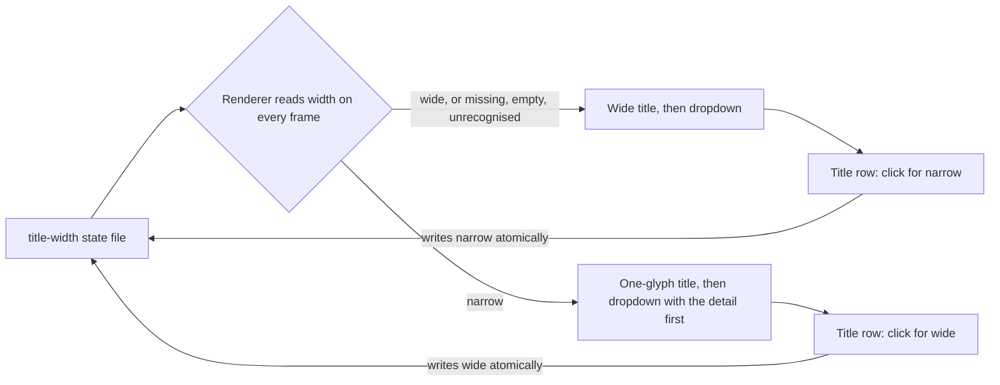

# pg-task-focus-swiftbar

The SwiftBar menu-bar plugin for [`pg-task-focus`](../pg-task-focus/README.md). It is a streaming
renderer: it keeps `pg-task-focus status --watch` open and turns every state line into a menu-bar
frame, and every click action in the dropdown is a direct `pg-task-focus` invocation (run with
`--client swiftbar`, so the daemon's per-client metrics see the plugin). The Nix module
`phillipgreenii.programs.pg-task-focus.swiftbar` installs it; `plugin.nix` generates the wrapper
SwiftBar runs (`swiftbar.type` is `streamable`, so the file name has no refresh interval).

| Part                                               | What it is                                                                           |
| -------------------------------------------------- | ------------------------------------------------------------------------------------ |
| `pg-task-focus-swiftbar/pg-task-focus-swiftbar.sh` | The renderer: one `jq` program over each state line, plus the stream loop.           |
| `pg-task-focus-swiftbar/tests/`                    | The bats suite (script-level, with a stub `pg-task-focus` playing `status --watch`). |
| `plugin.nix`                                       | The wrapper function and its flake check (`test-pg-task-focus-swiftbar-plugin`).     |

## What the title shows

The title shows ONLY the active task. The highest-priority state wins:

1. overtime (a warning icon, the cycle type and the time over),
2. a running cycle (`deep 12m`),
3. a paused cycle (`⏸ deep`, `⏸ deep · Resume?`),
4. a resume offer for another cycle (`Resume <title>?`),
5. the next due task (`Next: Post plan 22m`),
6. `idle`.

While a cycle runs or is paused, the next task is appended (`deep 12m · Post plan 8m`) when it is
overdue or due within the due-soon window. A read-only daemon only puts a lock icon in front.

An alert or an error is never title text. The ended-period banner (a day, week or sprint that needs
rolling over) and the read-only reason are rows of the dropdown. This follows the SwiftBar title
width convention (`docs/swiftbar-title-width.md` in `phillipg-nix-repo-base`, which names
`pa-monitor-swiftbar` as the reference implementation).

## The coarse clock

The menu bar redraws every few seconds, so the remaining time is bucketed rather than counted down
by the second. The two constants (`COARSE_WHOLE_MIN_S` and `COARSE_STEP_S`) sit in one block at the
top of the `jq` program in the renderer:

| Time left     | Shown as                                       | Example                                                           |
| ------------- | ---------------------------------------------- | ----------------------------------------------------------------- |
| 5 min or more | `Nm`                                           | 750 s is `12m`, 300 s is `5m`                                     |
| under 5 min   | `<` and the next 20 s step above the time left | 299 s is `<5m`, 280 s is `<5m`, 279 s is `<4m40s`, 20 s is `<40s` |
| under 20 s    | `<20s`                                         | 19 s is `<20s`                                                    |

Overtime uses the same buckets with a plus sign (`+5m`, `+<40s`). The dropdown rows never repeat a
value the title already shows, so the time left appears once: in the title (wide) or in the first
dropdown row (narrow).

## Wide and narrow

The title has two widths, switched from the dropdown. The default is wide.

| Width    | Title                                                | First dropdown row                  |
| -------- | ---------------------------------------------------- | ----------------------------------- |
| `wide`   | The active task and its coarse clock, in its colour. | Not a repeat of the title.          |
| `narrow` | One colour-coded glyph, for the laptop-only notch.   | The text the wide title would show. |

The narrow glyph is a focus ring, and the colour is the state. The colour of a state is the same in
both widths:

| State                     | Narrow glyph | Colour           |
| ------------------------- | ------------ | ---------------- |
| running                   | `◉`          | green `#3a9a4a`  |
| overtime                  | `◉`          | red `#cc3333`    |
| paused, or a resume offer | `◎`          | amber `#e0b000`  |
| idle, or only a next task | `○`          | grey `#888888`   |
| unreachable (no daemon)   | `⚠`          | orange `#e07000` |
| read-only                 | `⊘`          | red `#cc3333`    |

The last block of every dropdown, in every state and both widths, is the Title row
(`Title: wide (click for narrow)`) followed by Refresh. Clicking the Title row runs the renderer
itself with `--set-title-width` and the other width.

### The state file

The setting is the file `$XDG_STATE_HOME/pg-task-focus-swiftbar/title-width` (`XDG_STATE_HOME`
defaults to `~/.local/state`). It holds the word `wide` or `narrow` and a newline. A missing, empty,
unreadable or unrecognised value reads as wide, and a read problem is never an error in the menu
bar. The renderer is a long-lived process, so unlike a plugin SwiftBar re-runs on every refresh, it
re-reads the file on every frame and once a second while idle: a click shows within about a second
and needs no restart.

`pg-task-focus-swiftbar --set-title-width wide|narrow` writes the file (a temporary file in the same
directory, then a rename, so a render never reads half a value), prints nothing and exits without
rendering. It exits 2 on a missing or bad value (the existing setting stays) and 1 when the file
cannot be written. The Nix wrapper exports `PG_TASK_FOCUS_SWIFTBAR_SELF`, the renderer's store path,
so the Title row runs a path without whitespace (the installed plugin lives under a directory with a
space in its name); a bare run falls back to its own path, quoted when it has whitespace.

## Refresh rate

| Moment                       | Frame                                               |
| ---------------------------- | --------------------------------------------------- |
| A daemon state line arrives  | Emitted at once.                                    |
| A cycle runs                 | A tick re-renders the last state every 5 s.         |
| No cycle runs                | A tick every 15 s, to move the "due in" countdowns. |
| The title-width file changes | Emitted within about a second.                      |
| The stream ends              | The unreachable frame, then a reconnect after 5 s.  |

Each frame replaces the previous one in a single write behind the `~~~` separator. The separator
syntax is the renderer's one seam (`STREAM_SEPARATOR`); it is verified against the SwiftBar 2.0.1
README but not against the live GUI.

## Configuration

The wrapper bakes in the per-configuration values; each is also an environment variable of the
renderer (`--help` lists them all):

| Variable                               | Default   | Meaning                                                   |
| -------------------------------------- | --------- | --------------------------------------------------------- |
| `PG_TASK_FOCUS_SWIFTBAR_TICK_S`        | 5         | Seconds between ticks while a cycle runs.                 |
| `PG_TASK_FOCUS_SWIFTBAR_IDLE_TICK_S`   | 15        | Seconds between ticks otherwise.                          |
| `PG_TASK_FOCUS_SWIFTBAR_DUE_SOON_MIN`  | 30        | The window in which the next task is appended to a title. |
| `PG_TASK_FOCUS_SWIFTBAR_BOOST_MINUTES` | `5 10 25` | The boost sizes in the dropdown.                          |
| `PG_TASK_FOCUS_SWIFTBAR_SELF`          | `$0`      | The path the Title row runs.                              |

## Tests

- `test-pg-task-focus-swiftbar`: the bats suite, against the real renderer with a stub client.
- `test-pg-task-focus-swiftbar-plugin`: the generated wrapper (tags, exports, executable bit).
- `test-pg-task-focus-swiftbar-hm-render`: the Home-Manager module's output.

The one thing no test can prove is how the live SwiftBar GUI treats the stream and a click on the
Title row; that check belongs to the operator.
