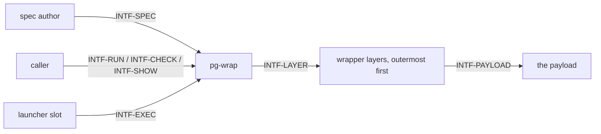

# pg-wrap — behavior docs

pg-wrap is a **standalone wrapper tool**. Given a **wrap spec** and a **payload**, it applies an
ordered chain of command prefixes around the payload, builds the environment the chain starts from,
and hands control to the chain, which ends in the payload. It is a Decorator (chain-loading, as in
`chpst`): every layer execs the next, so nothing of pg-wrap stays resident around the payload. This
set follows the behavior-docs method (`phillipgreenii-nix-agent-support · behavior-docs/docs/behavior`).

Start here, then the [glossary](glossary.md); the rules are in [invariants](invariants.md), the
boundaries in [interfaces](interfaces.md), the actors in [actors](actors.md), and the stories, use
cases and journeys in [journeys](journeys.md).

## The model

The diagram below **is** this set's interface inventory (`INV-8`), not a data-flow diagram and not a
component diagram.

Each interface is classified on **two axes**, counterparty kind and essential-versus-optional
participation, per the method (`INV-8`); see [interfaces](interfaces.md).

**pg-wrap names no caller.** By design (`INV-ISO-1`, this set's own floor), pg-wrap is mutually
unaware of whatever invokes it and of whatever it wraps: it speaks only of "a caller", "a launcher
slot" and "a payload". Anything about why a payload is run, which program asked for it, or what
happens to it afterwards is that caller's concern and is not carried here. A caller's own helper
that renders wrap specs is likewise the caller's: pg-wrap defines the spec and accepts any spec
however it was authored (`INV-SPEC-6`).

## Scope (extent + floor)

- **Extent (in)** — the wrap spec's format and its decode errors; the entry points (`run`, the
  second binary `pg-wrap-exec`, `check`, `show`); composition of one layer per spec entry; the
  minimal environment and the exact-name keep list; the exec prefix; the absolute-path rule; the
  `pg-wrap[<stage>]:` messages; exit 97 before the payload; removal of the spec-path variable from
  the payload's environment; the wrapper contract (`INV-WC-1` to `INV-WC-9`) every layer a spec
  names obeys.
- **Extent (out)** — what any particular layer program does beyond the wrapper contract; the
  payload's own behavior; how a caller chooses, renders or ships a spec; templating or per-item
  context (a spec has none); implementation mechanics (those are this package's own decision docs,
  which receive such content by the method's relocation procedure,
  `phillipgreenii-nix-agent-support · behavior-docs/docs/behavior · USECASE-5`).
- **Floor** — pg-wrap speaks in specs, entries, layers, payloads, environments, stages and exit
  codes, never in a caller's vocabulary borrowed without restating it at this set's own floor
  (`INV-20`).

## Realization gaps

This set's **realization-gap register** (`INV-23`): intended behavior this set's implementation has
not built yet, one row per gap, each keyed by the element id the gap is against. Not an open
question: the intent is settled and the build has not caught up (`INV-15`). This set is written
before the module exists, so every element is a gap until the module lands.

| Element        | Intended                                                                 | Where the implementation stands | Tracked by    |
| -------------- | ------------------------------------------------------------------------ | ------------------------------- | ------------- |
| `INV-SPEC-1`   | the spec format and its decode errors                                    | module not built yet            | `pg2-12gr4.8` |
| `INV-SPEC-2`   | a newer schema version is refused with the quoted message                | module not built yet            | `pg2-12gr4.8` |
| `INV-SPEC-3`   | string and array wrap entries, no templating                             | module not built yet            | `pg2-12gr4.8` |
| `INV-SPEC-4`   | strict environment and exact-name keep                                   | module not built yet            | `pg2-12gr4.8` |
| `INV-SPEC-5`   | the exec prefix                                                          | module not built yet            | `pg2-12gr4.8` |
| `INV-SPEC-6`   | absolute paths, and any author may write a spec                          | module not built yet            | `pg2-12gr4.8` |
| `INV-ENTRY-1`  | `run`                                                                    | module not built yet            | `pg2-12gr4.8` |
| `INV-ENTRY-2`  | `pg-wrap-exec`, the second binary                                        | module not built yet            | `pg2-12gr4.8` |
| `INV-ENTRY-3`  | `check`, the one validation entry point                                  | module not built yet            | `pg2-12gr4.8` |
| `INV-ENTRY-4`  | `show`                                                                   | module not built yet            | `pg2-12gr4.8` |
| `INV-ENTRY-5`  | the spec-path variable is removed from the payload's environment         | module not built yet            | `pg2-12gr4.8` |
| `INV-COMP-1`   | one layer per entry, the innermost rest is the payload                   | module not built yet            | `pg2-12gr4.8` |
| `INV-COMP-2`   | per-layer environment flow, `"$@"`, POSIX shell, no rc files             | module not built yet            | `pg2-12gr4.8` |
| `INV-ENV-1`    | inherited versus minimal environment                                     | module not built yet            | `pg2-12gr4.8` |
| `INV-FAIL-1`   | exit 97 before the payload                                               | module not built yet            | `pg2-12gr4.8` |
| `INV-FAIL-2`   | the `pg-wrap[<stage>]:` message form                                     | module not built yet            | `pg2-12gr4.8` |
| `INV-FAIL-3`   | the `pg-wrap-exec` no-spec message                                       | module not built yet            | `pg2-12gr4.8` |
| `INV-ISO-1`    | pg-wrap names and validates no caller                                    | module not built yet            | `pg2-12gr4.8` |
| `INV-WC-1`     | wrapper contract: run the rest of argv, argv and stdin unmodified        | module not built yet            | `pg2-12gr4.8` |
| `INV-WC-2`     | wrapper contract: exit status, own failure, not 9                        | module not built yet            | `pg2-12gr4.8` |
| `INV-WC-3`     | wrapper contract: nothing on stdout                                      | module not built yet            | `pg2-12gr4.8` |
| `INV-WC-4`     | wrapper contract: same controlling terminal, foreground process group    | module not built yet            | `pg2-12gr4.8` |
| `INV-WC-5`     | wrapper contract: deliver SIGTERM, SIGINT and SIGHUP                     | module not built yet            | `pg2-12gr4.8` |
| `INV-WC-6`     | wrapper contract: works under the minimal environment, never prompts     | module not built yet            | `pg2-12gr4.8` |
| `INV-WC-7`     | wrapper contract: exec when there is no cleanup                          | module not built yet            | `pg2-12gr4.8` |
| `INV-WC-8`     | wrapper contract: per-item data only from env or argv                    | module not built yet            | `pg2-12gr4.8` |
| `INV-WC-9`     | wrapper contract: absolute first words, checked by `check` and every run | module not built yet            | `pg2-12gr4.8` |
| `INTF-SPEC`    | the wrap spec boundary                                                   | module not built yet            | `pg2-12gr4.8` |
| `INTF-RUN`     | the `run` boundary                                                       | module not built yet            | `pg2-12gr4.8` |
| `INTF-EXEC`    | the `pg-wrap-exec` boundary                                              | module not built yet            | `pg2-12gr4.8` |
| `INTF-CHECK`   | the `check` boundary                                                     | module not built yet            | `pg2-12gr4.8` |
| `INTF-SHOW`    | the `show` boundary                                                      | module not built yet            | `pg2-12gr4.8` |
| `INTF-LAYER`   | the wrapper-contract boundary toward layers                              | module not built yet            | `pg2-12gr4.8` |
| `INTF-PAYLOAD` | the hand-off boundary toward the payload                                 | module not built yet            | `pg2-12gr4.8` |

## External references

This set follows the behavior-docs method and cites elements the method defines.

| Name        | What it is                                                                                                                            | Owner set-path                                                   | Owner UUID                                                                                                                                      |
| ----------- | ------------------------------------------------------------------------------------------------------------------------------------- | ---------------------------------------------------------------- | ----------------------------------------------------------------------------------------------------------------------------------------------- |
| `INV-8`     | a cross-product interaction MUST be an explicit interface, classified by counterparty kind and by essential-vs-optional participation | `phillipgreenii-nix-agent-support · behavior-docs/docs/behavior` | [67a79e92-2f98-40a2-9392-034a697e457e](https://github.com/phillipgreenii/nix-agent-support/blob/main/behavior-docs/docs/behavior/invariants.md) |
| `INV-15`    | the behavior docs set is the source of truth; a realization gap is normal, not a defect                                               | `phillipgreenii-nix-agent-support · behavior-docs/docs/behavior` | [375b542f-2a9f-4cfd-a77e-7aed45a416d5](https://github.com/phillipgreenii/nix-agent-support/blob/main/behavior-docs/docs/behavior/invariants.md) |
| `INV-20`    | a borrowed term at a reference seam MUST be inherited or renamed, never silently redefined                                            | `phillipgreenii-nix-agent-support · behavior-docs/docs/behavior` | [bafdd784-81ed-46fe-88f0-1a8c5fc4caf0](https://github.com/phillipgreenii/nix-agent-support/blob/main/behavior-docs/docs/behavior/invariants.md) |
| `INV-23`    | the realization-gap register is set-level, named `## Realization gaps`, and never an element                                          | `phillipgreenii-nix-agent-support · behavior-docs/docs/behavior` | [f3bba3e7-440f-4109-a4de-9d37daa34bcf](https://github.com/phillipgreenii/nix-agent-support/blob/main/behavior-docs/docs/behavior/invariants.md) |
| `USECASE-5` | the method's procedure for relocating implementation content out of a behavior doc                                                    | `phillipgreenii-nix-agent-support · behavior-docs/docs/behavior` | [7d6de948-3ef5-426a-949e-2dd872f06d28](https://github.com/phillipgreenii/nix-agent-support/blob/main/behavior-docs/docs/behavior/journeys.md)   |
