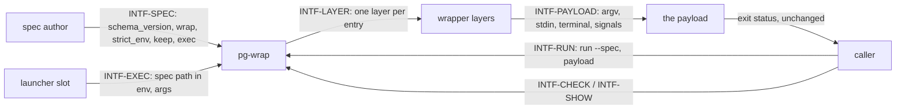

# Interfaces — pg-wrap

This file follows the interface convention of the behavior-docs method
(`phillipgreenii-nix-agent-support · behavior-docs/docs/behavior`): an **interface** is a boundary
described by **what crosses it** and **what must hold**, never _how_ it is implemented. See the
[glossary](glossary.md) for terms, [actors](actors.md) for who sits on each side,
[invariants](invariants.md) for the rules, and [journeys](journeys.md) for the flows that exercise
these interfaces.

The seven interfaces are described on **two axes**, the **kind** of party on the far side and
whether that party is an **essential or optional** participant in what pg-wrap exists to do:

| Interface      | Boundary                                      | Counterparty (kind)              | Participation           | Initiator |
| -------------- | --------------------------------------------- | -------------------------------- | ----------------------- | --------- |
| `INTF-SPEC`    | the wrap spec file                            | `ACTOR-WRAP-AUTHOR` (actor)      | essential               | author    |
| `INTF-RUN`     | `run`, with a spec and a payload              | `ACTOR-WRAP-CALLER` (actor)      | essential, driving port | caller    |
| `INTF-EXEC`    | `pg-wrap-exec`, spec path in the environment  | `ACTOR-WRAP-SLOT` (actor)        | optional                | slot      |
| `INTF-CHECK`   | `check`, one line per problem                 | `ACTOR-WRAP-CALLER` (actor)      | essential               | caller    |
| `INTF-SHOW`    | `show`, the composed layers                   | `ACTOR-WRAP-CALLER` (actor)      | optional                | caller    |
| `INTF-LAYER`   | the wrapper contract, toward each layer       | `ACTOR-WRAP-LAYER` (implementer) | essential               | pg-wrap   |
| `INTF-PAYLOAD` | the hand-off of argv, stdin, terminal, signal | `ACTOR-WRAP-PAYLOAD` (actor)     | essential               | pg-wrap   |

`INTF-SPEC`, `INTF-RUN`, `INTF-CHECK`, `INTF-LAYER` and `INTF-PAYLOAD` are **essential**: reading a
spec, running a payload inside it, validating it, obeying the contract and handing off to the payload
are what pg-wrap is for. `INTF-EXEC` and `INTF-SHOW` are **optional**: pg-wrap serves a caller with
no launcher slot and no wish to inspect, and every run works without them.

## `INTF-SPEC` — the wrap spec file <!-- uuid: 5a8f1d07-b2e9-4c43-8b6e-d4a3c7f09e25 -->

- **In (author → pg-wrap)** — a TOML document with `schema_version` (required integer), `wrap`
  (ordered entries, outermost first, string or array form), `strict_env`, `keep` and `exec`
  (`INV-SPEC-1` to `INV-SPEC-6`).
- **Out (pg-wrap → author)** — a decode error naming the spec as the stage (`pg-wrap[spec]:`) for
  an unknown key, a wrong type, a missing `schema_version` or a version newer than supported
  (`INV-SPEC-1`, `INV-SPEC-2`, `INV-FAIL-2`).
- **Guarantee** — a spec is read only by pg-wrap; no caller reads or validates it (`INV-ISO-1`).

## `INTF-RUN` — run a payload inside the layers <!-- uuid: e6b4c0d2-8a17-4f9b-a3c5-0f1e7d9a6b84 -->

- **In (caller → pg-wrap)** — `run --spec <file> -- <cmd> [args…]`: a spec path and the payload
  (`INV-ENTRY-1`).
- **Out (pg-wrap → caller)** — the payload's exit status, unchanged, because pg-wrap leaves nothing
  resident to remap it (`INV-WC-2`); or, when pg-wrap itself fails before the payload, exit 97 with a
  `pg-wrap[<stage>]:` message on stderr (`INV-FAIL-1`, `INV-FAIL-2`).
- **Guarantee** — the payload's environment never contains the spec-path variable
  (`INV-ENTRY-5`), and nothing is written to stdout by pg-wrap (`INV-WC-3`).

## `INTF-EXEC` — the second binary for a launcher slot <!-- uuid: 72e9a5f3-d0c4-4b18-96d7-a8b2e1c43f50 -->

- **In (slot → pg-wrap)** — the spec path in the spec-path variable, and all the args the slot
  passes, which may begin with `run` or `check` (those are just args, `INV-ENTRY-2`).
- **Out (pg-wrap → slot)** — the exec prefix followed by the args is executed (`INV-SPEC-5`); or,
  with the variable unset, exit 97 and the stated reason (`INV-FAIL-3`).
- **Guarantee** — the payload's environment never contains the spec-path variable
  (`INV-ENTRY-5`).

## `INTF-CHECK` — validate a spec <!-- uuid: 1d4c8b6e-93a7-4e02-b5f9-6c0a2d7e8b31 -->

- **In (caller → pg-wrap)** — `check --spec <file>` (`INV-ENTRY-3`).
- **Out (pg-wrap → caller)** — nothing and exit 0 when the spec decodes strictly and every
  referenced path is an executable regular file; otherwise one line per problem and exit 97
  (`INV-FAIL-1`).
- **Guarantee** — this is the ONE validation entry point; no other pg-wrap mode validates ahead of a
  run beyond the checks every run repeats (`INV-WC-9`).

## `INTF-SHOW` — show the composed layers <!-- uuid: a9f0e3d5-6b28-4c71-8d4a-e3c1b95f0a62 -->

- **In (caller → pg-wrap)** — `show --spec <file>` (`INV-ENTRY-4`).
- **Out (pg-wrap → caller)** — the composed layers (`INV-COMP-1`), without running any of them.

## `INTF-LAYER` — the wrapper contract toward each layer <!-- uuid: 4e7b2c91-f5d8-4a06-a9b3-7d8e0c1f4b95 -->

- **Out (pg-wrap → layer)** — the layer's own words followed by the rest of the chain, in the
  environment the previous layer left (`INV-COMP-1`, `INV-COMP-2`).
- **Guarantee, required of the layer** — it obeys `INV-WC-1` to `INV-WC-9`. pg-wrap is an
  **owner** of this contract: it states what a layer MUST hold and never what any particular layer
  does (`INV-ISO-1`).

## `INTF-PAYLOAD` — the hand-off to the payload <!-- uuid: d5a1f8c4-0e63-4b92-8c07-b4e6a9d23f1c -->

- **Out (pg-wrap → payload)** — its argv and stdin unmodified, the same controlling terminal in the
  foreground process group, and SIGTERM, SIGINT and SIGHUP delivered (`INV-WC-1`, `INV-WC-4`,
  `INV-WC-5`).
- **In (payload → caller, through pg-wrap)** — its exit status, unchanged (`INV-WC-2`).
