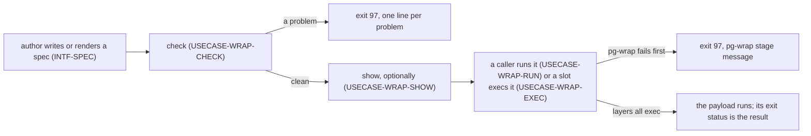
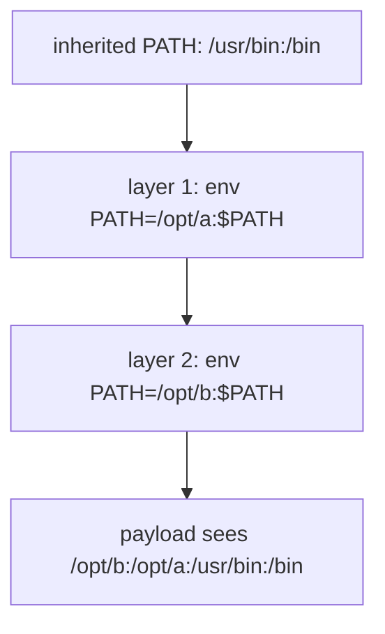

# Journeys — pg-wrap

Stories, use cases, and journeys, typed and leveled per the behavior-docs method's vocabulary
rules: **user-goal** level elements are `USECASE-`; **summary**-level multi-actor arcs stay
`JOURNEY-`. Each element carries, on its own definition, what it requires and what it includes
(`INV-22`).

## Stories

- **`STORY-WRAP-RUN`** <!-- uuid: 83c6d0a7-e9b1-4f54-b2a8-1f5c7e3d0b69 --> — As a caller, I want to
  run a payload inside an ordered chain of wrappers, so each wrapper's effect (a prefix on `PATH`, a
  different working environment) applies without the payload knowing about any of them.
  _(→ `USECASE-WRAP-RUN`; `INV-COMP-1`, `INV-WC-1`.)_
- **`STORY-WRAP-SLOT`** <!-- uuid: f1e4b7a9-3c05-4d68-9a1e-c2d8f06b5e73 --> — As the author of a
  launcher slot that accepts only a program path, I want to point it at one small binary and have
  the real payload run inside the chain, so a slot with no room for a command line still gets
  wrapped. _(→ `USECASE-WRAP-EXEC`; `INV-ENTRY-2`, `INV-SPEC-5`.)_
- **`STORY-WRAP-VALIDATE`** <!-- uuid: 60b9a3e2-d7f4-4c15-8e6b-9a0d3c5f1b87 --> — As a spec author, I
  want to learn before shipping that a spec is malformed or points at something that cannot run, so
  the failure happens in a build and not at the first launch.
  _(→ `USECASE-WRAP-CHECK`; `INV-SPEC-1`, `INV-SPEC-6`, `INV-WC-9`.)_
- **`STORY-WRAP-INSPECT`** <!-- uuid: c7d2f6b1-85a0-4e39-a4c8-3e9b1f7d2a05 --> — As a caller, I want
  to see the layers a spec composes without running them, so I can tell what a run would do.
  _(→ `USECASE-WRAP-SHOW`; `INV-ENTRY-4`.)_
- **`STORY-WRAP-ENVCHECK`** <!-- uuid: f81bfe72-beb0-45e6-b7ff-e998f088fe73 --> — As a spec author, I
  want to give pg-wrap an environment dump and learn which names the spec's environment would keep
  and which it would drop, so I can find a missing `keep` entry without running anything or exposing
  a value. _(→ `USECASE-WRAP-SHOW`; `INV-ENTRY-6`, `INV-SPEC-4`.)_
- **`STORY-WRAP-FAILFAST`** <!-- uuid: 2a5e8c0d-b4f3-4719-9d6a-f0c7b3e1a846 --> — As a caller, I want
  pg-wrap's own failures to look different from the payload's, with a message naming where it
  failed, so I never mistake a launch problem for the payload's result.
  _(→ `JOURNEY-WRAP-LIFE`; `INV-FAIL-1`, `INV-FAIL-2`, `INV-ISO-1`.)_

## Use cases

### `USECASE-WRAP-RUN` — run a payload inside the layers <!-- uuid: 9b3f1e7a-c8d6-4a24-b0e5-5d2a8c4f9e10 -->

**Primary actor:** `ACTOR-WRAP-CALLER`.
**Level:** user-goal.
**Preconditions:** a spec file and a payload.
_Requires:_ `INV-SPEC-1`, `INV-SPEC-2`, `INV-SPEC-3`, `INV-SPEC-4`, `INV-SPEC-5`, `INV-SPEC-6`,
`INV-ENTRY-1`, `INV-ENTRY-5`, `INV-COMP-1`, `INV-COMP-2`, `INV-ENV-1`, `INV-FAIL-1`, `INV-FAIL-2`,
`INV-WC-1`, `INV-WC-2`, `INV-WC-3`, `INV-WC-4`, `INV-WC-5`, `INV-WC-6`, `INV-WC-7`, `INV-WC-8`,
`INV-WC-9`.

1. The caller runs `run --spec <file> -- <cmd> [args…]`.
2. pg-wrap reads the spec strictly and builds the starting environment: inherited, or minimal plus
   the kept names (`INV-ENV-1`).
3. pg-wrap composes one layer per entry, outermost first, and execs the first layer; each layer
   execs the next, and the innermost execs the payload with the spec-path variable removed.
4. The payload runs with its argv and stdin unmodified, on the same controlling terminal, and its
   exit status comes back to the caller unchanged.

Extensions:

- 2a. The spec has an unknown key, a wrong type or no `schema_version`: pg-wrap exits 97 before the
  payload, with a `pg-wrap[spec]:` message (`INV-SPEC-1`, `INV-FAIL-1`).
- 2b. The spec's `schema_version` is newer than supported: refused with the `schema_version`
  message of `INV-SPEC-2`, exit 97.
- 3a. A layer's first word is not an absolute path, or a layer cannot be executed: pg-wrap exits 97
  before the payload, with a `pg-wrap[layer <i>]:` or `pg-wrap[exec]:` message (`INV-WC-9`,
  `INV-FAIL-2`).
- 4a. The caller sends SIGTERM, SIGINT or SIGHUP: it is delivered to the payload (`INV-WC-5`).

### `USECASE-WRAP-EXEC` — run through the second binary <!-- uuid: e8c0d4a5-1f9b-4635-8a2d-7b3e6f0c1d92 -->

**Primary actor:** `ACTOR-WRAP-SLOT`.
**Level:** user-goal.
**Preconditions:** the spec-path variable is set in the environment the slot's launcher received.
_Requires:_ `INV-ENTRY-2`, `INV-ENTRY-5`, `INV-SPEC-5`, `INV-FAIL-3`.
_Includes:_ `USECASE-WRAP-RUN`.

1. The slot executes `pg-wrap-exec` with the args it has, which may begin with `run` or `check`.
2. pg-wrap reads the spec named by the spec-path variable, then runs the exec prefix followed by all
   the args through the layers (`USECASE-WRAP-RUN`, steps 2 to 4).

Extensions:

- 1a. The spec-path variable is unset: pg-wrap exits 97 with the reason of `INV-FAIL-3`, so a
  pane that did not inherit the shell's variables is named as the likely cause.

### `USECASE-WRAP-CHECK` — validate a spec <!-- uuid: 3f7a9b2c-e5d0-4c88-a1f6-0e4d8b6a3c57 -->

**Primary actor:** `ACTOR-WRAP-AUTHOR` (or `ACTOR-WRAP-CALLER`).
**Level:** user-goal.
**Preconditions:** a spec file.
_Requires:_ `INV-ENTRY-3`, `INV-SPEC-1`, `INV-SPEC-2`, `INV-SPEC-6`, `INV-WC-9`, `INV-FAIL-1`.

1. The author runs `check --spec <file>`.
2. pg-wrap decodes the spec strictly and tests every referenced path.
3. Every path is an executable regular file: pg-wrap prints nothing and exits 0.

Extensions:

- 3a. A path is a directory, a broken symlink or a non-executable file: pg-wrap prints one line per
  problem and exits 97.

### `USECASE-WRAP-SHOW` — show the composed layers <!-- uuid: b4d1c8f0-7a36-4e5b-9c0a-d29e5f1b7a43 -->

**Primary actor:** `ACTOR-WRAP-CALLER` (or `ACTOR-WRAP-AUTHOR`).
**Level:** user-goal.
**Preconditions:** a spec file; optionally an environment dump of `NAME=value` lines.
_Requires:_ `INV-ENTRY-4`, `INV-ENTRY-6`, `INV-COMP-1`, `INV-ENV-1`, `INV-SPEC-4`, `INV-FAIL-1`.

1. The caller runs `show --spec <file>`, adding `--env-from <dump>` to test an environment.
2. pg-wrap prints the layers the spec composes, outermost first, and runs none of them.
3. With a dump, pg-wrap also prints the names the spec's environment would keep and the names it
   would drop (`INV-ENTRY-6`), never a value.

Extensions:

- 3a. The dump cannot be read, or a line is not `NAME=value`: pg-wrap prints nothing to stdout and
  exits 97 with a `pg-wrap[env]:` message naming the file and line, never the line's text.

## Journeys

### `JOURNEY-WRAP-LIFE` — a spec from authoring to a run <!-- uuid: 58e3a6d9-c2b0-4f71-b8d5-a6f1c0e94b27 -->

**Actors:** `ACTOR-WRAP-AUTHOR`, `ACTOR-WRAP-CALLER`, `ACTOR-WRAP-SLOT`.
**Level:** summary.
**Intent:** tell the whole arc once: a spec is authored by any means, validated before it ships, and
then run by a caller that pg-wrap knows nothing about, with its own failures told apart from the
payload's.
_Requires:_ `INV-ISO-1`, `INV-SPEC-6`, `INV-FAIL-1`, `INV-FAIL-2`.
_Includes:_ `USECASE-WRAP-CHECK`, `USECASE-WRAP-SHOW`, `USECASE-WRAP-RUN`, `USECASE-WRAP-EXEC`.

Because every pg-wrap failure is exit 97 and every other status is the payload's, the caller at the
end of the arc can always tell which side failed.

### `JOURNEY-WRAP-NESTED` — two layers, one payload <!-- uuid: 0c9f5b3e-a1d7-4826-8e4c-f3b2d6a7c018 -->

**Actors:** `ACTOR-WRAP-CALLER`, `ACTOR-WRAP-LAYER`, `ACTOR-WRAP-PAYLOAD`.
**Level:** summary.
**Intent:** show, by example (`INV-COMP-2`), why composition is one layer per entry: each layer's
environment edit builds on the one before it.
_Requires:_ `INV-COMP-1`, `INV-COMP-2`, `INV-SPEC-3`.
_Includes:_ `USECASE-WRAP-RUN`.

Folded into one shell command instead, the same two edits would give `/opt/b:/usr/bin:/bin`.
